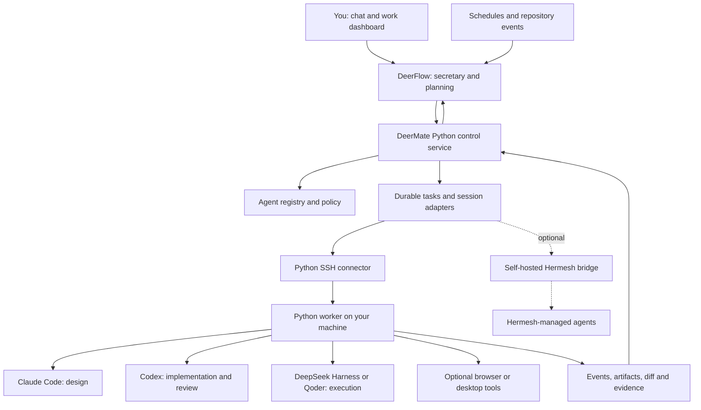

  

<h1 align="center">DeerMate</h1>

<strong>One private assistant. A team of agents. Your machines.</strong>

Talk to your secretary. Let the right agent take the job. Follow the work from one place.

  
  
  
  

<strong>English</strong> · <a href="README.zh-CN.md">简体中文</a>

<a href="#see-the-idea">Preview</a> · <a href="#how-it-fits-together">Architecture</a> · <a href="#connect-your-agents">Integrations</a> · <a href="#development-status">Progress</a> · <a href="CONTRIBUTING.md">Contribute</a>

> **Design preview · 2026-10-25.** This repository contains the product brief, architecture, integration contracts, roadmap, and a concept video. The DeerMate service, remote worker, routing, and dashboard are **not implemented yet**. The preview uses simulated data. There is no installable DeerMate release today.

## Meet your personal agent secretary

You should be able to say:

> “Watch this repository. When a reproducible bug arrives, ask Claude to propose a fix, let Codex implement it on my home machine, and have a separate agent review the patch. Bring me the result.”

Or:

> “Track these competitors on GitHub and Product Hunt. Explain what changed, keep the sources, and tell me only when something matters.”

DeerMate is an open-source project for making that workflow practical: a private assistant that remembers your preferences, delegates to specialist agents, follows long-running work, and returns evidence you can inspect.

It builds around **DeerFlow**, with a **Python control service and Python worker**, provider-specific session adapters, and optional browser or desktop tools. **Hermesh is an optional bridge**, rather than a required Go service. This repository is an independent project; the upstream projects are not affiliated with it.

## See the idea

**[▶ Watch the 24-second concept video](https://github.com/mzydmer/deermate/blob/main/docs/assets/deermate-concept.mp4)** · [Download MP4](https://raw.githubusercontent.com/mzydmer/deermate/main/docs/assets/deermate-concept.mp4) · [Storyboard and reproduction](docs/media.md)

The film illustrates an intended handoff: one request → role-based routing → work on your own machine → an independent review → a result with a diff and test evidence. It is a motion storyboard, not a recording of functioning software. A live demo will replace it when the first integration is working.

## What we are building

| Capability | Intended experience | Status |
| --- | --- | --- |
| A persistent secretary | One conversation for goals, preferences, handoffs, and follow-ups | Planned |
| Specialist routing | Choose an eligible agent by role, project, device availability, and budget | Planned |
| Home and cloud workers | Run bounded work on machines you own; show offline devices explicitly | Planned |
| Durable sessions | Start, inspect, resume, interrupt, and recover work without duplicate execution | Contract drafted |
| Repository maintenance | Triage issues, prepare fixes, collect CI evidence, and request independent review | Planned |
| Research watchlists | Track changes, keep citations, compare snapshots, and surface meaningful updates | Planned |
| One work dashboard | See the assignee, device, stage, recent activity, artifacts, and decisions | Concept only |
| Browser and desktop tools | Use a browser or a dedicated desktop session when the job needs an interface | Optional; planned |

“Private” means you choose where DeerMate stores and runs its own services. Sending a prompt to a cloud model still discloses that prompt to the model provider. Open-source software also does not make model usage or hosting free.

## How it fits together

The default backend plan is **Python end to end for DeerMate-owned services**:

| Component | Proposed implementation | Responsibility |
| --- | --- | --- |
| Secretary | DeerFlow integration | Conversation, planning, memory, and delegation |
| Control service | FastAPI + Pydantic | Task admission, registry, policy, and task status |
| Persistence | SQLite initially; PostgreSQL when needed | Task/session mapping, event cursors, and recovery records |
| Remote worker | Python asyncio | Bounded subprocess execution and local artifact collection |
| Private link | AsyncSSH using the SSH protocol | Encrypted transport with pinned host identity |
| Agent adapters | Python wrappers for each supported interface | Normalize native agent lifecycle and output |
| UI | Reuse DeerFlow first; add task cards | A single place to follow the work |

External agents may require Node.js, Rust binaries, macOS tools, or paid subscriptions. “Python backend” describes the services we maintain, not every tool that they invoke. No Go toolchain or Go service is required by the default design.

See [architecture](docs/architecture.md) and [the Python-first decision](docs/decisions/0001-python-first.md). The SSH path does not implement or claim wire compatibility with Hermesh.

## Connect your agents

The following interfaces have upstream documentation; **none has a completed DeerMate adapter yet**.

| Agent or tool | Planned integration | Upstream interface |
| --- | --- | --- |
| Codex | Persistent sessions and streamed events | [Codex app-server](https://developers.openai.com/codex/app-server) |
| Claude Code | Structured design/development runs | [Programmatic CLI / Agent SDK](https://code.claude.com/docs/en/headless) |
| DeepSeek Harness | A persistent ACP session | [`dsh --profile acp`](https://github.com/deepseek-ai/deepseek-harness/tree/master/packages/bundle/acp-app) |
| Qoder | An ACP adapter after compatibility checks | [Qoder CLI](https://docs.qoder.com/release-notes/qoder-cli) |
| Other ACP agents | Capability-negotiated adapter | [Agent Client Protocol](https://agentclientprotocol.com/) |
| Hermesh | Optional CLI bridge for existing installations | [Hermesh](https://github.com/hermeshai/hermesh) |
| Web applications | An optional browser tool | [Playwright MCP](https://github.com/microsoft/playwright-mcp) |
| macOS applications | An optional desktop tool on a dedicated session | [Peekaboo](https://github.com/openclaw/Peekaboo) |

**A model is not an agent adapter.** Using a DeepSeek model inside DeerFlow is different from delegating to a running DeepSeek Harness. Likewise, a Claude API call is different from a Claude Code session.

Grok Bot and Muse are possible external clients or collaborators, subject to the interfaces their products expose. An assistant being able to call our MCP tools does **not** establish that DeerMate can wake, control, or cancel that assistant. They are not required for the initial system.

Planned connection flow:

1. Register a machine and verify its SSH host fingerprint through a trusted channel.
2. Run the Python worker with a dedicated, limited OS account and configured project roots.
3. Authenticate each external agent locally using its supported login method.
4. Register adapter capabilities and project-specific policies.
5. Run a read-only smoke task before enabling writes.

There is deliberately no invented `pip install deermate` or one-command production setup here. The connection flow becomes executable documentation only when the worker exists. See [integration contracts](docs/integrations.md) and the [design-only example configuration](examples/deermate.example.yaml).

## Autonomy with explicit boundaries

The target is unattended work within permissions you set in advance. The proposed rules live at the tool and worker boundary, beyond the model prompt:

- **Separate capabilities:** research can read sources; a code worker can edit an allowed workspace; publishing or sending mail needs its own grant.
- **Separate execution:** different worktrees prevent overlapping edits; OS accounts, containers, or VMs provide isolation. A worktree alone is not a sandbox.
- **Recover deliberately:** reconcile an existing task before retrying; do not assume a timeout means the action never happened.
- **Preserve evidence:** keep session IDs, task state, event cursors, diffs, test receipts, and source links.
- **Bound the work:** task limits, concurrency limits, expiry, and cancellation are first-class design requirements.
- **Treat outside text as data:** an issue, email, web page, or another agent's result cannot grant additional authority.

**Encryption status:** the default design uses established SSH encryption; it has not been implemented or audited in DeerMate. A forwarding relay need not decrypt the SSH stream, but the SSH endpoints can read it. The optional Hermesh MCP gateway can decrypt its sessions; CLI and MCP paths have different trust boundaries. See [the security model](docs/security.md).

## Development status

We track delivered work separately from planned functionality. Current stage: **M0 — public design preview**.

| Milestone | Deliverable | State |
| --- | --- | --- |
| M0 | English/Chinese README, architecture, security boundaries, contracts, concept film | In this repository |
| M1 | Local Python worker + Codex adapter + one verified task lifecycle | Planned |
| M2 | DeerFlow tools + SSH remote worker + restart/reconnect reconciliation | Planned |
| M3 | Claude/ACP adapters + independent review + GitHub maintenance workflow | Planned |
| M4 | Unified task cards + research watchlists + scoped mail/browser tools | Planned |
| M5 | Optional Hermesh bridge + desktop execution + broader ecosystem adapters | Planned |

**First acceptance target:** send a task from DeerFlow, run it through Codex in a disposable repository, return the diff and test output, interrupt and resume it, then restart the control service without losing or duplicating the work.

No release dates or production-readiness claims are promised. [Detailed roadmap and acceptance criteria →](docs/roadmap.md)

## Built with the open-source ecosystem

| Project | Intended relationship |
| --- | --- |
| [DeerFlow](https://github.com/bytedance/deer-flow) | Secretary foundation; reuse its conversations, skills, and existing task capabilities |
| [Hermesh](https://github.com/hermeshai/hermesh) | Design inspiration and optional bridge; its code remains independently maintained |
| [Codex](https://github.com/openai/codex) | A native coding-agent runtime connected through documented interfaces |
| [DeepSeek Harness](https://github.com/deepseek-ai/deepseek-harness) | An optional ACP worker runtime |
| [AsyncSSH](https://github.com/ronf/asyncssh) | Proposed Python SSH implementation; no custom cryptography |
| [MCP Python SDK](https://github.com/modelcontextprotocol/python-sdk) | Proposed tool integration surface |
| [Playwright MCP](https://github.com/microsoft/playwright-mcp) / [Peekaboo](https://github.com/openclaw/Peekaboo) | Optional web and desktop capabilities |

This repository contains original design documents and media, not a vendored copy of these projects. Their licenses, support policies, model costs, and security boundaries remain their own. We do not claim endorsement, completed interoperability, or bundled third-party subscriptions.

## Join the project

Useful first contributions include a Codex lifecycle adapter, an SSH worker design review, a DeerFlow integration spike, and security feedback on task recovery. Please read [CONTRIBUTING.md](CONTRIBUTING.md) before starting a large change.

- [Open a design proposal](https://github.com/mzydmer/deermate/issues/new?template=design-proposal.yml)
- [Propose an integration](https://github.com/mzydmer/deermate/issues/new?template=integration-request.yml)
- [Read the roadmap](docs/roadmap.md)
- [Report a security concern](SECURITY.md)

## License

[MIT](LICENSE). Copyright © 2026 DeerMate contributors.
