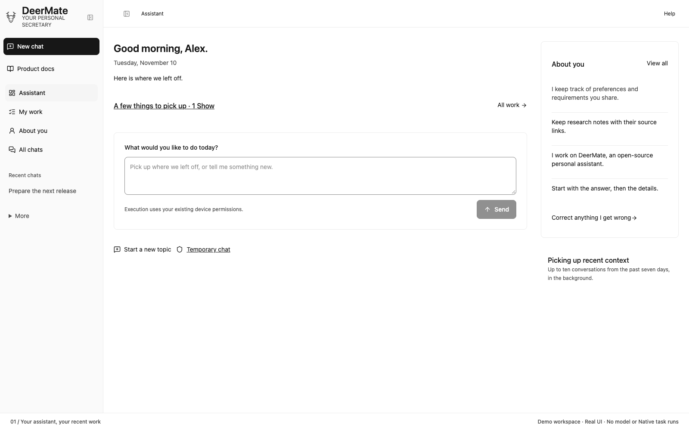
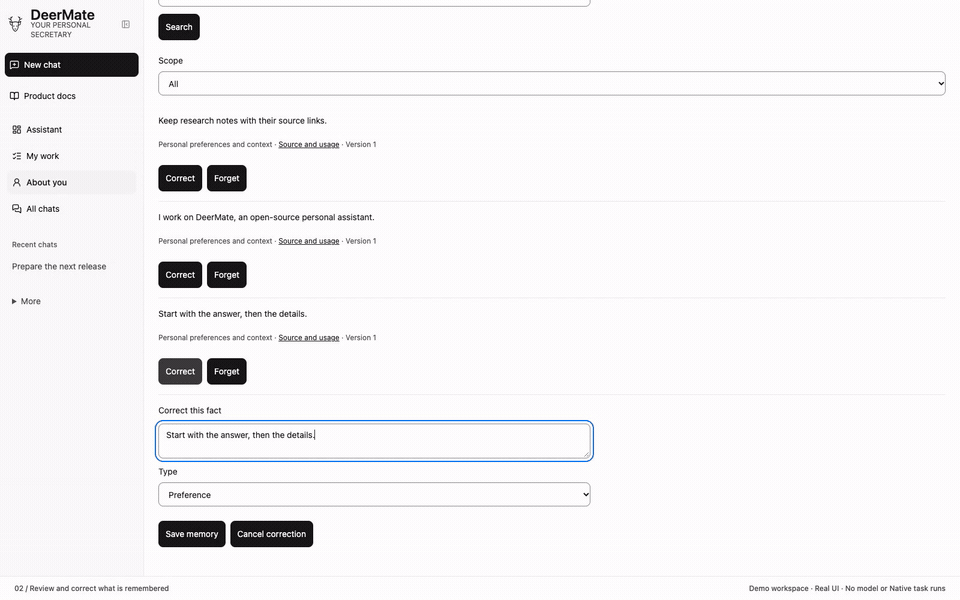
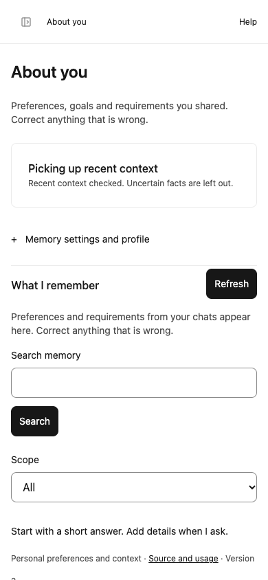
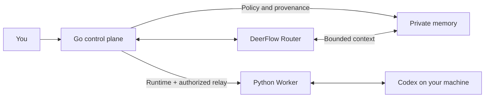

<h1 align="center">DeerMate</h1>
<p align="center"><strong>Your private assistant. Your agents. Your machines.</strong></p>
<p align="center">Pick up where you left off, keep useful context, and send work to your own Codex.</p>
<p align="center">
  <a href="LICENSE"></a>
  <a href="https://github.com/mzydmer/deermate/actions/workflows/ci.yml"></a>
  
</p>
<p align="center"><strong>English</strong> · <a href="README.zh-CN.md">简体中文</a></p>
<p align="center"><a href="#get-started">Get started</a> · <a href="docs/product/guide/overview.md">Product guide</a> · <a href="#research">Research</a> · <a href="CONTRIBUTING.md">Contribute</a></p>

DeerMate is a self-hosted personal assistant built around **DeerFlow**, with a **Go control plane** and a **Python Worker**. Talk through a goal, continue an existing topic, or delegate a bounded coding task to an authorized device. Work, memory, and execution evidence stay accessible from one workspace.



## Watch the workspace

[](https://github.com/mzydmer/deermate/blob/main/docs/assets/readme/workspace-tour.mp4)

**[▶ Watch the 22-second walkthrough](https://github.com/mzydmer/deermate/blob/main/docs/assets/readme/workspace-tour.mp4)** · [Download MP4](https://raw.githubusercontent.com/mzydmer/deermate/main/docs/assets/readme/workspace-tour.mp4) · [Media details](docs/media.md)

Recorded from the running app with sample data: memory correction is saved through Go and DeerMem, then an empty temporary chat is created. No model response or Codex execution is staged in this video.

## What you can do

| | In the workspace |
| --- | --- |
| **Pick up a topic** | See a few recent items with source times, return to the original conversation, or tell the assistant what comes next. |
| **Keep useful context** | Ordinary preferences can be remembered across chats. Review their source and scope, correct them, pause capture, or forget a fact in **About you**. |
| **Keep a chat separate** | A temporary topic neither reads nor adds long-term memory. Its ordinary chat history is still saved. |
| **Work with your Codex** | Connect a scoped project on your machine. Follow-up turns keep the same native session and workspace, with separate results and validation per round. |
| **Inspect the result** | **My work** separates execution, independent validation, and uncertain outcomes. A model's summary alone does not establish success. |

Memory is on by default for new accounts; existing choices are preserved. Coding work requires a configured model, an available executor, and valid device authorization. See the [usage guide](docs/product/guide/quickstart.md) and [device setup](docs/agent-authorizations.md).

<details>
<summary>Mobile memory view</summary>



</details>

## Get started

For the full local workspace, use **macOS, Docker Desktop, Python 3.12+, Git, and Helm 3.18+ (3.x)**. The local Compose helper is currently macOS-specific; see the [platform notes](docs/local-docker.md) before building.

```bash
git clone https://github.com/mzydmer/deermate.git
cd deermate
python3.12 -m venv .venv
source .venv/bin/activate
python -m pip install -e '.[dev]'
python scripts/local_docker.py init
python scripts/local_docker.py build
python scripts/local_docker.py up
```

Open **http://localhost:2026**, create the first administrator, and configure a chat model. Install and sign in to Codex on the execution machine when you want to run coding tasks. The first build downloads the pinned DeerFlow and image dependencies.

| Deployment | Guide |
| --- | --- |
| Local workspace, model setup, and verification | [Local Docker](docs/local-docker.md) |
| Small Linux server with Docker Compose | [Single-host deployment](docs/single-host.md) |
| Worker only on macOS/Linux | [Worker setup](docs/local-worker.md) |
| Kubernetes / ACK | [Optional cluster deployment](docs/ack-deployment.md) |

## How it fits together



The Router coordinates the conversation; the Worker owns its coding session. Go checks identity, project scope, budgets, and operation IDs before admitting work. After a lost acknowledgement, DeerMate reconciles the original operation rather than submitting it again.

Personal memory reuses DeerMem files and FTS5. Clear preferences take a fast path; general extraction has a bounded model budget. Refreshing the home page does not call a model or start a coding task.

Transport uses HTTPS or SSH. The cloud application and execution endpoints can read task content; this is **not a claim of end-to-end encryption**. Worktrees isolate code changes, not operating-system access. [Architecture](docs/architecture.md) · [Security](docs/security.md)

## Research

DeerMate explores persistent coordination across agent sessions and personal devices. It builds on the [DSH Super-agent Router/Worker idea](https://github.com/deepseek-ai/dsh-superagent-prototype) and studies three questions:

| Question | Mechanism to evaluate |
| --- | --- |
| Can the assistant stay responsive during long work? | Separate Router/Worker sessions and direct delivery of already-associated events. |
| Can work recover without duplicate side effects? | Persistent operation identity, one native root per conversation, and explicit uncertainty. |
| Can personal context remain useful and correctable? | Source-bound memory, limited retrieval, scope checks, and deletion barriers. |

The system and acceptance fixtures are implemented; comparative research results are still pending. Functional checks do not establish a quality, speed, or supervision-cost improvement. [Research spec](docs/specs/m4-continuous-agent.md) · [Evaluation plan](docs/product/technical/evaluation.md)

## Current scope

**Workspace v2 is released to the existing hosted installation.** The assistant, memory management, Go login/API, and Codex adapter have implementation and verification evidence. Real-provider memory, native multi-turn, browser, and deployment checks have separate scopes in the [verification index](docs/verification/README.md).

| Integration | Status |
| --- | --- |
| Codex; MCP; scoped HTTPS / SSH Worker connection | Implemented; execution requires valid project/device authorization. |
| GitHub observation | Bounded single-repository Alpha; sources and automatic execution are configured separately. |
| Claude / ACP, DeepSeek Harness, Qoder | Additional executor adapters are planned. |
| Hermesh, Product Hunt tracking, mail, desktop automation | Optional bridges and workflows are planned. |

[Development status](docs/STATUS.md) · [Roadmap](docs/roadmap.md) · [Changelog](docs/product/changelog.md)

## Open-source ecosystem

Built on [DeerFlow](https://github.com/bytedance/deer-flow), [Codex](https://github.com/openai/codex), [MCP](https://github.com/modelcontextprotocol/python-sdk), and [AsyncSSH](https://github.com/ronf/asyncssh). [DSH Super-agent](https://github.com/deepseek-ai/dsh-superagent-prototype) informs the research architecture; [Hermesh](https://github.com/hermeshai/hermesh) is an optional bridge direction. These are independent projects, with their own licenses and service terms.

## Contribute

Start with [CONTRIBUTING.md](CONTRIBUTING.md). Coding agents should read [AGENTS.md](AGENTS.md); all frontend work follows [design.md](design.md). Useful contributions include executor adapters, recovery cases, memory counterexamples, and reproducible evaluations.

[Issues](https://github.com/mzydmer/deermate/issues) · [Security reports](SECURITY.md) · [Project evolution](docs/EVOLUTION.md)

[MIT](LICENSE) · © 2026 DeerMate contributors
