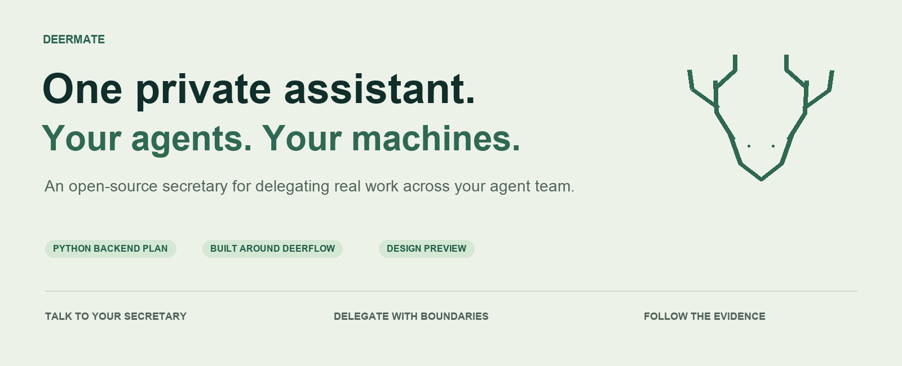
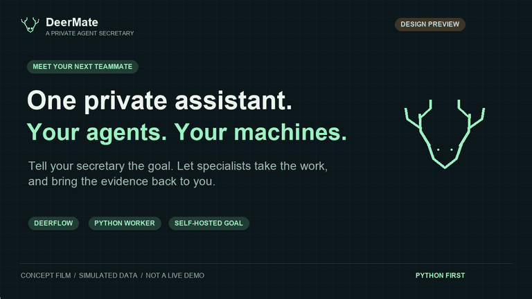
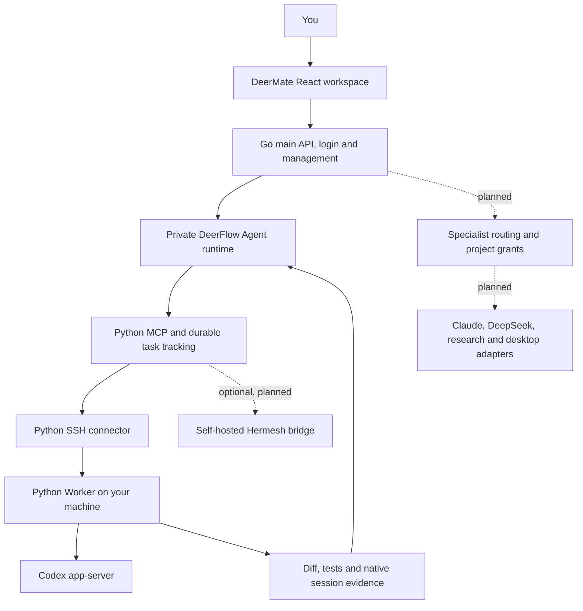

<p align="center">
  
</p>

<h1 align="center">DeerMate</h1>
<p align="center"><strong>One private assistant. A team of agents. Your machines.</strong></p>
<p align="center">Talk to your secretary. Let the right agent take the job. Follow the work from one place.</p>

<p align="center">
  <a href="LICENSE"></a>
  
  
  
</p>
<p align="center"><strong>English</strong> · <a href="README.zh-CN.md">简体中文</a></p>
<p align="center"><a href="#see-the-idea">Preview</a> · <a href="#how-it-fits-together">Architecture</a> · <a href="#connect-your-agents">Integrations</a> · <a href="#development-status">Progress</a> · <a href="CONTRIBUTING.md">Contribute</a></p>

> **Go control plane + cloud-to-home alpha · 2026-10-29.** A real cloud secretary model now delegates through a separately approved temporary SSH link to home Codex, returning an independently tested patch and delivered notification. Go owns login/management/public APIs; DeerFlow/Worker remain internal Python services. Device pairing and specialist routing remain planned; the video is simulated. [Verified scope and limits](docs/specs/m2-home-reverse-link.md).

## Meet your personal agent secretary

You should be able to say:

> “Watch this repository. When a reproducible bug arrives, ask Claude to propose a fix, let Codex implement it on my home machine, and have a separate agent review the patch. Bring me the result.”

Or:

> “Track these competitors on GitHub and Product Hunt. Explain what changed, keep the sources, and tell me only when something matters.”

DeerMate is an open-source project for making that workflow practical: a private assistant that remembers your preferences, delegates to specialist agents, follows long-running work, and returns evidence you can inspect.

It builds around **DeerFlow**, with a **Go main/management backend**, Go user/login and frontend APIs, and a Python execution worker, provider-specific session adapters, and optional browser or desktop tools. **Hermesh is an optional bridge**, rather than a required Go service. This repository is an independent project; the upstream projects are not affiliated with it.

## See the idea

[](https://github.com/mzydmer/deermate/blob/main/docs/assets/deermate-concept.mp4)

**[▶ Watch the 24-second concept video](https://github.com/mzydmer/deermate/blob/main/docs/assets/deermate-concept.mp4)** · [Download MP4](https://raw.githubusercontent.com/mzydmer/deermate/main/docs/assets/deermate-concept.mp4) · [Storyboard and reproduction](docs/media.md)

The film illustrates an intended handoff: one request → role-based routing → work on your own machine → an independent review → a result with a diff and test evidence. It is a motion storyboard, not a recording of functioning software. A live demo will replace it when the first integration is working.

## Run the local worker

Python 3.11+, Git, and macOS or Linux are required. Codex must be installed and authenticated separately.

```bash
git clone https://github.com/mzydmer/deermate.git
cd deermate
python3 -m venv .venv
source .venv/bin/activate
python -m pip install -e '.[dev]'
cp examples/local-worker.toml deermate.toml
```

Edit `deermate.toml` to register a trusted repository and its validation command, then run `deermate serve`. In another terminal:

```bash
deermate doctor
deermate submit --project demo --key first-task --prompt 'Investigate and fix the bug.'
deermate status TASK_ID
deermate events TASK_ID
deermate diff TASK_ID
```

Replace `TASK_ID` with the submission's returned ID. The service binds to `127.0.0.1` and creates a local bearer token. It is not a remotely exposed production service. [Full setup, cancellation, recovery, and verification →](docs/local-worker.md)

To connect a trusted DeerFlow process on the same host, install `.[mcp]` and configure its background task tools using the [DeerFlow guide](docs/deerflow.md) and [example configuration](examples/deerflow.extensions.json). The additional read-only `check_worker_connection` tool checks the configured connection without submitting work. The Worker runs independently of the MCP process. A real model has now selected MCP tools through the normal run API, completed a real local Codex repair and delivered its notification. See [live acceptance](docs/secretary-acceptance.md). A separately approved temporary cloud-to-home link has also passed real model/Codex dispatch, independent validation, notification and nine OpenSSH policy checks ([receipt](docs/verification/home-link-2026-10-28.json)); automatic pairing and actual lease expiry remain unverified.

Run `deermate --config controller.toml --worker home doctor` before dispatching to an enrolled home Worker. It checks credentials, pinned identities and protocol, returns sanitized JSON and exits nonzero when blocked. A reachable API does not establish native-agent login, capacity or project authorization. See the [SSH setup and preflight guide](docs/ssh-worker.md).

**Follow up with the same Codex:** an optional chat tool and child-task API preserve the native session/workspace and each round’s evidence. Worker/MCP/SSH, pinned Gateway and a real cloud-to-home three-round conversation are verified, with independent validation and delivered notifications ([receipt](docs/verification/codex-conversation-live-2026-10-29.json)). [Setup and limits](docs/codex-conversation.md).

**Public research tools:** minimal deployments now include public search and page reading. The **Tools & connections** page inspects loaded tools and tests saved MCP connections by discovering tool names without executing them. GitHub, Notion and SQL still require a service and authorization; catalog entries are not connected accounts. [Usage and limits](docs/tools-and-connections.md).

**One chat, one coding session:** registered Codex requests bind once and follow up in the same native session/workspace. Concurrent or uncertain submissions cannot create a replacement session. Conversations are named from their first message and remain editable. Claude execution is a future adapter. [Usage and rollout](docs/chat-sessions.md).

## What we are building

For a directly reachable SSH Worker, install `.[mcp,ssh]`, fill in [enrollment](examples/ssh-controller.toml), and run `deermate --config controller.toml --worker home mcp` or existing CLI commands. The [SSH guide](docs/ssh-worker.md) covers host trust, credentials, expiry and bound handles; each additional device/account/network deployment needs its own enrollment and acceptance.

**Run the backend demo:** [one-command walkthrough](docs/demo.md) · [captured event replay](docs/assets/gateway-ssh-demo.html) · [21-check receipt](docs/verification/gateway-ssh-2026-10-25.json). It exercises the actual Gateway → MCP → SSH → Worker path, including repair, validation failure, restart, reconnect and revocation. Download the HTML to replay it locally. Generated keys, same-host processes and an offline native fixture keep its scope explicit; the concept video above remains simulated.

**Run the full local Docker profile:** [startup, login and real Codex verification](docs/local-docker.md) · [retained live receipt](docs/verification/local-docker-2026-10-26.json). On the tested Mac it serves `http://localhost:2026`; a generated private owner password and named volumes preserve account/task state. No cloud key is needed. Fresh profiles leave the model empty; existing managed models can be configured separately.

**DeerMate workspace:** the default address opens the protected secretary home, with real recent tasks, a validation-evidence drawer, account-scoped draft handoff, accessible motion and an original Lottie mark. See [frontend source and checks](frontend/README.md). Specialist routing and browser chat input/streaming acceptance remain separate.

**Deploy the control plane to Alibaba Cloud ACK:** [quick deployment guide](docs/ack-deployment.md). Python scripts build ACR images and install the pinned DeerFlow Helm chart with private access, persistent cloud-disk state and optional enrolled home Worker. Actual cluster installation and cloud-to-home acceptance remain operator-specific.

**Lowest-cost personal trial:** the optional [single-host Docker bundle](docs/single-host.md) uses four prebuilt images, one server and local disks, without managed Kubernetes or a load balancer. An actual 2 vCPU/2 GiB SWAS host passed bounded HTTP/browser checks and a controlled reboot; model and home Worker workloads remain separate ([receipt](docs/verification/single-host-cloud-2026-10-27.json)). Go authentication and management remain in place; initial access uses a localhost SSH tunnel. The optional [public IPv4 HTTPS profile](docs/specs/single-host-public-ip.md) passed account migration, trusted certificate, login and host reboot checks on a small Singapore node ([receipt](docs/verification/single-host-public-ip-2026-10-27.json)); the private default is retained.

| Capability | Intended experience | Status |
| --- | --- | --- |
| A persistent secretary | One conversation for goals, preferences, handoffs, and follow-ups | Planned |
| Specialist routing | Choose an eligible agent by role, project, device availability, and budget | Planned |
| Home and cloud workers | Run bounded work on machines you own; show offline devices explicitly | One temporary cloud-to-home task verified; guided device enrollment pending |
| Durable sessions | Local start/status/events/interrupt/resume; idempotent submission and explicit restart recovery | Local implementation |
| Repository maintenance | Triage issues, prepare fixes, collect CI evidence, and request independent review | Planned |
| Research watchlists | Track changes, keep citations, compare snapshots, and surface meaningful updates | Planned |
| One work dashboard | Secretary home, bounded real task list, status filters and validation evidence | First read-only view implemented; device liveness and task controls pending |
| Browser and desktop tools | Use a browser or a dedicated desktop session when the job needs an interface | Optional; planned |

“Private” means you choose where DeerMate stores and runs its own services. Sending a prompt to a cloud model still discloses that prompt to the model provider. Open-source software also does not make model usage or hosting free.

## How it fits together



The backend follows the owner’s updated **Go control plane + Python Agent runtime/Worker** direction:

| Component | Proposed implementation | Responsibility |
| --- | --- | --- |
| Secretary | DeerFlow integration | Conversation, planning, memory, and delegation |
| Main and management backend | Go `net/http` | Frontend API boundary, workspace summary, users/roles, sessions, CSRF and audit |
| Persistence | SQLite initially; PostgreSQL when needed | Task/session mapping, event cursors, and recovery records |
| Remote worker | Python asyncio | Bounded subprocess execution and local artifact collection |
| Private link | AsyncSSH using the SSH protocol | Encrypted transport with pinned host identity |
| Agent adapters | Python wrappers for each supported interface | Normalize native agent lifecycle and output |
| UI | Reuse DeerFlow first; add task cards | A single place to follow the work |

External agents may require Node.js, Rust binaries, macOS tools, or paid subscriptions. Go owns the public API/auth boundary; DeerFlow and Worker/MCP/SSH retain Python. Docker builds Go automatically; native backend development uses Go 1.27.3.

See [Go backend / API guide](backend/README.md), [architecture](docs/architecture.md) and [ADR 0007](docs/decisions/0007-go-control-plane.md), which supersedes the original Python-only control-plane choice. The SSH path does not implement or claim wire compatibility with Hermesh.

## Connect your agents

The Codex native app-server adapter is implemented locally. The remaining adapters are planned and require their own compatibility validation.

| Agent or tool | Planned integration | Upstream interface |
| --- | --- | --- |
| Codex | Persistent sessions and streamed events | [Codex app-server](https://developers.openai.com/codex/app-server) |
| Claude Code | Structured design/development runs | [Programmatic CLI / Agent SDK](https://code.claude.com/docs/en/headless) |
| DeepSeek Harness | A persistent ACP session | [`dsh --profile acp`](https://github.com/deepseek-ai/deepseek-harness/tree/master/packages/bundle/acp-app) |
| Qoder | An ACP adapter after compatibility checks | [Qoder CLI](https://docs.qoder.com/release-notes/qoder-cli) |
| Other ACP agents | Capability-negotiated adapter | [Agent Client Protocol](https://agentclientprotocol.com/) |
| Hermesh | Optional CLI bridge for existing installations | [Hermesh](https://github.com/hermeshai/hermesh) |
| Web applications | An optional browser tool | [Playwright MCP](https://github.com/microsoft/playwright-mcp) |
| macOS applications | An optional desktop tool on a dedicated session | [Peekaboo](https://github.com/openclaw/Peekaboo) |

**A model is not an agent adapter.** Using a DeepSeek model inside DeerFlow is different from delegating to a running DeepSeek Harness. Likewise, a Claude API call is different from a Claude Code session.

Grok Bot and Muse are possible external clients or collaborators, subject to the interfaces their products expose. An assistant being able to call our MCP tools does **not** establish that DeerMate can wake, control, or cancel that assistant. They are not required for the initial system.

Planned connection flow:

1. Register a machine and verify its SSH host fingerprint through a trusted channel.
2. Run the Python worker with a dedicated, limited OS account and configured project roots.
3. Authenticate each external agent locally using its supported login method.
4. Register adapter capabilities and project-specific policies.
5. Run a read-only smoke task before enabling writes.

Direct SSH implementation and provisioning are documented in [the SSH guide](docs/ssh-worker.md). Local setup uses the [worker guide](docs/local-worker.md) and [TOML example](examples/local-worker.toml). The [broader YAML example](examples/deermate.example.yaml) remains design-only. Install from this repository; a package named `deermate` on a registry is not claimed to be this project.

## Autonomy with explicit boundaries

The target is unattended work within permissions you set in advance. The proposed rules live at the tool and worker boundary, beyond the model prompt:

- **Separate capabilities:** research can read sources; a code worker can edit an allowed workspace; publishing or sending mail needs its own grant.
- **Separate execution:** different worktrees prevent overlapping edits; OS accounts, containers, or VMs provide isolation. A worktree alone is not a sandbox.
- **Recover deliberately:** reconcile an existing task before retrying; do not assume a timeout means the action never happened.
- **Preserve evidence:** keep session IDs, task state, event cursors, diffs, test receipts, and source links.
- **Bound the work:** task limits, concurrency limits, expiry, and cancellation are first-class design requirements.
- **Treat outside text as data:** an issue, email, web page, or another agent's result cannot grant additional authority.

**Encryption status:** direct SSH implements explicit host-key verification, dedicated credentials and bounded connection lifetime. Generated-key protocol tests pass; no independent audit or actual device deployment is claimed. SSH endpoints can read plaintext. Relay/NAT and Hermesh have separate trust boundaries. See [security](docs/security.md) and [revocation](docs/ssh-worker.md).

## Development status

We track delivered work separately from planned functionality. Current stage: **M4.3 Go backend and shared frontend design**, on the locally verified Docker/Worker stack.

| Milestone | Deliverable | State |
| --- | --- | --- |
| M0 | English/Chinese README, architecture, security boundaries, contracts, concept film | In this repository |
| M1 | Local Python worker + Codex adapter + one verified task lifecycle | Implemented locally; see verification scope |
| M2 | DeerFlow tools + SSH remote worker + restart/reconnect reconciliation | MCP/direct SSH and temporary cloud-to-home task verified; automatic enrollment and expiry observation pending |
| M3 | Claude/ACP adapters + independent review + GitHub maintenance workflow | Planned |
| M4 | Secretary workspace, Go main/management APIs, shared design system | Implemented and locally verified; watchlists/mail and execution grants remain planned |
| M5 | Optional Hermesh bridge + desktop execution + broader ecosystem adapters | Planned |

**Verified so far:** a real Codex repair in a disposable repository returned a patch and an independently executed passing test. A live interruption and continuation preserved the same native session. Offline protocol tests cover idempotency, restart recovery, input handling, deadlines, and denied permissions. Native session IDs and policy snapshots persist in SQLite. In-flight work after restart requires explicit recovery; it is never automatically replayed. See [verification and current limits](docs/local-worker.md).

Historical M2.1 verification had 51 passing normal tests (two opt-in upstream checks skipped), a passing ordinary-driver probe and a separately passing actual Gateway/SQLite process-restart verifier with 14 recorded checks. That backend check used a model-free submit entry and offline native fixture. Current evidence, including local browser login and real Codex, is tracked in [STATUS](docs/STATUS.md).

No release dates or production-readiness claims are promised. [Detailed roadmap and acceptance criteria →](docs/roadmap.md)

The current normal suite has **199 passed, 7 opt-in cases skipped**. Real cloud-model-to-home-Codex acceptance passed one bounded task, independent tests and delivered notification; nine actual cloud OpenSSH checks passed. The fixed deployment contracts passed 32 cases after adding the optional chat provider. Earlier fixture receipts retain their original scope; see [STATUS](docs/STATUS.md) and the [new receipt](docs/verification/home-link-2026-10-28.json).

Track the first implementation milestone: [Python worker + Codex session lifecycle · #1](https://github.com/mzydmer/deermate/issues/1).

## Built with the open-source ecosystem

| Project | Intended relationship |
| --- | --- |
| [DeerFlow](https://github.com/bytedance/deer-flow) | Secretary foundation; reuse its conversations, skills, and existing task capabilities |
| [Hermesh](https://github.com/hermeshai/hermesh) | Design inspiration and optional bridge; its code remains independently maintained |
| [Codex](https://github.com/openai/codex) | A native coding-agent runtime connected through documented interfaces |
| [DeepSeek Harness](https://github.com/deepseek-ai/deepseek-harness) | An optional ACP worker runtime |
| [AsyncSSH](https://github.com/ronf/asyncssh) | Implemented optional SSH transport; tested at 2.24.1; no custom cryptography |
| [MCP Python SDK](https://github.com/modelcontextprotocol/python-sdk) | Implemented optional stdio bridge; tested with SDK 1.30.0 |
| [Playwright MCP](https://github.com/microsoft/playwright-mcp) / [Peekaboo](https://github.com/openclaw/Peekaboo) | Optional web and desktop capabilities |

This repository contains original design documents and media, not a vendored copy of these projects. Their licenses, support policies, model costs, and security boundaries remain their own. We do not claim endorsement, completed interoperability, or bundled third-party subscriptions.

**Frontend design:** All frontend changes follow [design.md](design.md), our Vercel/Geist-inspired neutral design system shared by React and Go management pages.

## Join the project

For agent-assisted development, start with [AGENTS.md](AGENTS.md). Follow the [product spec](docs/SPEC.md), [current development status](docs/STATUS.md), [evolution log](docs/EVOLUTION.md), and [architecture decisions](docs/decisions/README.md). The status page separates implemented, verified, merged, and released work.

Useful first contributions include SSH identity design, configured-model notification validation, native lifecycle coverage, and feedback on task recovery. Please read [CONTRIBUTING.md](CONTRIBUTING.md) before starting a large change.

- [Open a design proposal](https://github.com/mzydmer/deermate/issues/new?template=design-proposal.yml)
- [Propose an integration](https://github.com/mzydmer/deermate/issues/new?template=integration-request.yml)
- [Read the roadmap](docs/roadmap.md)
- [Report a security concern](SECURITY.md)

## License

[MIT](LICENSE). Copyright © 2026 DeerMate contributors.
