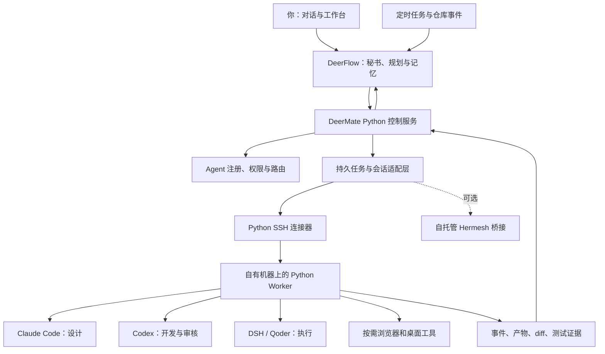

<h1 align="center">DeerMate</h1>

<strong>一个私人秘书，一支 Agent 团队，你自己的机器。</strong>

跟秘书交代目标，让合适的 Agent 接手，在同一个工作台跟进结果。

<a href="README.md">English</a> · <strong>简体中文</strong> · <a href="LICENSE">MIT 开源</a> · 设计预览 · Python 后端方案

> **当前阶段：设计预览，2026-10-25。** 仓库已经提供项目说明、架构、安全边界、接入契约、开发路线和概念视频。DeerMate 服务、远程 Worker、自动路由和仪表盘**尚未实现**。预览使用模拟数据，目前没有可安装的 DeerMate 发行版。

## 你的私人 Agent 秘书

你只需要说：

> “帮我盯这个仓库。有可复现的 bug，就让 Claude 出修复方案，让家里的 Codex 实现，再交给另一个 Agent 审核，最后带回结果。”

或者：

> “跟踪这些竞品在 GitHub 和 Product Hunt 的变化，保存来源，告诉我新增了什么功能。有重要变化再通知。”

DeerMate 希望把这些事变成可以追踪的工作：秘书记住偏好、拆解任务、选择执行者、跟进长任务，最后交付可检查的结果。

技术路线以 **DeerFlow + Python 控制服务 + Python Worker + 会话适配层 + 按需桌面工具**为核心。**Hermesh 作为可选桥接**，默认方案不要求 Go 服务或 Go 工具链。DeerMate 是独立项目，与这些上游项目没有官方隶属关系。

## 先看概念视频

**[▶ 观看 24 秒概念视频](https://github.com/mzydmer/deermate/blob/main/docs/assets/deermate-concept.mp4)** · [下载 MP4](https://raw.githubusercontent.com/mzydmer/deermate/main/docs/assets/deermate-concept.mp4) · [分镜与生成方法](docs/media.md)

视频呈现目标流程：一句话交代 → 按角色派工 → 在自己的机器执行 → 独立审核 → 返回 diff 和测试证据。它是概念动效，**不代表软件已经实现**。首个集成完成后，会补充真实运行演示。

## 我们正在构建什么

| 能力 | 目标体验 | 进展 |
| --- | --- | --- |
| 常驻私人秘书 | 一个对话入口，管理目标、偏好和后续工作 | 规划中 |
| 专事专办 | 根据职责、项目权限、设备在线情况和预算分派 | 规划中 |
| 家里与云端协作 | 调用自有机器；离线设备明确显示等待状态 | 规划中 |
| 持久会话 | 启动、查询、继续、中断和恢复，避免重复执行 | 契约草案 |
| 开源项目维护 | issue 分流、修复、测试、独立审核 | 规划中 |
| 竞品与资料跟踪 | 对比历史快照，保留引用，有实质变化再报告 | 规划中 |
| 一个工作仪表盘 | 查看执行者、机器、阶段、事件、产物和决策 | 概念设计 |
| 浏览器和桌面操作 | 必要时使用专用浏览器或独立桌面会话 | 可选，规划中 |

“私人”指可以选择 DeerMate 自有服务和数据的部署位置。调用云模型时，发送的内容仍会被模型提供方处理。开源免费也不等于模型、订阅和服务器没有费用。

## 架构：自有后端全部 Python

| 组件 | 拟采用技术 | 职责 |
| --- | --- | --- |
| 秘书入口 | DeerFlow 集成 | 复用对话、记忆、Skills 和任务能力 |
| 控制服务 | FastAPI + Pydantic | 接纳任务、注册 Agent、校验权限、查询状态 |
| 持久化 | 首先 SQLite，必要时 PostgreSQL | 任务与远程会话映射、事件游标、恢复记录 |
| 远程 Worker | Python asyncio | 有边界地运行外部 Agent，收集产物 |
| 加密连接 | AsyncSSH，使用 SSH 协议 | 主机身份校验、加密传输 |
| 会话适配器 | Python | 统一各 Agent 的启动、查询、继续、中断和结果 |
| 界面 | 优先复用 DeerFlow | 增加远程任务卡片，避免维护两套工作台 |

这里的“全 Python 后端”指 **DeerMate 自己维护的服务**。外部 Agent 可能使用 Node.js、Rust 二进制或 macOS 工具，不要求重新实现它们。Python SSH 通道不声称兼容 Hermesh 的底层协议。

详细设计：[架构](docs/architecture.md) · [Python 优先决策](docs/decisions/0001-python-first.md)。

## 接入方式

下面列出上游已有接口与拟接入方式，**目前均没有完成 DeerMate 适配或联调**。

| 执行者 | 拟接入方式 | 预期岗位 |
| --- | --- | --- |
| Codex | 官方 app-server | 编码、测试、审核 |
| Claude Code | 非交互 CLI / Agent SDK | 设计、分析、开发 |
| DeepSeek Harness | `dsh --profile acp` | 持久执行会话 |
| Qoder | ACP，完成兼容性验证后接入 | 编码与执行 |
| 其他 ACP Agent | 协商能力后的协议适配 | 按需专职工作 |
| Hermesh | 可选 CLI 桥接 | 连接已有 Hermesh 部署 |
| Playwright MCP | 可选浏览器工具 | 网页操作与验收 |
| Peekaboo | 可选 macOS 桌面工具 | 本地应用界面操作 |

接入一个模型，与调度一个完整 Agent 是两回事。比如在 DeerFlow 使用 DeepSeek 模型，不等于已经连接 DeepSeek Harness。

Grok Bot、Muse 可以作为未来的外部客户端或协作者，但必须以它们实际开放的接口为准。它们能调用我们的 MCP 工具，不等于我们能反向唤醒、控制或取消它们。第一版不依赖它们。

拟定的接入流程：

1. 注册机器，通过可信渠道核对 SSH 主机指纹。
2. 使用独立且受限的系统账户运行 Python Worker，配置允许访问的项目根目录。
3. 在执行机上按官方方式登录外部 Agent。
4. 注册 Agent 能力，设置项目级权限与任务限制。
5. 先执行只读检查，再按需开放写入。

Worker 尚未实现，因此此处不提供虚构的安装命令。[接入契约](docs/integrations.md)和[设计示例配置](examples/deermate.example.yaml)用于讨论，不是可运行配置。

## 自动执行的边界

目标是在你预先设定的授权范围内尽量无人值守。权限计划在工具与 Worker 边界执行，不能仅靠提示词约束：

- 调研、改代码、发邮件、合并和发布分别授权。
- worktree 隔离代码改动，系统账户、容器或虚拟机提供执行隔离；worktree 不是沙箱。
- 超时后先核实原任务状态，再决定重试，避免重复副作用。
- 保存远程会话 ID、事件游标、diff、测试证据和调研来源。
- 为任务设置时限、并发上限、失效时间和取消方式。
- issue、邮件、网页和其他 Agent 的回复都是外部数据，不能提升权限。

**加密进展：** 默认设计使用成熟的 SSH 加密协议，但 DeerMate 尚未实现或审计。转发中继可以只传递密文，SSH 两端仍能读取内容。可选 Hermesh MCP 网关能够解密其会话，不能将它和 CLI 直连的信任边界混为一谈。详见[安全模型](docs/security.md)。

## 开发进展

当前阶段：**M0，公开设计预览**。已交付的内容与计划中的运行能力分别列出。

| 阶段 | 交付内容 | 状态 |
| --- | --- | --- |
| M0 | 中英文 README、架构、安全边界、接入契约、概念视频 | 已在仓库提供 |
| M1 | 本地 Python Worker、Codex 适配器、可验证的单任务生命周期 | 规划中 |
| M2 | DeerFlow 工具、SSH 远程 Worker、重启和重连恢复 | 规划中 |
| M3 | Claude/ACP 适配、独立审核、GitHub 维护流程 | 规划中 |
| M4 | 统一任务卡片、竞品 watchlist、受限邮件与浏览器工具 | 规划中 |
| M5 | 可选 Hermesh 桥接、桌面操作与生态扩展 | 规划中 |

首个验收目标：从 DeerFlow 提交任务，让 Codex 在测试仓库执行，返回 diff 和测试输出；可以中断和继续；控制服务重启后任务不丢失，也不重复启动。

不承诺未经验证的发布日期或生产可用性。[完整路线与验收标准](docs/roadmap.md)。

## 开源生态

- [DeerFlow](https://github.com/bytedance/deer-flow)：秘书基础，优先复用现有能力。
- [Hermesh](https://github.com/hermeshai/hermesh)：架构参考和可选桥接，其实现独立维护。
- [Codex](https://github.com/openai/codex)、[DeepSeek Harness](https://github.com/deepseek-ai/deepseek-harness)：通过公开接口连接的外部执行者。
- [AsyncSSH](https://github.com/ronf/asyncssh)：拟采用的 Python SSH 库，不自行发明加密协议。
- [MCP Python SDK](https://github.com/modelcontextprotocol/python-sdk)：拟采用的工具接入基础。
- [Playwright MCP](https://github.com/microsoft/playwright-mcp)、[Peekaboo](https://github.com/openclaw/Peekaboo)：可选网页与桌面能力。

当前仓库包含原创设计文档和媒体，没有打包这些上游项目的源码。各项目保留自己的许可证、费用、安全边界和维护方式。列出生态项目不表示已经兼容、得到官方认可或包含第三方订阅。

## 参与开发

欢迎贡献 Codex 生命周期适配器、SSH Worker 设计评审、DeerFlow 接入原型和恢复机制安全评审。开始较大改动前，请先阅读[贡献指南](CONTRIBUTING.md)。

[设计提案](https://github.com/mzydmer/deermate/issues/new?template=design-proposal.yml) · [接入提案](https://github.com/mzydmer/deermate/issues/new?template=integration-request.yml) · [安全反馈](SECURITY.md)

## 许可证

[MIT](LICENSE)，Copyright © 2026 DeerMate contributors。
