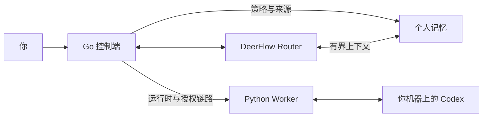

<h1 align="center">DeerMate</h1>
<p align="center"><strong>一个私人助手，你的 Agent，你自己的机器。</strong></p>
<p align="center">接着上次聊，记下有用的事，把工作交给你自己的 Codex。</p>
<p align="center">
  <a href="LICENSE"></a>
  <a href="https://github.com/mzydmer/deermate/actions/workflows/ci.yml"></a>
  
</p>
<p align="center"><a href="README.md">English</a> · <strong>简体中文</strong></p>
<p align="center"><a href="#开始使用">开始使用</a> · <a href="docs/product/guide/overview.md">使用指南</a> · <a href="#研究方向">研究方向</a> · <a href="CONTRIBUTING.md">参与开发</a></p>

DeerMate 是一个可自托管的个人助手：基于 **DeerFlow**，由 **Go 控制端**和 **Python Worker**连接你自己的执行设备。你可以交代一件新事、接着旧话题聊，或把有明确范围的代码任务交给 Codex，在同一个工作台查看安排、记忆和结果。


## 看看怎么用

[](https://github.com/mzydmer/deermate/blob/main/docs/assets/readme/workspace-tour.mp4)

**[▶ 观看 22 秒操作视频](https://github.com/mzydmer/deermate/blob/main/docs/assets/readme/workspace-tour.mp4)** · [下载 MP4](https://raw.githubusercontent.com/mzydmer/deermate/main/docs/assets/readme/workspace-tour.mp4) · [素材说明](docs/media.md)

视频录自正在运行的应用，使用演示数据：实际保存一次记忆纠正，再创建一个空的临时话题。没有编排模型回答，也没有在片中运行 Codex。

## 可以用它做什么

| | 在工作台里 |
| --- | --- |
| **接着上次的事** | 首页带回几条有来源和时间的近期事项；回到原话题继续，或直接交代下一步。 |
| **记下你的习惯** | 普通表达中的偏好可以跨对话使用。在「关于你」查看来源与范围，纠正、暂停整理或忘记一条记录。 |
| **只谈这一次** | 临时话题不读取、不新增长期记忆，普通聊天记录仍会保存。 |
| **让自己的 Codex 干活** | 连接设备上的指定项目；后续追问沿用同一个原生会话和工作区，每轮分别保留结果与验证。 |
| **检查实际结果** | 「我的工作」分别显示执行、独立验证和未知状态，不凭模型一句“完成了”认定成功。 |

新账号默认开启记忆，已有账号保留原选择。执行代码需要配置模型、可用的执行器和有效设备授权。[第一次使用](docs/product/guide/quickstart.md) · [接入设备](docs/agent-authorizations.md)

<details>
<summary>查看手机界面</summary>


</details>

## 开始使用

完整本地工作台需要 **macOS、Docker Desktop、Python 3.12+、Git 和 Helm 3.18+（3.x）**。本地 Compose 脚本目前面向 macOS，搭建前请先看[平台说明](docs/local-docker.md)。

```bash
git clone https://github.com/mzydmer/deermate.git
cd deermate
python3.12 -m venv .venv
source .venv/bin/activate
python -m pip install -e '.[dev]'
python scripts/local_docker.py init
python scripts/local_docker.py build
python scripts/local_docker.py up
```

打开 **http://localhost:2026**，创建首个管理员并配置聊天模型。需要执行代码时，再在执行设备安装并登录 Codex。首次构建会下载固定版本的 DeerFlow 和镜像依赖。

| 部署方式 | 说明 |
| --- | --- |
| 本地完整工作台、模型配置与验收 | [本地 Docker](docs/local-docker.md) |
| 小型 Linux 服务器，Docker Compose | [单机部署](docs/single-host.md) |
| 只运行 Worker，支持 macOS/Linux | [Worker 安装](docs/local-worker.md) |
| Kubernetes / ACK | [可选集群部署](docs/ack-deployment.md) |

## 架构与分工



Router 负责统筹对话，Worker 保留代码工作的独立会话。Go 在接纳前检查身份、项目范围、预算和操作编号。回执丢失后先核对原操作，不重新提交一份相同工作。

个人记忆复用 DeerMem 文件与 FTS5。清楚的偏好走快速整理，一般归纳受模型预算限制。刷新首页不会调用模型，也不会启动代码任务。

传输使用 HTTPS 或 SSH，云端应用和执行端可以读取任务内容；当前不宣称端到端加密。worktree 用于隔离代码改动，不代替操作系统沙箱。[架构说明](docs/architecture.md) · [安全边界](docs/security.md)

## 研究方向

DeerMate 研究怎样让私人助手跨 Agent 会话、跨个人设备持续推进工作。架构借鉴 [DSH Super-agent 的 Router/Worker 思想](https://github.com/deepseek-ai/dsh-superagent-prototype)，重点验证三个问题：

| 问题 | 计划评估的机制 |
| --- | --- |
| 长任务执行时，秘书能否保持响应？ | Router/Worker 分工，已关联事件直通原工作。 |
| 断线恢复后，能否避免重复副作用？ | 持久操作身份、固定原生会话、显式未知状态。 |
| 记忆能否有用、可追溯、可纠正？ | 规范来源、有界召回、范围检查和遗忘屏障。 |

系统与验收工具已有实现，对比研究尚未完成。功能验收不等于已经证明质量、速度或人工监督成本改善。[研究 Spec](docs/specs/m4-continuous-agent.md) · [评估计划](docs/product/technical/evaluation.md)

## 当前进展

**工作台 v2 已发布到既有线上实例。** 助手、记忆管理、Go 登录/API 与 Codex 适配均有实现和验收记录。真实模型、原生多轮、浏览器与部署验证分别记录范围，见[验证索引](docs/verification/README.md)。

| 接入 | 当前状态 |
| --- | --- |
| Codex、MCP、受限 HTTPS / SSH Worker 连接 | 已实现；执行需要有效的项目和设备授权。 |
| GitHub 观察 | 单仓库、有界 Alpha；来源和自动执行需另外配置。 |
| Claude / ACP、DeepSeek Harness、Qoder | 其他执行器适配待开发。 |
| Hermesh、Product Hunt 跟踪、邮件、桌面自动化 | 可选桥接与工作流待开发。 |

[开发状态](docs/STATUS.md) · [路线图](docs/roadmap.md) · [变更日志](docs/product/changelog.md)

## 开源生态

基于 [DeerFlow](https://github.com/bytedance/deer-flow)、[Codex](https://github.com/openai/codex)、[MCP](https://github.com/modelcontextprotocol/python-sdk) 和 [AsyncSSH](https://github.com/ronf/asyncssh)。[DSH Super-agent](https://github.com/deepseek-ai/dsh-superagent-prototype)是研究架构参考，[Hermesh](https://github.com/hermeshai/hermesh)保留为可选桥接方向。各项目独立维护，并有自己的许可证与服务条款。

## 参与开发

先读[贡献指南](CONTRIBUTING.md)。编码 Agent 从 [AGENTS.md](AGENTS.md)接续；前端统一遵循 [design.md](design.md)。欢迎贡献执行器适配、恢复场景、记忆反例和可复现评估。

[提交问题](https://github.com/mzydmer/deermate/issues) · [安全反馈](SECURITY.md) · [项目演进](docs/EVOLUTION.md)

[MIT](LICENSE) · © 2026 DeerMate contributors
