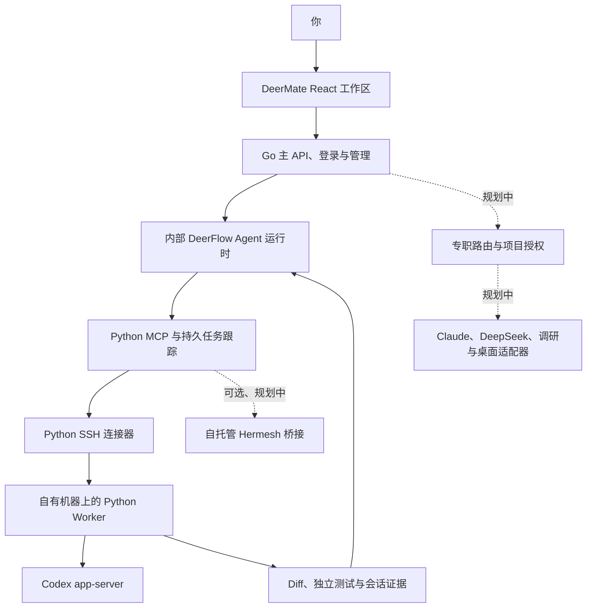

<p align="center"></p>

<h1 align="center">DeerMate</h1>
<p align="center"><strong>一个私人秘书，一支 Agent 团队，你自己的机器。</strong></p>
<p align="center">跟秘书交代目标，让合适的 Agent 接手，在同一个工作台跟进结果。</p>
<p align="center"><a href="README.md">English</a> · <strong>简体中文</strong> · <a href="LICENSE">MIT 开源</a> · 本地 Worker Alpha · Go 主后端</p>

> **当前阶段：Go 控制端 + 本地 Worker Alpha，2026-10-26。** Go 已负责主服务、管理、用户登录和前端 API，本地通过 27 项 API 与 18 项浏览器检查，保留原账号及真实 Codex 任务证据。DeerFlow/Worker 继续作为内部 Python 服务。云端、秘书模型路由及真实设备/NAT 仍待验收；视频仍是模拟概念预览。

## 你的私人 Agent 秘书

你只需要说：

> “帮我盯这个仓库。有可复现的 bug，就让 Claude 出修复方案，让家里的 Codex 实现，再交给另一个 Agent 审核，最后带回结果。”

或者：

> “跟踪这些竞品在 GitHub 和 Product Hunt 的变化，保存来源，告诉我新增了什么功能。有重要变化再通知。”

DeerMate 希望把这些事变成可以追踪的工作：秘书记住偏好、拆解任务、选择执行者、跟进长任务，最后交付可检查的结果。

技术路线以 **Go 主服务/管理服务 + DeerFlow 内部运行时 + Python Worker + 会话适配层 + 按需桌面工具**为核心。**Hermesh 作为可选桥接**，用户登录、角色与前端 API 统一由 Go 提供，Docker 会自动编译 Go 服务。DeerMate 是独立项目，与这些上游项目没有官方隶属关系。

## 先看概念视频

[](https://github.com/mzydmer/deermate/blob/main/docs/assets/deermate-concept.mp4)

**[▶ 观看 24 秒概念视频](https://github.com/mzydmer/deermate/blob/main/docs/assets/deermate-concept.mp4)** · [下载 MP4](https://raw.githubusercontent.com/mzydmer/deermate/main/docs/assets/deermate-concept.mp4) · [分镜与生成方法](docs/media.md)

视频呈现目标流程：一句话交代 → 按角色派工 → 在自己的机器执行 → 独立审核 → 返回 diff 和测试证据。它是概念动效，**不代表软件已经实现**。首个集成完成后，会补充真实运行演示。

## 运行本地 Worker

需要 Python 3.11+、Git，以及 macOS 或 Linux。Codex 需单独安装并完成官方登录。

```bash
git clone https://github.com/mzydmer/deermate.git
cd deermate
git checkout feat/deermate-workspace  # 实现分支合并前使用
python3 -m venv .venv
source .venv/bin/activate
python -m pip install -e '.[dev]'
cp examples/local-worker.toml deermate.toml
```

编辑 `deermate.toml`，填写可信 Git 仓库路径和测试命令，然后运行 `deermate serve`。另一个终端中：

```bash
deermate submit --project demo --key first-task --prompt '分析并修复这个 bug。'
deermate status TASK_ID
deermate events TASK_ID
deermate diff TASK_ID
```

`TASK_ID` 使用提交接口返回的值。服务只监听 `127.0.0.1`，并创建本地 bearer token。[完整安装、中断、继续与恢复说明](docs/local-worker.md)。

同一主机上的可信 DeerFlow 进程可安装 `.[mcp]`，按 [DeerFlow 接入指南](docs/deerflow.md)和[配置示例](examples/deerflow.extensions.json)接入三个后台任务工具。Worker 独立于 MCP 进程运行；实际 Gateway/SQLite 也已通过 SSH 完成[组合演示](docs/demo.md)。本地页面/登录另有真实浏览器验证，模型派单/通知与真实设备部署仍需后续工作。

## 我们正在构建什么

直接可达的 SSH Worker 可安装 `.[mcp,ssh]`，填写[注册配置](examples/ssh-controller.toml)，运行 `deermate --config controller.toml --worker home mcp` 或既有 CLI 命令。[SSH 指南](docs/ssh-worker.md)包含主机信任、凭据、期限和绑定句柄；实际设备/账户/网络仍需部署验收。

**运行后端演示：** [一条命令复现](docs/demo.md) · [已捕获事件回放](docs/assets/gateway-ssh-demo.html) · [21 项检查收据](docs/verification/gateway-ssh-2026-10-25.json)。覆盖实际 Gateway → MCP → SSH → Worker 的修复、验证失败、重启、重连与撤权。HTML 下载后可离线打开；使用同机进程、临时密钥和离线原生 fixture。上方视频仍是模拟概念预览。

**本地 Docker 启动：** [安装、登录与真实 Codex 验收](docs/local-docker.md) · [实际收据](docs/verification/local-docker-2026-10-26.json)。实测 Mac 上的入口为 `http://localhost:2026`，随机 owner 密码仅在私密本地文件中保存，命名卷保留账号和任务。不需要云端 AK/SK，秘书聊天模型暂不配置。

**DeerMate 工作台：** 默认地址直接进入受保护的私人秘书首页，可查看近期真实任务、筛选状态、检查验证证据，并把当前会话的目标草稿转入原对话编辑器。加入统一动效和原创 Lottie 小鹿，支持键盘、手机宽度、深色与减少动态效果。[源码与验证方式](frontend/README.md)。专职路由和秘书模型验收仍需后续工作。

**部署到阿里云 ACK：** [快速部署指南](docs/ack-deployment.md)。Python 脚本构建 ACR 镜像并安装固定版本 DeerFlow Helm Chart，默认私人访问、云盘持久化，可再启用家中 Worker 注册。实际集群安装和云端到家庭链路仍需在用户环境验收。

| 能力 | 目标体验 | 进展 |
| --- | --- | --- |
| 常驻私人秘书 | 一个对话入口，管理目标、偏好和后续工作 | 规划中 |
| 专事专办 | 根据职责、项目权限、设备在线情况和预算分派 | 规划中 |
| 家里与云端协作 | 调用自有机器；离线设备明确显示等待状态 | 规划中 |
| 持久会话 | 本地提交、查询、事件、中断、继续；幂等提交和显式恢复 | 已有本地实现 |
| 开源项目维护 | issue 分流、修复、测试、独立审核 | 规划中 |
| 竞品与资料跟踪 | 对比历史快照，保留引用，有实质变化再报告 | 规划中 |
| 一个工作仪表盘 | 秘书首页、近期真实任务、状态筛选和验证证据 | 首个只读工作台已实现；设备在线探测和任务控制待完成 |
| 浏览器和桌面操作 | 必要时使用专用浏览器或独立桌面会话 | 可选，规划中 |

“私人”指可以选择 DeerMate 自有服务和数据的部署位置。调用云模型时，发送的内容仍会被模型提供方处理。开源免费也不等于模型、订阅和服务器没有费用。

## 架构：Go 控制端与 Python Agent 运行时



| 组件 | 拟采用技术 | 职责 |
| --- | --- | --- |
| 秘书入口 | DeerFlow 集成 | 复用对话、记忆、Skills 和任务能力 |
| 主服务与管理服务 | Go `net/http` | 前端 API、工作区聚合、用户角色、登录会话、CSRF 与审计 |
| 持久化 | 首先 SQLite，必要时 PostgreSQL | 任务与远程会话映射、事件游标、恢复记录 |
| 远程 Worker | Python asyncio | 有边界地运行外部 Agent，收集产物 |
| 加密连接 | AsyncSSH，使用 SSH 协议 | 主机身份校验、加密传输 |
| 会话适配器 | Python | 统一各 Agent 的启动、查询、继续、中断和结果 |
| 界面 | 优先复用 DeerFlow | 增加远程任务卡片，避免维护两套工作台 |

用户新要求取代原 Python-only 控制端方案。Go 负责主服务、管理、用户登录和前端 API；DeerFlow、现有 Worker/MCP/SSH 保留 Python。外部 Agent 继续使用各自运行时。Python SSH 通道不声称兼容 Hermesh 的底层协议。

详细设计：[架构](docs/architecture.md) · [Go 迁移决策](docs/decisions/0007-go-control-plane.md) · [Go 后端与 API](backend/README.md)。

## 接入方式

已实现本地 Codex app-server 适配。其他适配器仍待开发和独立验证。

| 执行者 | 拟接入方式 | 预期岗位 |
| --- | --- | --- |
| Codex | 官方 app-server | 编码、测试、审核 |
| Claude Code | 非交互 CLI / Agent SDK | 设计、分析、开发 |
| DeepSeek Harness | `dsh --profile acp` | 持久执行会话 |
| Qoder | ACP，完成兼容性验证后接入 | 编码与执行 |
| 其他 ACP Agent | 协商能力后的协议适配 | 按需专职工作 |
| Hermesh | 可选 CLI 桥接 | 连接已有 Hermesh 部署 |
| Playwright MCP | 可选浏览器工具 | 网页操作与验收 |
| Peekaboo | 可选 macOS 桌面工具 | 本地应用界面操作 |

接入一个模型，与调度一个完整 Agent 是两回事。比如在 DeerFlow 使用 DeepSeek 模型，不等于已经连接 DeepSeek Harness。

Grok Bot、Muse 可以作为未来的外部客户端或协作者，但必须以它们实际开放的接口为准。它们能调用我们的 MCP 工具，不等于我们能反向唤醒、控制或取消它们。第一版不依赖它们。

拟定的接入流程：

1. 注册机器，通过可信渠道核对 SSH 主机指纹。
2. 使用独立且受限的系统账户运行 Python Worker，配置允许访问的项目根目录。
3. 在执行机上按官方方式登录外部 Agent。
4. 注册 Agent 能力，设置项目级权限与任务限制。
5. 先执行只读检查，再按需开放写入。

直接 SSH 已有[实现与部署指南](docs/ssh-worker.md)。本地实现使用[Worker 指南](docs/local-worker.md)和[TOML 示例](examples/local-worker.toml)。[更完整的 YAML 示例](examples/deermate.example.yaml)仍是设计草案，不能用于启动服务。当前从仓库安装，不声称包注册表中的同名项目属于本仓库。

## 自动执行的边界

目标是在你预先设定的授权范围内尽量无人值守。权限计划在工具与 Worker 边界执行，不能仅靠提示词约束：

- 调研、改代码、发邮件、合并和发布分别授权。
- worktree 隔离代码改动，系统账户、容器或虚拟机提供执行隔离；worktree 不是沙箱。
- 超时后先核实原任务状态，再决定重试，避免重复副作用。
- 保存远程会话 ID、事件游标、diff、测试证据和调研来源。
- 为任务设置时限、并发上限、失效时间和取消方式。
- issue、邮件、网页和其他 Agent 的回复都是外部数据，不能提升权限。

**加密进展：** 直接 SSH 已实现明确的主机密钥校验、专用凭据和有限连接寿命，临时密钥协议测试已通过；尚无独立审计或真实设备部署证明。SSH 两端可以读取明文，中继/NAT 和 Hermesh 另有信任边界。详见[安全模型](docs/security.md)和[撤权行为](docs/ssh-worker.md)。

## 开发进展

当前阶段：**M4.1，首个 DeerMate 工作台**；运行于已验证的 M2.5 Docker/Worker 基础上。已交付的内容与计划中的运行能力分别列出。

| 阶段 | 交付内容 | 状态 |
| --- | --- | --- |
| M0 | 中英文 README、架构、安全边界、接入契约、概念视频 | 已在仓库提供 |
| M1 | 本地 Python Worker、Codex 适配器、可验证的单任务生命周期 | 已有实现，验证范围见指南 |
| M2 | DeerFlow 工具、SSH 远程 Worker、重启和重连恢复 | MCP/直接 SSH 已实现；真实设备、账户策略与 NAT 待验收 |
| M3 | Claude/ACP 适配、独立审核、GitHub 维护流程 | 规划中 |
| M4 | 统一任务卡片、竞品 watchlist、受限邮件与浏览器工具 | 规划中 |
| M5 | 可选 Hermesh 桥接、桌面操作与生态扩展 | 规划中 |

已验证真实 Codex 修复，独立执行测试通过并返回 diff；真实中断与继续也验证了同一原生会话的复用。离线协议测试覆盖幂等、重启恢复、输入、超时和权限拒绝。原生会话 ID 与策略快照保存在 SQLite；重启后运行中的任务需要显式恢复，不会自动重放。[本地验证与限制](docs/local-worker.md)。

历史 M2.1 常规测试为 51 项通过、两项 opt-in 上游检查跳过；另行执行的驱动检查和实际 Gateway/SQLite 进程验收均通过，保留 14 项结果，用测试入口代替模型选工具、以离线原生 fixture 执行。当前证据（含本地浏览器登录与真实 Codex）见 [STATUS](docs/STATUS.md)。

不承诺未经验证的发布日期或生产可用性。[完整路线与验收标准](docs/roadmap.md)。

当前常规测试为 **94 项通过、6 项 opt-in 用例跳过**；实际 Chart/本地/overlay 策略另行通过 22 项。本次 Docker 运行保留 14 项真实 Gateway/SSH/Codex 检查及四项浏览器检查。此前本地/SSH Gateway 的 14/21 项 fixture、上游驱动及 [22 项 SSH 收据](docs/verification/ssh-transport-2026-10-25.json)保留为历史证据；真实设备/OpenSSH/NAT 和秘书模型对话仍待验收，见 [STATUS](docs/STATUS.md)。

首个开发任务：[Python Worker 与 Codex 会话生命周期 · #1](https://github.com/mzydmer/deermate/issues/1)。

## 开源生态

- [DeerFlow](https://github.com/bytedance/deer-flow)：秘书基础，优先复用现有能力。
- [Hermesh](https://github.com/hermeshai/hermesh)：架构参考和可选桥接，其实现独立维护。
- [Codex](https://github.com/openai/codex)、[DeepSeek Harness](https://github.com/deepseek-ai/deepseek-harness)：通过公开接口连接的外部执行者。
- [AsyncSSH](https://github.com/ronf/asyncssh)：已用于可选 SSH 传输，测试版本 2.24.1，不自行发明加密协议。
- [MCP Python SDK](https://github.com/modelcontextprotocol/python-sdk)：已用于可选 stdio 桥接，测试版本 1.30.0。
- [Playwright MCP](https://github.com/microsoft/playwright-mcp)、[Peekaboo](https://github.com/openclaw/Peekaboo)：可选网页与桌面能力。

当前仓库包含原创设计文档和媒体，没有打包这些上游项目的源码。各项目保留自己的许可证、费用、安全边界和维护方式。列出生态项目不表示已经兼容、得到官方认可或包含第三方订阅。

## 参与开发

Agent 接续开发先读 [AGENTS.md](AGENTS.md)。[基础规格 SPEC](docs/SPEC.md) 记录需求与验收标准，[当前开发状态](docs/STATUS.md) 记录实现、验证与交付状态，[项目演进](docs/EVOLUTION.md) 保留变化历史，[架构决策 ADR](docs/decisions/README.md) 解释关键取舍。后续开发需按变更范围同步维护这些记录。

欢迎贡献 SSH 身份设计、已配置模型的通知验证、原生生命周期测试和恢复机制评审。开始较大改动前，请先阅读[贡献指南](CONTRIBUTING.md)。

[设计提案](https://github.com/mzydmer/deermate/issues/new?template=design-proposal.yml) · [接入提案](https://github.com/mzydmer/deermate/issues/new?template=integration-request.yml) · [安全反馈](SECURITY.md)

## 许可证

[MIT](LICENSE)，Copyright © 2026 DeerMate contributors。
