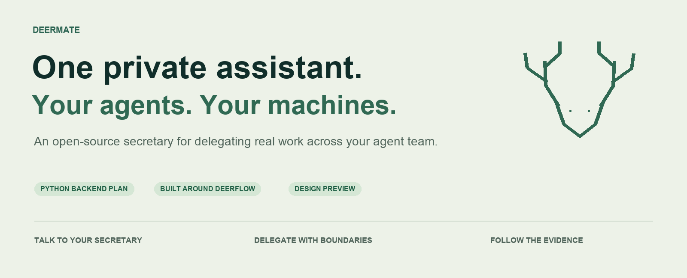
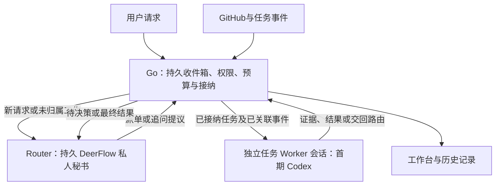
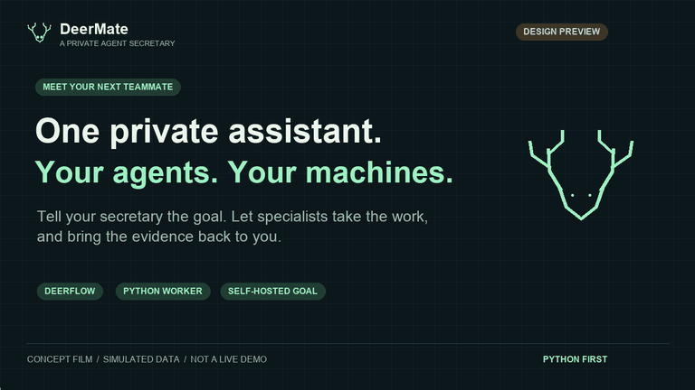

<p align="center"></p>

<h1 align="center">DeerMate</h1>
<p align="center"><strong>一个私人秘书，一支 Agent 团队，你自己的机器。</strong></p>
<p align="center">跟秘书交代目标，让合适的 Agent 接手，在同一个工作台跟进结果。</p>
<p align="center"><a href="README.md">English</a> · <strong>简体中文</strong> · <a href="LICENSE">MIT 开源</a> · Agent 系统研究 Alpha · Go 主后端</p>
<p align="center"><a href="#research">研究方向</a> · <a href="docs/specs/m4-continuous-agent.md">Spec</a> · <a href="docs/specs/m4-continuous-agent-plan.md">实施与评估计划</a> · <a href="docs/STATUS.md">开发进度</a></p>

> **当前阶段：私人 Agent 系统研究 Alpha，2026-11-09。** Go 控制端、真实 Codex 会话续接和个人记忆首页已有实现证据；用户管理的设备授权与出站 HTTPS 有独立本地验收。持久 Router/Worker 已有**Alpha 实现和离线集成验收**（新版交互默认可用，发布状态见当前状态），真实接入与对比实验另行验收。视频仍为概念预览。[当前状态](docs/STATUS.md) · [研究规格](docs/specs/m4-continuous-agent.md)。

## 你的私人 Agent 秘书

新版工作台把入口分成「助手」「我的工作」「关于你」。正常聊天就能记下偏好，新账号默认开启；已有暂停选择保留。个人、项目和当前阶段分别使用，可查看原话、纠正、忘记，或者用临时对话。首页只显示有依据的近期事项，打开页面不派单。

本地已通过 [16 项真实模型记忆闭环](docs/verification/workspace-v2-model-2026-11-09.json)和[同一 Codex 原生会话两轮验收](docs/verification/workspace-v2-native-2026-11-09.json)。工作台已部署既有云端实例，原账号与历史保留（[上线收据](docs/verification/workspace-v2-cloud-2026-11-09.json)）。上述模型与 Native 是独立范围的检查，不代表云端到家庭设备的完整新演示，也不是科研收益证明；[实施与发布进度](docs/specs/workspace-assistant-v2-plan.md)分别记录。

[产品使用文档](docs/product/guide/overview.md) · [技术方案](docs/product/technical/architecture.md) · [变更日志](docs/product/changelog.md)。应用内「产品文档」进入 `/docs`；文档中心已发布到既有云端实例，交付与验证范围见[上线收据](docs/verification/product-documentation-cloud-2026-11-04.json)。后续 Agent 遵守[文档更新约束](docs/DOCUMENTATION_POLICY.md)。

你只需要说：

> “帮我盯这个仓库。有可复现的 bug，就让 Claude 出修复方案，让家里的 Codex 实现，再交给另一个 Agent 审核，最后带回结果。”

或者：

> “跟踪这些竞品在 GitHub 和 Product Hunt 的变化，保存来源，告诉我新增了什么功能。有重要变化再通知。”

DeerMate 希望把这些事变成可以追踪的工作：秘书记住偏好、拆解任务、选择执行者、跟进长任务，最后交付可检查的结果。

技术路线以 **Go 主服务/管理服务 + DeerFlow 内部运行时 + Python Worker + 会话适配层 + 按需桌面工具**为核心。**Hermesh 作为可选桥接**，用户登录、角色与前端 API 统一由 Go 提供，Docker 会自动编译 Go 服务。DeerMate 是独立项目，与这些上游项目没有官方隶属关系。

<a id="research"></a>

## 研究方向：持续协作的私人 Agent 系统

DeerMate 研究如何让一个私人秘书跨独立 Agent 会话、变化的信息流和用户自己的设备，持续推进工作。我们关注任务身份与授权如何保持、失败后如何恢复真实证据，以及何时需要人的注意力。

研究贡献目标是**可运行的系统设计、明确的不变量和可复现的评估方法**。架构借鉴 [DSH Super-agent 的 Router/Worker 思想](https://github.com/deepseek-ai/dsh-superagent-prototype/blob/8c32a9dc5d72c033816c6a8110b37f40cf94fba4/docs/004-prompts.md)和[上下文工程](https://www.anthropic.com/research/effective-context-engineering-for-ai-agents)，探索它们在 Go 控制、自托管、原生会话连续性与独立执行证据中的具体实现。

**M4.5 Alpha 架构：已有实现，尚无 Router 对比实验结果。**



**Router 负责统筹与沟通，任务 Worker 负责执行。** Router 异步派单后仍能接待新请求；已关联 Thread 的事件经过 Go 校验后直通原 Worker，超范围的请求再交回 Router。Go 保存持久状态并执行权限门禁，每个任务 Worker 保留独立执行对话与原生会话。首期 Native 并发 1 是小规模部署的执行配额，协调过程仍然异步。

| 研究问题 | 拟研究的机制 | 计划测量什么 |
| --- | --- | --- |
| 后台工作持续时，秘书能否保持响应？ | Router/Worker 分工、异步回报与订阅直通 | 前台响应 p50/p95、路由模型调用、积压与完成工作量 |
| 主动处理能否持续服从已有授权？ | 代码接纳范围、版本化规则及 off/observe/auto | 越权接纳、错误任务关联、决策依据与模型请求数 |
| 断线、重启和丢回执后，任务身份能否保持？ | 固定原生会话、持久操作及未知结果核对 | 重复原生根、副作用重放、恢复结果及人工介入案例 |
| 记忆能否在预算内找回正确证据？ | 工作→事件→会话→证据的有界引用，加上个人记忆 | 来源找回正确性、上下文大小、读取延迟与失效/越权泄漏案例 |
| 持续协作能否减少人的监督负担？ | 结构化待处理、以证据确认完成、安静的常规更新 | 每件完成工作所需人工介入、漏报的重要问题与通知数量 |

计划对比三类方案：具备等价后台工具的单协调会话、所有事件经过 Router 的双层系统、加入 Thread 直通的双层系统；另做引用召回与路由机制的消融。使用相同事件轨迹、模型版本、预算和 Worker 配额，同时报告延迟、完成证据、模型用量和失败结果。

计划开放可回放的合成事件、故障注入场景、固定版本配置和脱敏收据。现有[验证材料](docs/verification/README.md)提供组件和有限集成的证据；新方案的 **23 项验收标准按组件/集成/真实接入分别追踪**，尚未宣称性能提升。

[阅读 Spec](docs/specs/m4-continuous-agent.md) · [实施与评估 Plan](docs/specs/m4-continuous-agent-plan.md) · [架构决策草案](docs/decisions/0015-continuous-agent-control-plane.md)

**最低成本试运行：** 可选[单机 Docker 部署](docs/single-host.md)，复用四个预构建镜像、服务器系统盘与网络，保留 Go 登录和管理功能。实际 2 核 2 GiB 轻量云主机已通过有限页面/API 与整机重启验收；模型负载和家庭 Worker 仍需单独验证（[收据](docs/verification/single-host-cloud-2026-10-27.json)）。无需为此创建 ACK、NAT 或负载均衡，初次使用 SSH 本地转发访问。 另有可选[公网 IP HTTPS](docs/specs/single-host-public-ip.md)：新加坡小主机已通过账号迁移、可信证书、登录与整机重启验收（[收据](docs/verification/single-host-public-ip-2026-10-27.json)）；默认私有配置保留。

## 先看概念视频

[](https://github.com/mzydmer/deermate/blob/main/docs/assets/deermate-concept.mp4)

**[▶ 观看 24 秒概念视频](https://github.com/mzydmer/deermate/blob/main/docs/assets/deermate-concept.mp4)** · [下载 MP4](https://raw.githubusercontent.com/mzydmer/deermate/main/docs/assets/deermate-concept.mp4) · [分镜与生成方法](docs/media.md)

视频呈现目标流程：一句话交代 → 按角色派工 → 在自己的机器执行 → 独立审核 → 返回 diff 和测试证据。它仍是概念动效；实际执行证据由下文各项验收收据单独记录。

## 运行本地 Worker

需要 Python 3.11+、Git，以及 macOS 或 Linux。Codex 需单独安装并完成官方登录。

```bash
git clone https://github.com/mzydmer/deermate.git
cd deermate
python3 -m venv .venv
source .venv/bin/activate
python -m pip install -e '.[dev]'
cp examples/local-worker.toml deermate.toml
```

编辑 `deermate.toml`，填写可信 Git 仓库路径和测试命令，然后运行 `deermate serve`。另一个终端中：

```bash
deermate submit --project demo --key first-task --prompt '分析并修复这个 bug。'
deermate status TASK_ID
deermate events TASK_ID
deermate diff TASK_ID
```

`TASK_ID` 使用提交接口返回的值。服务只监听 `127.0.0.1`，并创建本地 bearer token。[完整安装、中断、继续与恢复说明](docs/local-worker.md)。

同一主机上的可信 DeerFlow 进程可安装 `.[mcp]`，按 [DeerFlow 接入指南](docs/deerflow.md)和[配置示例](examples/deerflow.extensions.json)接入后台任务工具，另有只读 `check_worker_connection` 供秘书检查连接，不创建任务。Worker 独立于 MCP 进程运行；真实千问已通过正式 run API 自行选工具，经 SSH 开发服务完成本机真实 Codex 修复、独立测试与通知 delivered，见[真实模型验收](docs/secretary-acceptance.md)。历史临时云到家庭链路也通过真实模型/Codex 派单、独立测试、通知和 9 项 OpenSSH 检查（[收据](docs/verification/home-link-2026-10-28.json)），该授权已经到期。新的[设备授权与出站 HTTPS](docs/agent-authorizations.md)有独立本地验收，实际部署及真实设备结果以 STATUS 为准。

派单前可运行 `deermate doctor` 检查本地连接，或运行 `deermate --config controller.toml --worker home doctor` 检查已注册的家庭 Worker。命令检查凭据、SSH/Worker 身份与协议，输出脱敏 JSON；受阻时退出码为 1。API 可达不代表原生 Agent 已登录、有空闲容量或项目权限。见 [SSH 接入与预检指南](docs/ssh-worker.md)。

**连续追问同一个 Codex：** 新增可选聊天工具与按轮子任务，保留原生会话/工作区和每轮证据。Worker/MCP/SSH、固定 Gateway 与真实云到家庭三轮均已通过，独立测试与通知送达（[收据](docs/verification/codex-conversation-live-2026-10-29.json)）。[接入与边界](docs/codex-conversation.md)。

## 我们正在构建什么

直接可达的 SSH Worker 可安装 `.[mcp,ssh]`，填写[注册配置](examples/ssh-controller.toml)，运行 `deermate --config controller.toml --worker home mcp` 或既有 CLI 命令。[SSH 指南](docs/ssh-worker.md)包含主机信任、凭据、期限和绑定句柄；每台新增设备/账户/网络仍需各自注册与验收。

**运行后端演示：** [一条命令复现](docs/demo.md) · [已捕获事件回放](docs/assets/gateway-ssh-demo.html) · [21 项检查收据](docs/verification/gateway-ssh-2026-10-25.json)。覆盖实际 Gateway → MCP → SSH → Worker 的修复、验证失败、重启、重连与撤权。HTML 下载后可离线打开；使用同机进程、临时密钥和离线原生 fixture。上方视频仍是模拟概念预览。

**本地 Docker 启动：** [安装、登录与真实 Codex 验收](docs/local-docker.md) · [实际收据](docs/verification/local-docker-2026-10-26.json)。实测 Mac 上的入口为 `http://localhost:2026`，随机 owner 密码仅在私密本地文件中保存，命名卷保留账号和任务。不需要云端 AK/SK，新配置默认模型为空，可另行接入管理模型。

**DeerMate 工作台：** 默认地址直接进入受保护的私人秘书首页，可查看近期真实任务、筛选状态、检查验证证据，并把当前会话的目标草稿转入原对话编辑器。加入统一动效和原创 Lottie 小鹿，支持键盘、手机宽度、深色与减少动态效果。[源码与验证方式](frontend/README.md)。专职路由与浏览器输入/流式呈现仍需后续验收。

**部署到阿里云 ACK：** [快速部署指南](docs/ack-deployment.md)。Python 脚本构建 ACR 镜像并安装固定版本 DeerFlow Helm Chart，默认私人访问、云盘持久化，可再启用家中 Worker 注册。实际集群安装和云端到家庭链路仍需在用户环境验收。

| 能力 | 目标体验 | 进展 |
| --- | --- | --- |
| 常驻私人秘书 | 一个对话入口，管理目标、偏好和后续工作 | M4.5 Alpha，新版交互默认可用；[接入与使用](docs/continuous-secretary.md) |
| 专事专办 | 根据职责、项目权限、设备在线情况和预算分派 | 有代码边界的 Router 设计提案，首期 Codex |
| 家里与云端协作 | 调用自有机器；离线设备明确显示等待状态 | 历史临时链路已验收；用户管理配对/HTTPS 已本地验收 |
| 持久会话 | 本地提交、查询、事件、中断、继续；幂等提交和显式恢复 | 已有本地实现 |
| 开源项目维护 | issue 分流、修复、测试、独立审核 | 规划中 |
| 竞品与资料跟踪 | 对比历史快照，保留引用，有实质变化再报告 | 规划中 |
| 一个工作仪表盘 | 秘书首页、近期真实任务、状态筛选和验证证据 | 首个只读工作台已实现；设备在线探测和任务控制待完成 |
| 浏览器和桌面操作 | 必要时使用专用浏览器或独立桌面会话 | 可选，规划中 |

“私人”指可以选择 DeerMate 自有服务和数据的部署位置。调用云模型时，发送的内容仍会被模型提供方处理。开源免费也不等于模型、订阅和服务器没有费用。

## 架构：Go 控制端与 Python Agent 运行时

```mermaid
flowchart TD
    U[你] --> UI[DeerMate React 工作区]
    UI --> G[Go 主 API、登录与管理]
    G --> D[内部 DeerFlow Agent 运行时]
    D --> M[Python MCP 与持久任务跟踪]
    M --> S[已登记传输：出站 HTTPS 或 SSH]
    S --> W[自有机器上的 Python Worker]
    W --> C[Codex app-server]
    W --> R[Diff、独立测试与会话证据]
    R --> D
    G -. M4.5可选Alpha .-> P[持久 Router 与事件驱动工作]
    P -. 规划中 .-> A[Claude、DeepSeek、调研与桌面适配器]
    M -. 可选、规划中 .-> H[自托管 Hermesh 桥接]
```

| 组件 | 拟采用技术 | 职责 |
| --- | --- | --- |
| 秘书入口 | DeerFlow 集成 | 复用对话、记忆、Skills 和任务能力 |
| 主服务与管理服务 | Go `net/http` | 前端 API、工作区聚合、用户角色、登录会话、CSRF 与审计 |
| 持久化 | 首先 SQLite，必要时 PostgreSQL | 任务与远程会话映射、事件游标、恢复记录 |
| 远程 Worker | Python asyncio | 有边界地运行外部 Agent，收集产物 |
| 加密连接 | 出站 HTTPS 连接器或可选 AsyncSSH | 用户管理设备授权或显式 SSH 注册；本地 HTTPS 与历史 SSH 验收范围分开 |
| 会话适配器 | Python | 统一各 Agent 的启动、查询、继续、中断和结果 |
| 界面 | 优先复用 DeerFlow | 增加远程任务卡片，避免维护两套工作台 |

用户新要求取代原 Python-only 控制端方案。Go 负责主服务、管理、用户登录和前端 API；DeerFlow、现有 Worker/MCP/SSH 保留 Python。外部 Agent 继续使用各自运行时。Python SSH 通道不声称兼容 Hermesh 的底层协议。

详细设计：[架构](docs/architecture.md) · [Go 迁移决策](docs/decisions/0007-go-control-plane.md) · [Go 后端与 API](backend/README.md)。

## 接入方式

已实现本地 Codex app-server 适配。其他适配器仍待开发和独立验证。

| 执行者 | 拟接入方式 | 预期岗位 |
| --- | --- | --- |
| Codex | 官方 app-server | 编码、测试、审核 |
| Claude Code | 非交互 CLI / Agent SDK | 设计、分析、开发 |
| DeepSeek Harness | `dsh --profile acp` | 持久执行会话 |
| Qoder | ACP，完成兼容性验证后接入 | 编码与执行 |
| 其他 ACP Agent | 协商能力后的协议适配 | 按需专职工作 |
| Hermesh | 可选 CLI 桥接 | 连接已有 Hermesh 部署 |
| Playwright MCP | 可选浏览器工具 | 网页操作与验收 |
| Peekaboo | 可选 macOS 桌面工具 | 本地应用界面操作 |

接入一个模型，与调度一个完整 Agent 是两回事。比如在 DeerFlow 使用 DeepSeek 模型，不等于已经连接 DeepSeek Harness。

Grok Bot、Muse 可以作为未来的外部客户端或协作者，但必须以它们实际开放的接口为准。它们能调用我们的 MCP 工具，不等于我们能反向唤醒、控制或取消它们。第一版不依赖它们。

用户管理的设备接入已本地验收，按[授权指南](docs/agent-authorizations.md)操作，部署范围另查 STATUS：

1. 从“Agent 授权”生成短时配对命令，在设备执行。
2. 启动本地 Worker 和主动出站 HTTPS 连接器，无需开放本机 Worker 公网端口。
3. 选择项目、操作、期限，以及到期时对已开始任务的处理方式。
4. 在本机确认同一个授权版本；原生 Agent 登录留在设备。
5. 派单前分别检查授权和连接。连接检查不会运行 Native 任务。

直接 SSH 已有[实现与部署指南](docs/ssh-worker.md)。本地实现使用[Worker 指南](docs/local-worker.md)和[TOML 示例](examples/local-worker.toml)。[更完整的 YAML 示例](examples/deermate.example.yaml)仍是设计草案，不能用于启动服务。当前从仓库安装，不声称包注册表中的同名项目属于本仓库。

## 自动执行的边界

目标是在你预先设定的授权范围内尽量无人值守。权限计划在工具与 Worker 边界执行，不能仅靠提示词约束：

- 调研、改代码、发邮件、合并和发布分别授权。
- worktree 隔离代码改动，系统账户、容器或虚拟机提供执行隔离；worktree 不是沙箱。
- 超时后先核实原任务状态，再决定重试，避免重复副作用。
- 保存远程会话 ID、事件游标、diff、测试证据和调研来源。
- 为任务设置时限、并发上限、失效时间和取消方式。
- issue、邮件、网页和其他 Agent 的回复都是外部数据，不能提升权限。

**加密进展：** SSH 使用固定主机身份；出站 HTTPS 复用可信服务与本机确认的授权。云端应用和执行端可以读取任务明文。历史真实 SSH 与本地 HTTPS 授权证据各有范围，尚无独立审计；Hermesh 保留自己的信任边界。详见[安全模型](docs/security.md)、[设备授权](docs/agent-authorizations.md)和[SSH 撤权](docs/ssh-worker.md)。

## 开发进展

已交付 **M4.4c–e，今日关注与首页动作**，有本地验收及既有新加坡单机的云端首页/API 验收。[记忆指南](docs/personal-memory.md)说明存取与召回；[首页指南](docs/personal-home.md)说明关注历史对话、证据简报、只读跟进、原会话续接和可选目标建议。语义提取、自动归并及模型作业预算仍待开发。

**M4.5，持久 Router/Worker 协作**已实现 Alpha，新版交互默认可用并复用对话模型，设置提供本人记忆管理；此更新已上线既有单机，见[发布记录](docs/verification/default-secretary-memory-cloud-2026-11-04.json)。原默认关闭 Alpha 已部署到既有单机；[上线收据](docs/verification/continuous-cloud-2026-11-04.json)记录 27 项公网 HTTPS/账号/数据/API 与 17 项授权回归通过，原数据保留。用户开关仍关闭、自动额度为 0、GitHub 来源未配置；实际 Router/Provider/Native、完整 UI 和对比实验仍待验证。用户管理的 Agent 授权另有[本地收据](docs/verification/agent-authorization-local-2026-11-03.json)。

| 阶段 | 交付内容 | 状态 |
| --- | --- | --- |
| M0 | 中英文 README、架构、安全边界、接入契约、概念视频 | 已在仓库提供 |
| M1 | 本地 Python Worker、Codex 适配器、可验证的单任务生命周期 | 已有实现，验证范围见指南 |
| M2 | DeerFlow 工具、远程 Worker、重启和重连恢复 | 历史 MCP/SSH 链路已验收；用户管理配对/HTTPS 已本地验收，真实到期观察另行记录 |
| M3 | Claude/ACP 适配、独立审核、GitHub 维护流程 | 规划中 |
| M4 | 秘书工作台、Go 主服务/管理 API、统一设计规范 | 工作台已有实现，用户管理执行授权已本地验收；竞品跟踪/邮件待开发 |
| M4.4a | 个人设置、显式记忆存取、范围内 FTS5 召回与聊天注入 | 已本地验收并部署云端，记忆默认关闭 |
| M4.4b | 对话中的明确记忆指令、规范来源与失效控制 | 已本地验收并部署云端，无额外提取模型调用 |
| M4.4c–e | 持久关注、任务证据、目标建议与首页动作接纳 | 云端首页/API 已验收；动作使用本地合成模型，新首页 Native 入口待真实验收 |
| M4.5 | 持久 Router、独立 Worker、事件直通、有界召回及执行接纳 | Alpha，新版默认交互已上线；离线集成与历史云端 API 已验证；实际模型/Native、完整 UI 与对比实验待完成 |
| M5 | 可选 Hermesh 桥接、桌面操作与生态扩展 | 规划中 |

已验证真实 Codex 修复，独立执行测试通过并返回 diff；真实中断与继续也验证了同一原生会话的复用。离线协议测试覆盖幂等、重启恢复、输入、超时和权限拒绝。原生会话 ID 与策略快照保存在 SQLite；重启后运行中的任务需要显式恢复，不会自动重放。[本地验证与限制](docs/local-worker.md)。

历史 M2.1 常规测试为 51 项通过、两项 opt-in 上游检查跳过；另行执行的驱动检查和实际 Gateway/SQLite 进程验收均通过，保留 14 项结果，用测试入口代替模型选工具、以离线原生 fixture 执行。当前证据（含本地浏览器登录与真实 Codex）见 [STATUS](docs/STATUS.md)。

不承诺未经验证的发布日期或生产可用性。[完整路线与验收标准](docs/roadmap.md)。

`701a309` 的实现验收记录 **244 项通过、9 项 opt-in 跳过**，固定 Provider/图/来源/首页契约 41 项、Go/Gateway API 43 项、浏览器 14 项和部署/overlay 27 项，使用合成数据与离线 Fake 模型。[云端升级收据](docs/verification/personal-home-cloud-2026-11-03.json)另记 25 项公网 HTTPS/API、8 项页面检查及历史账号/任务/模型文件保留；升级时没有模型/Native 执行或负载测试。授权模块有独立本地收据。各项证据保留原提交和场景范围，不作为 Router 对比结果，见 [STATUS](docs/STATUS.md)与[本地首页收据](docs/verification/personal-home-2026-11-02.json)。

首个开发任务：[Python Worker 与 Codex 会话生命周期 · #1](https://github.com/mzydmer/deermate/issues/1)。

## 开源生态

- [DeerFlow](https://github.com/bytedance/deer-flow)：秘书基础，优先复用现有能力。
- [Hermesh](https://github.com/hermeshai/hermesh)：架构参考和可选桥接，其实现独立维护。
- [Codex](https://github.com/openai/codex)、[DeepSeek Harness](https://github.com/deepseek-ai/deepseek-harness)：通过公开接口连接的外部执行者。
- [DSH Super-agent prototype](https://github.com/deepseek-ai/dsh-superagent-prototype)：Router/Worker、订阅直通与观察模式的研究参考，独立维护。
- [AsyncSSH](https://github.com/ronf/asyncssh)：已用于可选 SSH 传输，测试版本 2.24.1，不自行发明加密协议。
- [MCP Python SDK](https://github.com/modelcontextprotocol/python-sdk)：已用于可选 stdio 桥接，测试版本 1.30.0。
- [Playwright MCP](https://github.com/microsoft/playwright-mcp)、[Peekaboo](https://github.com/openclaw/Peekaboo)：可选网页与桌面能力。

当前仓库包含原创设计文档和媒体，没有打包这些上游项目的源码。各项目保留自己的许可证、费用、安全边界和维护方式。列出生态项目不表示已经兼容、得到官方认可或包含第三方订阅。

**前端设计规范：** 所有前端开发遵循 [design.md](design.md)，采用 Vercel/Geist 风格的中性设计语言，React 与 Go 管理页共用 token。

## 参与开发

Agent 接续开发先读 [AGENTS.md](AGENTS.md)。[基础规格 SPEC](docs/SPEC.md) 记录需求与验收标准，[当前开发状态](docs/STATUS.md) 记录实现、验证与交付状态，[项目演进](docs/EVOLUTION.md) 保留变化历史，[架构决策 ADR](docs/decisions/README.md) 解释关键取舍。后续开发需按变更范围同步维护这些记录。

欢迎贡献 SSH 身份设计、已配置模型的通知验证、原生生命周期测试和恢复机制评审。开始较大改动前，请先阅读[贡献指南](CONTRIBUTING.md)。

[设计提案](https://github.com/mzydmer/deermate/issues/new?template=design-proposal.yml) · [接入提案](https://github.com/mzydmer/deermate/issues/new?template=integration-request.yml) · [安全反馈](SECURITY.md)

## 许可证

[MIT](LICENSE)，Copyright © 2026 DeerMate contributors。
