# Architecture proposal

Status: M1 Worker, M2.1 MCP and M2.2 enrolled direct SSH implemented; broader distributed routing remains a proposal. Updated: 2026-10-25. See [local](local-worker.md), [DeerFlow](deerflow.md) and [SSH](ssh-worker.md) guides for runnable scope and evidence.

## Product boundary

DeerMate coordinates agents that already exist. DeerFlow supplies the conversation, planning, skills, and secretary experience. DeerMate adds a worker registry, bounded delegation, native session adapters, and a durable link between the conversation and execution evidence. Reuse DeerFlow's existing scheduling and background-task mechanisms where their contracts fit, rather than creating another competing scheduler.

The control service and worker are maintained in Python. The initial UI reuses DeerFlow, whose frontend has its own toolchain. External agent executables remain external dependencies. The optional Hermesh bridge is not part of the default installation.

The MCP bridge forwards three tools to the independent authenticated HTTP Worker, locally or through an enrolled SSH channel. It does not acquire a database lock or own native execution. The pinned Gateway/SQLite restart path and SSH now run in one [combined fixture demonstration](demo.md), alongside individual SSH protocol and upstream-driver checks. Real-model notifications, UI and actual two-machine deployment remain separate work.

## Proposed components

| Component | Owns | Does not own |
| --- | --- | --- |
| DeerFlow integration | Conversation tools and presentation of task results | Reimplementing DeerFlow memory or its model loop |
| Control service | Task identity, policy, adapter dispatch, durable mapping, event cursors | Arbitrary unrestricted shell access for the secretary |
| SSH connector | Host identity and an encrypted execution channel | Agent permissions or application-level task success |
| Worker | Local project resolution, process lifecycle, limits, event/artifact collection | An implied right to read the whole host filesystem |
| Native agent adapter | Protocol framing, native session IDs, status normalization | Treating an LLM's success claim as test evidence |

## Initial topology

Begin with one control service and one worker on a trusted network. Use SQLite for the initial single-instance design; do not put the SQLite file on a network filesystem. PostgreSQL becomes necessary before multiple controllers coordinate the same tasks. Do not add Kubernetes or a separate distributed workflow platform to the first milestone.

The implemented AsyncSSH connector verifies explicit known_hosts and dedicated credentials, then forwards HTTP to the remote Worker loopback port. Enrollment pins a persistent application instance; remote handles bind that instance to the task. Grant checks, bounded connection age and explicit recovery are described in [ADR 0004](decisions/0004-ssh-loopback-transport.md). Operators provision credentials/accounts through a trusted channel. Reverse tunnels, relay discovery and NAT enrollment remain unimplemented.

## Task lifecycle

```mermaid
stateDiagram-v2
    [*] --> queued
    queued --> running: worker claims task
    running --> input_required: bounded decision needed
    input_required --> running: authorized answer
    running --> reconnecting: connection lost; outcome unknown
    reconnecting --> running: reconcile native session
    reconnecting --> failed: recovery cannot establish safe continuation
    queued --> cancelled: cancelled before claim
    running --> cancelling: interruption requested
    cancelling --> cancelled: worker confirms stop
    running --> completed: adapter and acceptance evidence agree
    running --> failed: execution or acceptance failure
    completed --> [*]
    cancelled --> [*]
    failed --> [*]
```

`reconnecting` is not success or failure. A failed network request does not establish that its side effect never happened. Retries reconcile stored native session IDs and event cursors first. Interrupted work retains enough context for an explicit continuation. Cancellation is not reported complete until the worker acknowledges interruption or the remaining uncertainty is exposed to the user.

## Durable records

Persist task ID, parent task, idempotency key, project ID, selected machine and adapter, native session ID, admission policy snapshot, event cursor, attempt number, deadline, and acceptance evidence. Keep credentials out of prompts, ordinary task rows, and logs; retain secret references where needed.

The worker must save the admitted task mapping before starting a subprocess. Duplicate deliveries return the existing task handle. A controller restart reconciles known worker tasks instead of blindly replaying commands. A detached process whose state cannot be verified becomes an explicit recovery problem.

## Routing and roles

First filter by project allowlist, permissions, adapter capability, machine availability, and task limits. Then choose among eligible workers. LLM planning may propose a choice; deterministic admission enforces it. A routing prompt cannot add a machine, change a project root, or grant publishing rights.

Role presets are editable defaults, not claims that a provider is always best: design, implementation, independent review, research, browser, and desktop. Review receives the patch and acceptance criteria in a fresh session. It does not inherit authority to merge.

## Artifacts and desktop work

Artifacts carry task provenance and a bounded path under the worker's configured output directory. Symlinks, oversized files, and traversal attempts must be validated by the implementation. The dashboard should display a bounded preview and leave full output as a downloadable artifact.

Desktop automation runs in a dedicated user/VM session, with exclusive control of that desktop while a task is active. Concurrent agents must not type into the same interactive session. Coding tasks use documented CLI/protocol interfaces unless the task specifically requires the application UI.

## Open questions

- Validate a real two-machine deployment and limited OS account, beyond the protocol fixture.
- Add guided enrollment/NAT and incident recovery on top of the existing explicit key/expiry/revocation policy.
- Verify how DeerFlow background tasks and native agent resumption interact across restarts.
- Define budget enforcement from incomplete or delayed provider usage reporting.
- Choose a task-card integration approach without a deep DeerFlow fork.

See [integration contracts](integrations.md), [security](security.md), and [roadmap](roadmap.md).
