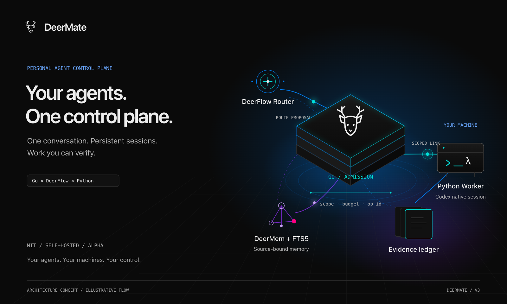
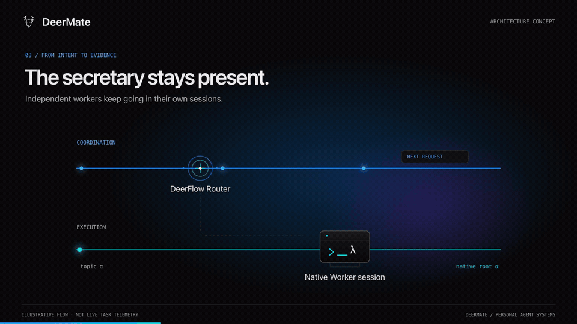
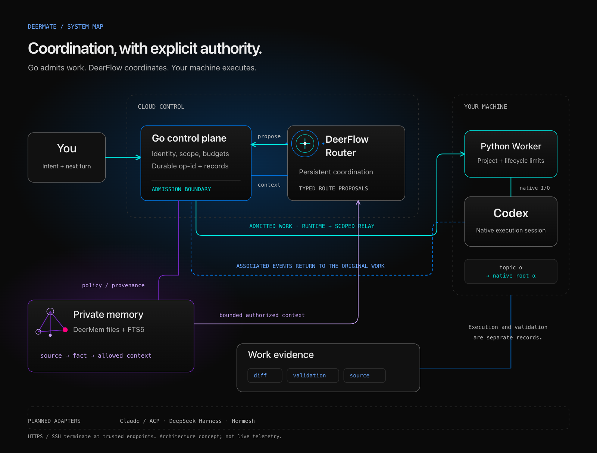

# README v3 文案与版式骨架

设计提案，2026-11-10。配合[视觉方案](readme-tech-v3.md)与[设计预览](readme-tech-v3-review.html)使用。下文展示正式 README 的叙事和文案层级；相对素材路径属于本轮方案目录。

---

# DeerMate

**The control plane for your personal agents.**

One conversation. Persistent sessions. Work you can verify.

<!-- 此处放置深色架构 Hero：控制核心、原生会话轨道、云端与自己的设备。 -->

DeerMate connects a persistent secretary, scoped workers, personal memory, and your own machines. A Go control plane governs what gets admitted. DeerFlow coordinates the conversation. Codex carries out the coding work on an authorized device.

**Go control plane · DeerFlow runtime · Python Worker · Self-hosted · MIT · Alpha**

## From intent to evidence

<!-- 主视频用概念架构演绎替代操作教学；GIF 是其中的短片段。 -->

An architecture concept film. Illustrative flows, not a staged execution log.

## Built around continuity

**A present secretary. Independent workers.**

New intent reaches the Router. Events already linked to a work item can return to its Worker after Go checks scope and identity. A long coding turn does not own the secretary's whole conversation.

**One topic. One native root.**

Keep the same native session and workspace across follow-up turns. If an acknowledgement is lost, reconcile the original operation rather than inventing a new session or replaying the task.

**Authority outside the prompt.**

Identity, project scope, budgets, and operation IDs are enforced at admission and execution boundaries. Imported issues, pages, and other agents' messages cannot authorize new actions.

**Memory with a source.**

Personal context stays linked to an allowed source and scope. Read it, correct it, pause capture, or forget it; late results cannot restore a fact across its deletion barrier.

## A system, not just a chat window

| Layer | Responsibility |
| --- | --- |
| Go control plane | Identity, policy, scope, budgets, durable operations and work records. |
| DeerFlow Router / runtime | Conversation coordination, typed routing proposals and bounded context. |
| Authorized device / Python Worker | Resolve registered projects, keep the Native session, collect results and run configured validation. |
| Personal memory | DeerMem facts and FTS5, governed by Go's provenance and policy checks. |

Execution, independent validation, and uncertainty remain separate. HTTPS/SSH protects transport; the participating cloud application and execution endpoints can read task content.

## Research questions. Running code.

Inspired by DSH Super-agent's Router/Worker approach, DeerMate studies continuity across conversations, changing events, and personal machines:

- **Responsiveness:** independent coordination and execution lanes, with direct delivery for linked work.
- **Recovery:** durable operation identity and native-session affinity, including unknown outcomes.
- **Context integrity:** bounded source retrieval, scope checks, corrections and deletion barriers.

The project provides system mechanisms and scoped acceptance evidence. Comparative quality, performance, and supervision-cost experiments remain future work.

[Research spec](../specs/m4-continuous-agent.md) · [Evaluation plan](../product/technical/evaluation.md) · [Verification evidence](../verification/README.md)

## Extend the system

**Available:** Codex adapter, MCP, scoped HTTPS / SSH Worker connection, source-bound personal memory, and a bounded single-repository GitHub observer.

**Planned adapters and workflows:** Claude / ACP, DeepSeek Harness, optional Hermesh bridge, Product Hunt, mail and desktop automation. Place these in a visibly separate roadmap area, never in an unlabelled active-agent cluster.

## Start with your own machine

[Local workspace](../local-docker.md) · [Small-server deployment](../single-host.md) · [Device authorization](../agent-authorizations.md) · [Contribute](../../CONTRIBUTING.md)

See the current workspace

The real interface and its memory-management flow remain available as supplementary material: [workspace recording](../assets/readme/workspace-tour.mp4) · [product guide](../product/guide/overview.md).

---

## 中文主文案建议

- 主定位：**把 Agent 连成系统，把控制权留在你手里。**
- 主视频标题：**从一句话，到有依据的结果。**
- Router / Worker：**秘书接着聊，Worker 接着做。**
- 原生会话：**接回原来的会话，而不是重新开始。**
- 权限：**权限写在系统边界里，不靠一句提示词。**
- 记忆：**上下文有来源，记忆有边界。**
- 证据：**带回改动、验证与来源。**

这些文案用于项目叙事，不替代安装说明或产品能力声明。正式改写时仍保留 Alpha、已实现/规划及验证范围的文字说明，视觉标识不能独自承担含义。
