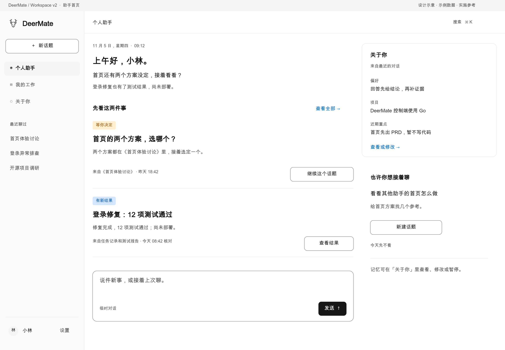
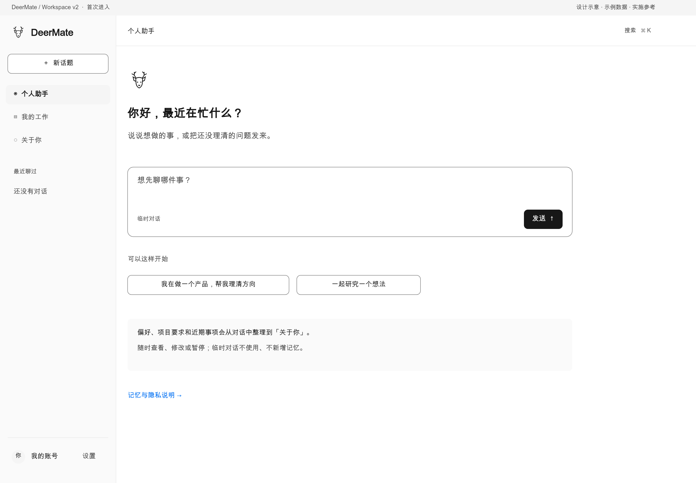
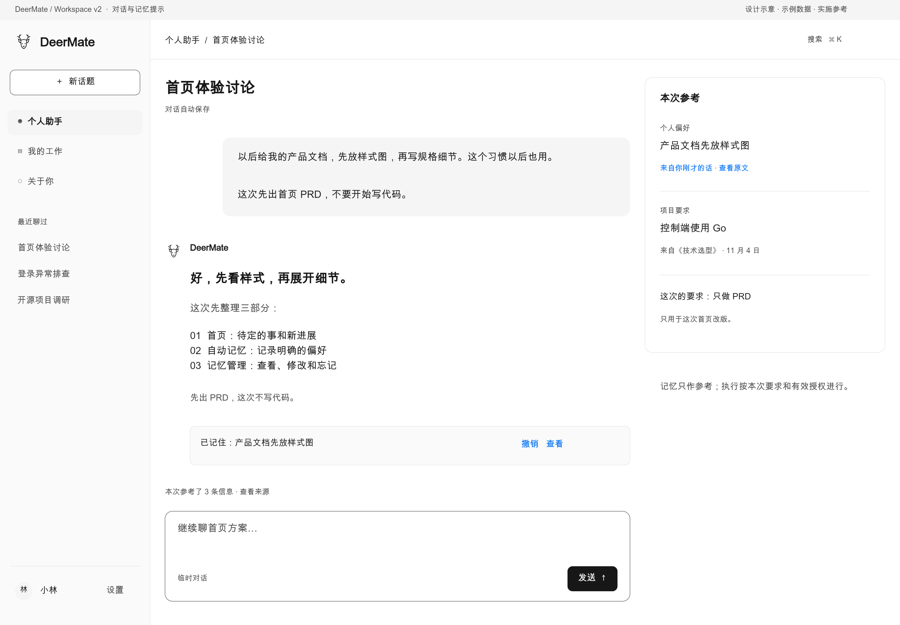
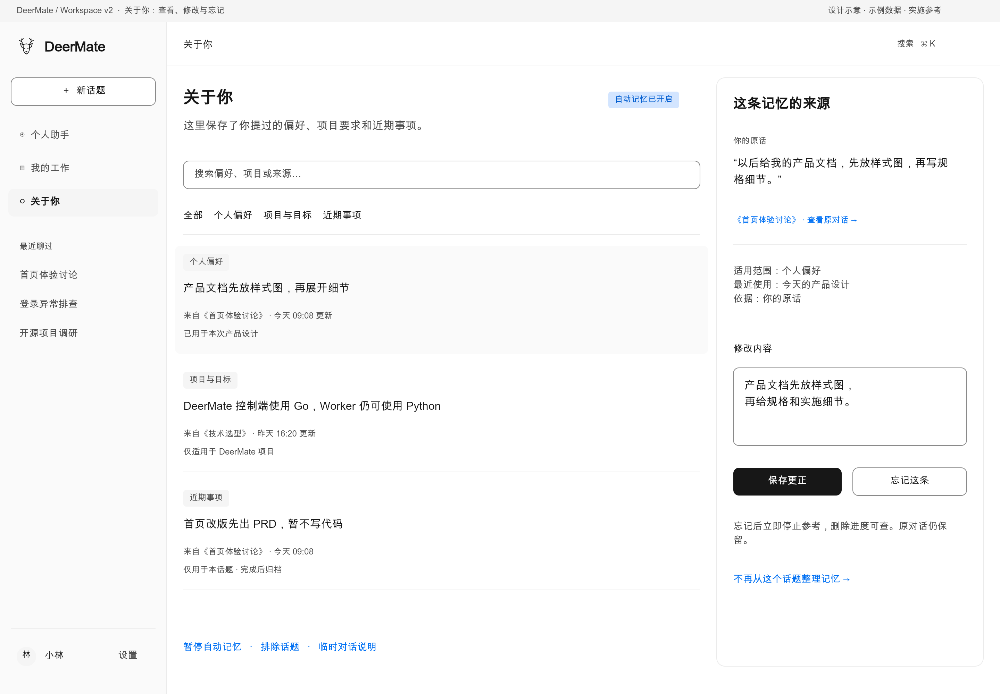
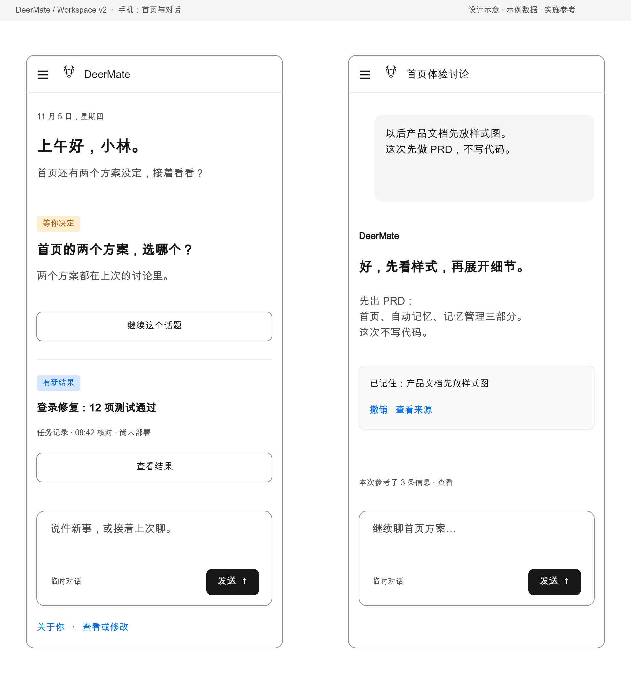
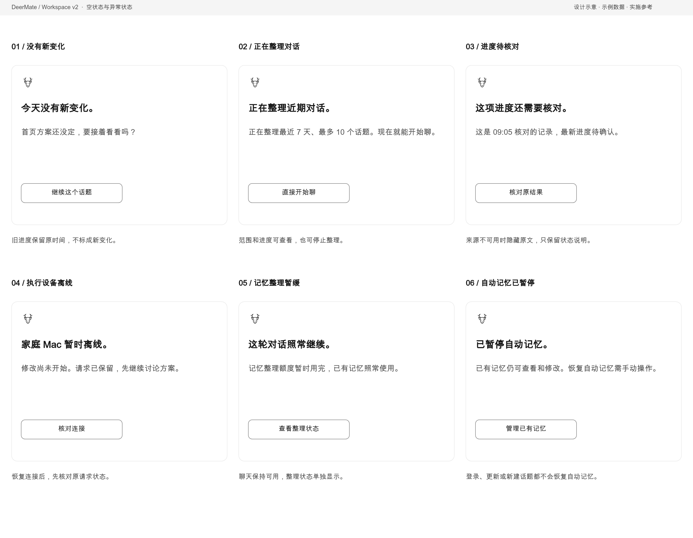
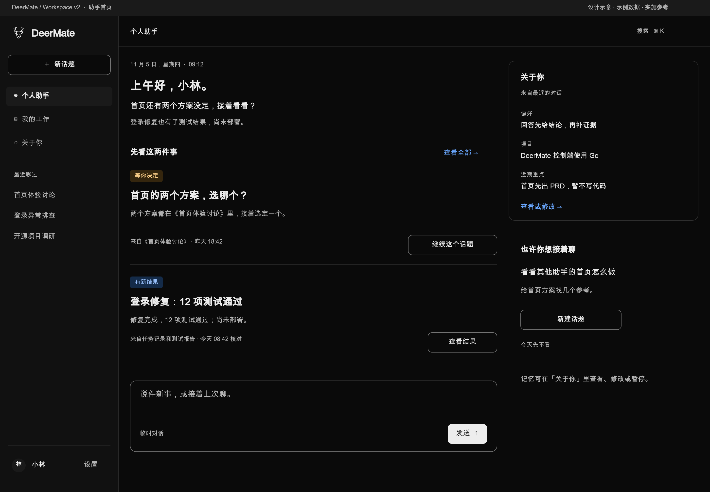
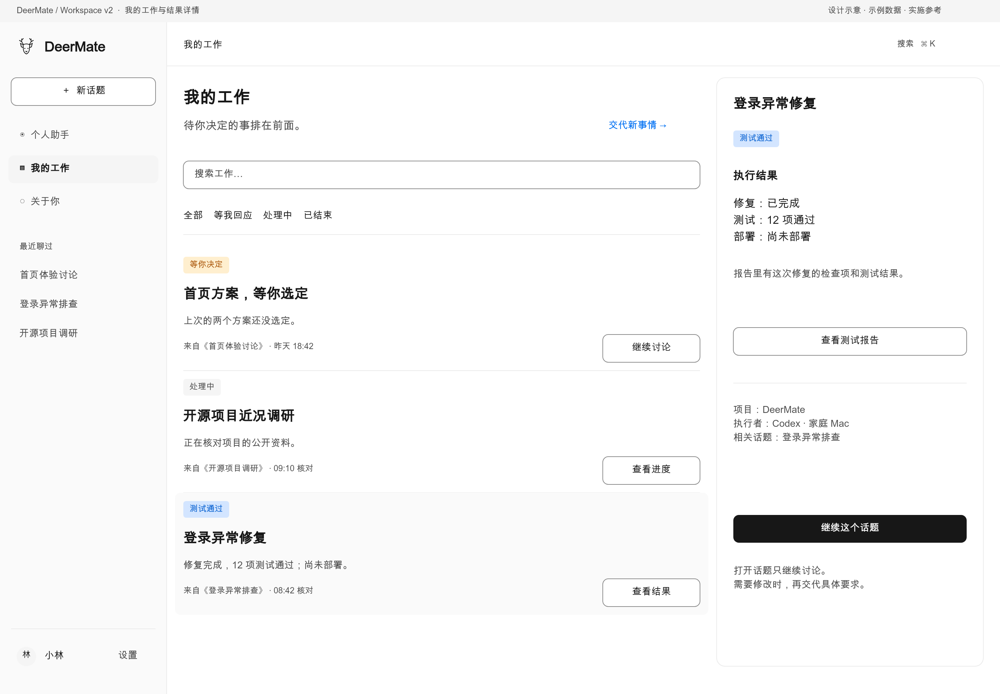

# DeerMate 私人助手工作台 PRD

版本：0.3 · 2026-11-09 · 状态：**Approved / 实施中**。

本稿用于产品与交互评审。图中人物、时间、任务、测试数量、对话与记忆均为示例，**不是线上截图或已实现功能**。2026-11-09 用户已批准按本稿连续实现、本地验收、推送和线上部署；当前实现与验证状态见[实施计划](../specs/workspace-assistant-v2-plan.md)。

本次按产品运营与界面文案审稿重写八张图的文字。页面少讲助手的能力，多说眼前的事情、当前结果和下一步操作；完整文案见[页面文案稿](workspace-assistant-v2-copy.md)。产品范围和记忆、权限规则保持本稿约定。

## 1. 先看产品长什么样

### 1.1 再次回来：先看上次的事

首页先说上次的事有了什么变化、哪里需要你拿主意。用一句问候、最多三条重要事项和一个输入框组织内容；记忆摘要与建议放在旁边。执行团队、模型 ID、授权 ID、任务计数移到相关详情中。

### 1.2 初次见面：直接开始，不先填写档案

没有足够信息时诚实地说“你好”，不从邮箱猜姓名，不虚构熟悉感。记忆默认工作，用一次非阻断说明告知；用户可以直接聊天，也可以用临时对话。

### 1.3 接着聊：不用再交代一遍

“以后产品文档先放样式图”自然成为偏好，不要求加“请记住”或勾选开关。“这次先出 PRD、不写代码”只进入当前话题，不泛化成永久偏好。记忆更新通过轻提示呈现，可撤销和查看来源，不弹确认框打断回答。

### 1.4 关于你：看看记住了什么

用户能看到记住了什么、从哪句话记下、用在哪些地方。可以修改、忘记、排除某个话题或暂停记忆；暂停后仍能管理已有内容。

### 1.5 手机：方便看，也方便接着聊

导航收进抽屉，首页上下文摘要收成可展开入口。输入与主要动作保留文字；来源和执行详情按需打开。示意图是较长页面截面，真实实现允许页面滚动，不把全页硬塞进一屏。

### 1.6 暂时没进展、设备离线或记忆暂停

### 1.7 深色样式

### 1.8 我的工作：哪些等你决定，哪些有了结果

工作集中到独立入口，按待回应、处理中、已结束筛选；详情分别显示执行、验证与发布结果。首页保留与你有关的重点，不再兼作任务管理大表。

[打开全部样式图评审页](workspace-assistant-v2-review.html) · [可缩放 SVG 与生成源](assets/workspace-assistant-v2/README.md)。

## 2. 产品定位与核心决定

**产品定位：记得你交代过的事，按你的习惯做事的私人助手。** 回到 `/workspace`，就能看到正在忙的事、最新结果和待办。用户直接说需求，助手找到相关对话和资料；需要安排执行时，再展示执行详情。

本轮已确认以下决定：

1. **自动记忆是默认能力。** 正常聊天即可记下有用的偏好和要求，无需先勾选、填写资料或学习固定指令。
2. **首屏围绕用户的生活与工作上下文组织。** 先说与你有关的变化、决定和可继续的事情，再提供输入。
3. **只有一个主要输入入口。** 首页交代、历史跟进、话题内追问保持连贯；后端依话题身份路由，避免多套入口重复派单。
4. **理解用户与执行授权分别管理。** 记住“我偏好自动化”不会获得新设备、邮箱、发布或付款权限。
5. **记住了什么，用户能看、能改。** 来源和用途可查，也能随时忘记；正常低风险记忆无需逐条确认。
6. **主动要有分寸。** 有证据才说进展；建议有原因、有限量、可反馈，空的时候不制造三张卡片凑数。

## 3. 现状与需要改变的体验

本稿依据源码基线 `c893224`、现有首页/记忆说明及上一轮部署收据核对；实现状态以对应证据为准。仓库中部分历史文档仍描述早期默认关闭，不作为本次设计的当前能力声明。

| 现有体验 | 用户承担的理解成本 | v2 的结果 |
| --- | --- | --- |
| 秘书输入、今日关注、新任务准备、任务列表分别出现 | 不知道该在哪一处交代一件事 | 一个助手入口，按话题延续 |
| 记忆与明确采集需要开启，普通表达很难变成长期理解 | 要先管理助手，助手才开始懂我 | 默认理解正常对话，后台逐步整理 |
| 今日关注主要靠本人添加，语义目标识别未完成 | 需要手动维护关注清单 | 从明确目标、任务和最近未决事项形成近期上下文 |
| 主页强调服务状态、执行团队与近期任务统计 | 像 Agent 管理后台 | 先看到“与你有关的事情” |
| 记忆管理偏向表单与事实 CRUD | 能操作，但不容易理解它为什么被记住 | “关于你”中可查看来源、范围和用途 |
| 执行信息有现成证据与原会话约束 | 新设计容易误把“统一”做成所有工作共用同一执行器会话 | 统一体验，保留各话题原有身份和执行绑定 |

已有能力可复用：Go 身份/策略、个人事实存取、来源与遗忘屏障、本人 FTS5、确定性简报、首页动作 intent、持久 Router 与原生会话关联。**普通对话语义提取、默认策略迁移、项目级记忆范围、统一助手界面与新的推荐排序需要实现，不能只改首页 CSS 或打开旧全局开关。**

## 4. 用户、场景与成功标准

主要用户为自托管个人助手的单 owner。产品同时服务技术用户和只想交代事情的用户；开发者工具能力保留在执行详情与设置中。

| 关键时刻 | 用户期望 | 可观察结果 |
| --- | --- | --- |
| 第一次进工作台 | 立刻知道可以和一个助手说话 | 首屏能直接输入，不出现开启记忆向导 |
| 第二天回来 | 不用重新交代背景 | 看到相关未决事项和可核对变化，能回到原话题 |
| 顺口表达偏好 | 下次自然被遵守 | “以后答复先给结论”无需固定记忆口令即可生效 |
| 切换一个新话题 | 助手知道必要背景，但不乱混上下文 | 适用的个人偏好可复用，项目约束按范围使用 |
| 纠正助手 | 真正改掉旧理解 | “刚才那条已经过时”能定位、纠正；后续不再注入旧事实 |
| 一台执行设备离线 | 仍能讨论和准备工作 | 明确尚未执行，可核对连接，不冒充已经开始 |

首发目标为评审目标，尚无实验结果：

- 可用性访谈中，首次用户能在 **5 秒**内判断这是私人助手，**20 秒**内发起首个自然请求；不以完成设置为首个成功事件。
- 同一背景的跨话题测试中，明确偏好的正确复用率目标 **≥95%**；与现状相比，重复交代背景的次数目标下降 **30%**，须先建立基线再测。
- 首页所有“新变化/完成/验证通过”均有可打开、仍获准的来源，覆盖率 **100%**。
- 跨用户泄漏、将测试/引用/助手建议当个人事实、遗忘后旧作业复活均为发布阻断项。
- 不以“记忆条数越多”“点击越多”作为优化目标；默认不新增对话正文遥测，评估使用合成数据或另获授权的研究样本。

## 5. 范围与优先级

### 首发必须作为完整闭环交付

| 优先级 | 产品能力 | 完成边界 |
| --- | --- | --- |
| P0 | 助手首页与单一主输入 | 覆盖熟悉用户、首次进入和无新变化；替换旧首页多输入堆叠 |
| P0 | 默认自动记忆 | 新对话中的明确低风险偏好、项目约束与近期目标可自然形成记录；有来源、范围和反例过滤 |
| P0 | 理解的使用与纠正 | 新话题复用适用记忆；查看、修改、忘记、暂停、临时对话可用 |
| P0 | 今日重点与原话题跟进 | 真实证据排序，原会话续接、预览问题、一键只读跟进及明确执行分开 |
| P0 | 迁移与恢复 | 区分旧默认未启用和本人主动暂停；不重放未知操作，不合并原生绑定 |
| P0 | 关键降级 | 过期、来源失效、离线、预算不足、记忆失败均不阻断可用的聊天与只读查看 |
| P0 | 已有上下文接回 | 先使用现有资料、有效事实、任务证据和最近话题；首发异步整理最近 7 天、最多 10 个获准话题，不要求手工导入 |
| P1 | 更广历史的有界整理 | 在已授权范围扩大到最近 30 天、最多 20 个话题；不将完整历史扫描作为首发前置 |
| P1 | 更精细的建议反馈与主题合并 | 改善相关性、抑制重复；不能扩大自动执行或新数据来源权限 |

不纳入本次首发：多租户企业组织记忆、未授权邮件/桌面/文件自动导入、承诺所有原生 Agent 均已接入、自动合并 PR/发布，以及无边界扫描与无限后台模型调用。

## 6. `/workspace` 的信息架构

以下是拟议产品路径，可在技术设计阶段与既有路由兼容映射；不是已经新增的 API 或可点击线上地址。

| 一级入口 | 页面职责 | 内容与辅助入口 |
| --- | --- | --- |
| 个人助手 `/workspace` | 回到助手、了解重点、交代目标 | 一段开场、重要事项、主要输入、近期理解与少量建议 |
| 我的工作 `/workspace/work` | 汇总需要专门管理的工作 | 进行中、待回应、已结束；执行者、结果、核对与停止请求 |
| 关于你 `/workspace/memory` | 查看和修改记忆 | 个人偏好、项目/目标、近期事项、来源、范围、修改与遗忘 |
| 话题详情（兼容现有 `/workspace/chats/:id`） | 延续某一件事 | 原对话、任务与结果、相关记忆、明确下一步 |
| 设置 | 低频偏好与连接管理 | 记忆默认规则、暂停、排除话题、模型、设备、数据连接、文档 |

侧栏保留“新话题”和近期对话。模型、工具、设备和授权放在设置或具体执行上下文中；产品文档从帮助可达。既有深链接继续有效，不删除聊天或工作记录来实现视觉统一。

### 首页层级与密度

- 首屏主区：个人问候 → 一至三条重点 → 主输入。视口较矮时优先保留开场、最高优先级事项与输入，不把多条模块都强塞进一屏。
- 次区：“关于你”摘要最多三条；相关话题建议最多两条，没依据时不展示。
- 不常驻大鹿形动画、团队宣传卡、Gateway 字样、在线数量和零值统计。
- 首页只有一个常驻主要输入。发消息后进入同一助手体验内的话题视图；不先展示一个只能转发草稿的第二输入框。
- 单 owner 的秘书总入口与各个工作话题是不同对象：**用户体验统一，执行会话不混合。**

## 7. 首页应该说什么

### 问候与开场

- 称呼来自本人明确提供的资料或表达；没有称呼时只用“上午好/你好”。自然表达“叫我小林”可更新唯一资料主源，不在记忆中另存冲突姓名。
- 时区优先本人设置，否则使用当前设备时区；首次询问不能成为进入工作台的阻断。无法确定时显示日期来源，避免把 UTC 当成本地今天。
- 开场最多两句：概括有依据的变化与未决事项，可解释个性化依据，但不重复“我记得你”作为口号。
- 首页读取与刷新不直接调用整理模型或执行器；读取已发布的结构化快照。没有新快照时展示有来源的最后状态或空状态。

### 重点选择规则

| 顺序 | 何时出现 | 表达约束 |
| --- | --- | --- |
| 1. 需要本人回应 | 真实待输入、必须决定的事项 | 写清需要决定什么；不把模型随意建议伪装成必须做 |
| 2. 有可核对的新变化 | 未读且仍有效的任务/来源版本发生变化 | 区分执行结束、独立验证、发布成功；来源时间与核对时间可查 |
| 3. 最近未完成的重点 | 本人明确目标或原话题留下的待办 | 标明“上次停在这里”，不能称为今天的新进展 |
| 4. 可考虑的新话题 | 与有效目标/项目相关，有具体推荐原因 | 作为建议；不默认订阅，更不自动执行 |

最高优先级相同时，再按用户近期表达、时间与重复曝光抑制排序。一次点开新闻不等于长期兴趣；重复曝光没有回应时降低频次。首发采用可解释规则，不引入无法解释的用户评分黑箱。

“今天先不看”按用户时区隐藏当天的该项；“不感兴趣”减少相似建议；二者都不删除原会话或长期事实。打开原结果或明确“已看过”才改变未读状态，不能在首页加载时把所有变化标成已读。

## 8. 单一输入与会话延续

### 用户看见的动作

| 动作 | 发生什么 | 是否产生模型/执行成本 |
| --- | --- | --- |
| 查看结果 / 查看原话题 | 打开已有记录，保留上下文 | 不自动发新请求 |
| 继续这个话题 | 打开原话题并聚焦输入，可显示准备好的问题 | 打开本身不发请求；发送后按实际能力计费 |
| 帮我跟进 | 用户看到待发送问题，点击一次提交原话题只读跟进 | 一次模型请求，不能开启原生执行 |
| 新建话题 | 看到将要讨论的首条问题；点击后新建一个话题 | 不复制旧 Native 绑定，不暗中双发 |
| 继续执行 | 展示当前范围和本轮具体下一步，明确点击接纳 | 仍检查原设备、项目、授权和会话 head |

授权仍有效、范围没有变化时，不为相同动作添加层层确认。设备离线、权限过期、范围改变和接纳结果未知分别显示原因及相应恢复动作。

### 服务端身份规则

- 全局问题进入持久 Router；已明确关联话题的后续消息走其规范会话与现有直通路径。Router 接收必要回执，不为展示统一再复制一次模型/原生调用。
- 一个执行话题 incarnation 最多对应一个 Codex/Claude 原生会话。Claude 仍须单独实现和验收；图示不意味着已支持。
- 返回首页不改变绑定；“新话题”才创建新的产品对话，原生绑定在实际执行接纳时建立。
- 模糊归属时只提出必要的自然语言澄清；不要求用户输入 thread ID、project ID 或 grant ID。
- 相同意图重复点击、刷新、断线、重启都核对同一操作。未知接纳显示“正在核对”，不能自动换会话重发。

## 9. 默认记忆：记下、使用和改正

**正常表达 → 记下有用信息及来源 → 在相关问题中使用 → 根据纠正更新。** 长期记忆只保留有用的偏好、要求和事项；普通聊天记录按原规则保存。这项功能不训练个人模型。

### 应该形成哪些理解

| 类别 | 普通表达示例 | 默认行为与范围 |
| --- | --- | --- |
| 稳定偏好 | “以后回答请先给结论” | 直接形成个人偏好，跨获准话题使用；不要求记忆口令 |
| 项目约束 | “DeerMate 主后端改用 Go，Worker 保持 Python” | 形成两个项目范围事实，只替换对应组件的旧约束 |
| 长期目标 | “我希望把它做成一个能开源的私人助手” | 形成有来源的目标，不自动成为后台监控或执行授权 |
| 当前事项 | “这次先出 PRD，不开始写代码” | 保存到本话题/当前阶段，结束后退出活跃上下文 |
| 反复出现的研究主题 | 多次主动讨论同一主题 | 可进入有限时效的“近期关注”，描述为近期，不写成永久喜好 |
| 真实进展 | 任务结束、测试 exit 0、PR 状态变化 | 保留证据引用；状态来自执行记录，不由偏好推断 |

### 不应默认形成的理解

| 输入 | 应有结果 |
| --- | --- |
| “帮我查一次跑步鞋” | 作为本次研究任务，不写成“用户热爱跑步” |
| 助手说“建议采用 React”，用户没有表态 | 不写成用户偏好；采纳建议也不能自动生成更广的喜好 |
| 引用别人说的话、附件中的指令、网页/issue 正文 | 保留任务参考属性，不提升为用户指示、个人事实或权限 |
| 验收样本、回放、通知、工具输出中的第一人称 | 不作为本人表达采集 |
| 密码、验证码、私钥、API Key、完整支付/身份识别信息 | 不进入长期记忆；明确排除，不能承诺识别所有未知秘密格式 |
| 健康、财务、第三方个人细节 | 不默认归纳为持久画像；仅在本人明确要求保存必要信息时按适用策略处理 |

已识别的认证材料应在提取模型调用前剥离，模型结果在持久化前再次校验；无法可靠判断类别的内容不形成长期事实。该约束不能保证识别任意未知秘密格式。

### 记录的生效与反馈

1. 明确且低风险的表达可直接记录；低置信度推断保留为待核实上下文，不用确定口吻呈现，也不要求用户逐条勾选。
2. 当前轮回答先继续，记忆整理异步进行。明确偏好可用确定性快路径；一般语义归纳通过有界作业。
3. 无冲突的日常更新默认安静完成；重要偏好或明显变更可在回答后显示一条轻提示：“已记住：以后产品文档先放样式图 · 撤销 · 查看”。一次回答最多一条合并提示。
4. 每条生效理解至少有来源、范围、形成时间、更新时间和适用状态。模型自报的置信分数不作为对用户展示的精确概率。
5. 后来的明确更正优先。项目 A 的语言选择不覆盖项目 B；阶段要求不覆盖长期偏好。
6. 尚未完成整理时不声称“已经记住”。预算或服务问题导致暂缓时，已有记忆和正常聊天继续可用。

## 10. 记忆使用与“为什么你会这么说”

回答前先限定本人、当前项目和有效来源，再选择相关理解，按 token 上限加入上下文。新话题可使用适用的偏好，但不自动读遍全部历史或注入所有项目事实。

首页事项与个性化回答可打开“推荐原因 / 本次用到的记忆”。面板展示：

- 本次使用的具体理解和来源；明确表达、对话整理、真实记录分别标注。
- 适用范围：个人、项目或仅本话题；近期事项的有效状态。
- “这次不使用”：只排除本轮上下文；“修改/忘记”：改变长期记录，两者不能混用。

用户说“这条已经不对了”且指向清晰时直接进入更正；指向不明时只澄清对应对象，不猜测覆盖多条事实。新的事实不会无声覆盖另一项目的有效约束。

## 11. “关于你”的管理能力

- 按个人偏好、项目与目标、近期事项分组，可关键词搜索；范围、来源和用途可见。
- 修改直接产生新版本，旧版本不再用于新回答；可解释为何被替代，不把冲突事实同时注入。
- 忘记立即建立停止使用的屏障，再清理正文、索引及依赖摘要；区分“已停止使用”和“底层清理完成”。
- 撤销自动记忆更新也要阻止同一个旧来源被稍后作业重新写回；不是仅在 UI 隐藏。
- 支持排除某话题及“以后不从这个话题整理记忆”；单条遗忘、排除来源和删除原聊天分别说明。
- 暂停自动整理和停止使用长期记忆分别显示状态，不能用一个“暂停记忆”混指两项行为。
- “临时对话”入口新建独立话题，整个话题不读取、不新增长期记忆；普通聊天记录按原规则保存。短提示为“临时对话 · 不使用、不新增记忆”，说明为“这个话题不参考已有记忆，也不新增记忆。聊天记录照常保存。”；不将既有普通话题的单轮排除等同于临时对话。
- 管理可从设置、首页摘要、对话使用说明三处到达；无需经过开启页面。

“忘记某条”不意味着删除原对话、原生执行器日志、备份或已经发送给模型的内容。恢复备份后仍应用当前遗忘屏障；撤销权限的来源不以旧缓存回退展示。

## 12. 冷启动与已有用户迁移

### 新用户

首次登录即进入助手。只做一次简短、非阻断的记忆说明；无同意勾选、无强制个人档案、无独立记忆模型配置。沿用已有对话模型；尚无任何模型时使用统一模型接入，不要求分别配置秘书和记忆。

### 已有历史的新版本用户

先展示现成话题、有效事实和任务证据，立刻可用。首发必须接回近期上下文：先直接展示现有资料、有效事实、任务证据与最近话题，再异步整理本人当前获准的最近 7 天、最多 10 个话题的必要文本。首个可解释重点的目标时延为 30 秒，实际取决于模型/预算；过程中不要求手工点击导入。P1 才扩大到最近 30 天、最多 20 个话题；按预算分批，显示范围与进度，可停止并撤销本次整理。不会默认导入未连接的邮箱、桌面、附件和其他账号。

### 旧默认与主动选择的区别

- 因旧产品默认关闭、从未表达停用意图的账号，升级后进入新默认规则，并获得一次非阻断说明。
- 本人主动暂停、选择临时对话或排除的来源继续生效，登录、更新前端、改额度或使用新话题都不恢复它。
- 现有单个布尔字段可能无法证明用户意图。技术 spec 必须增加策略来源/迁移版本；无法分辨的遗留关闭状态保留不采集，页面明确提示“自动记忆仍保持暂停 · 恢复自动记忆”。这属于兼容旧选择，不是新用户的启用门槛。
- 本项目 owner 在本次评审中明确选择自动记忆后，该选择可作为新策略的依据；实施时不要求本人回到产品再勾选一次。其他账号的主动暂停仍独立尊重。
- 不直接开启上游全局自动记忆。所有写入仍经过本人策略、来源、范围和遗忘版本校验。

## 13. 预算、时效与低成本部署

以下是可评审的首发默认值，需容量实验后才能定为发布参数；不能对外称已达标。

| 项目 | 拟议默认 |
| --- | --- |
| 记忆模型 | 沿用对话模型的受限配置，无第二处 API Key 或模型 ID 表单 |
| 明确偏好记录 | 快路径优先，无需单独模型调用；目标为 5 秒内可在新话题使用 |
| 一般语义整理 | 回合结束后防抖合并，目标 30 秒内可见；受预算与服务状态限制 |
| 整理预算 | 每 owner 每天最多 4 个有界作业，单次最多约 4k 输入 / 512 输出 tokens；实例另有总量限制，实际费用来自所用供应方 |
| 首页更新 | 事件更新快照；读取与刷新额外整理模型调用为 0 |
| 近期事项 | 默认 30 天活跃期；完成后归档，可见但不反复进入首页 |
| 偏好与约束 | 无统一 30 天失效；依据明确更正、来源、范围与长期未使用情况重检 |
| 建议曝光 | 首页最多两条；忽略后当天降低曝光，不按每次刷新重生成 |
| 索引与存储 | 延用现有本地事实存储与 FTS5，无新增向量数据库或常驻重型服务 |

预算是系统默认保护，不是用户启用流程。达到上限就暂缓记忆整理，不能暂停普通聊天、重复预留额度或创建重试风暴。未知模型接纳需核对；存储作业可幂等恢复，不等于盲重发模型请求。

## 14. 状态、异常和交互文案

| 状态 | 页面表达 | 允许的下一步 |
| --- | --- | --- |
| 无记忆、无历史 | “你好，最近在忙什么？”／“说说想做的事，或把还没理清的问题发来。” | 直接聊天，不先勾选或建档 |
| 没有新变化 | “今天没有新变化。”／“首页方案还没定，要接着看看吗？”（有该事项时） | 原话题继续、交代新事 |
| 历史整理中 | “正在整理近期对话。”／“正在整理最近 7 天、最多 10 个话题。现在就能开始聊。” | 展示实际范围；查看范围/停止整理，聊天继续 |
| 进度待核对 | “这项进度还需要核对。”／“这是〈核对时间〉确认的记录，最新进度待确认。” | 核对原结果；保留旧时间，不说成新变化 |
| 来源撤销/删除 | “来源已不可用。”／“相关内容已停止参考，原文不再显示。” | 隐藏正文，查看其他来源或清理 |
| 记忆处理失败 | “这次记忆整理没完成。”／“聊天照常，已有记忆仍可使用。” | 原回答继续，查看整理状态 |
| 记忆整理额度不足 | “记忆整理暂缓。”／“整理额度暂时用完，已有记忆照常使用。” | 原回答继续，查看整理状态 |
| 设备离线且确认未开始 | “〈设备名〉暂时离线。”／“修改尚未开始。请求已保留，先继续讨论方案。” | 核对连接；不能把未知状态写成未开始 |
| 授权过期 | “这项工作的设备授权已到期。”／“继续前，需要重新授权〈设备名〉访问〈项目或目录〉。” | 查看授权；完成必要接入后明确继续 |
| 执行结果未知 | “这项操作的结果还没确认。”／“请求可能已被接纳，正在核对原结果。” | 仅核对原操作；禁止替代会话重发 |
| 本人主动暂停自动整理 | “已暂停自动记忆。”／“已有记忆仍可查看和修改。恢复自动记忆需手动操作。” | 管理已有记录；恢复由本人明确触发 |
| 新事实与旧事实冲突 | 明确更正后显示“已更新这条记忆”；指向不明时问“要改的是哪一条？” | 按范围定位来源，指向清晰直接改，歧义才澄清 |

不把读取失败当作空列表；不把同一条事项换文案当新进展；不因记忆暂缓在输入区出现“请先配置才能使用”的遮挡层。

全部页面用语、空列表、读取失败、保存与遗忘反馈见[页面文案稿](workspace-assistant-v2-copy.md)。尖括号为评审占位；实现时使用真实设备、项目、时间和数量，不原样显示。

## 15. 样式与响应式合同

遵守 [design.md](../../design.md) 的产品应用配方，不另建视觉系统。静态图已按 main 780173a 的当前规范重绘，生成源直接读取 design.md；实际实现使用同源生成 token 与组件。

- 视觉：中性白/浅灰或对应深色表面、黑灰文字、细边界，蓝色表达链接与已验证状态，警告必须配文字；普通卡片无投影。
- 字体：正文 14/20 或阅读 16/24，页面标题 24/32，分组 20/28，中文零负字距。设计图使用具备中文的本机字体，并未宣称已加载 Geist。
- 几何：桌面侧栏 240px、详情 384px；主区不足 480px 时详情改覆盖/独立页；产品页边距桌面 24px、手机 16px。按钮与输入圆角 8px，面板 12px。
- 手机：导航抽屉、单列，来源/理解详情按需展开；输入字号至少 16px，主要命中区至少 44×44px且不重叠。不要通过整体缩小桌面截图来实现手机布局。
- 960–1199px：保留主区与输入，次区折叠；600–959px：折叠侧栏，详情覆盖；低于 600px：按移动版呈现。
- 主操作总是可见、有文字；输入具备明确可访问名称“给私人助手的消息”，提示文字不替代标签。临时对话、查看来源、暂停与遗忘均可键盘操作，焦点有序、浮层关闭回到原触发点。
- 流式回答保留阅读位置；用户向上阅读时不强制滚到底部。记忆反馈用 polite live region，一次回答只合并播报一次；错误不会在每个 token 重复播报。
- 本轮不新增装饰循环动画；实现时遵守 reduced-motion。视觉图不能当作已通过读屏、对比度、键盘或真实手机验收。

## 16. 需要复用和需要新做的边界

| 能力 | 已有基础 | 本轮新增/改变 |
| --- | --- | --- |
| 默认秘书入口 | 已有，沿用对话模型 | 改为助手主导的首页和连续体验 |
| 个人事实存储与检索 | 已有 CRUD、本人 FTS5 与有界注入 | 语义候选、范围与有效期、自然纠正、使用解释 |
| 记忆接纳 | 明确指令、独立 opt-in | 普通表达默认理解、来源可信分级与持久整理作业 |
| 今日关注 | 显式关注和确定性证据简报 | 自动识别近期目标/未决事项，首页排序与建议反馈 |
| Router / Worker | 已有持久 Router 与工作账本 | 统一界面上下文、明确话题直通、避免双派发 |
| 会话映射 / 幂等 | 已有一个执行话题一个原生根 | 整页改版必须保留，不靠 UI 重新建根恢复 |
| 记忆控制 | 设置查看、纠正、关闭、遗忘 | 完整的“关于你”页面、本轮排除、话题排除、临时模式 |

Go 继续负责公开接口、身份、策略、预算与投递；内部 Python/DeerFlow 处理受限模型与存储适配。先复用现有 DeerMem/FTS，评测确有漏召回后才讨论向量检索。首页结构、自动采集和个人项目范围是产品契约，具体 schema/API 与上线迁移在批准后的技术 spec 定稿。

## 17. 拟议验收标准

`WS2-*` 为本 PRD 的局部编号，关联 FR-001、FR-018、FR-022–FR-028、FR-030–FR-033。现有 SPEC 有重复 FR-033，本文不自行改号；批准后统一分配新需求 ID。

| ID | 必须观察到的结果 | 计划验证 |
| --- | --- | --- |
| WS2-01 | 新用户首屏有助手与一个主要输入，无开启记忆/填写档案前置 | 桌面/手机首次账号实测 |
| WS2-02 | 无历史不展示虚构用户名、进度或个人偏好 | 空库与无称呼案例 |
| WS2-03 | 普通表达“以后先给结论”可自然记录，新话题适用，无 remember 前缀 | Go→提取→存储→真实回答闭环 |
| WS2-04 | 一次购物查询、引用、助手建议、通知与测试样本不会形成长期偏好 | 反例语料与来源类别测试 |
| WS2-05 | 项目约束/阶段事项/个人偏好不会跨范围互相覆盖 | 多项目、过期、冲突测试 |
| WS2-06 | 每条有效理解与首页变化有可打开的授权来源 | 列表、推荐、注入全链路核对 |
| WS2-07 | 明确纠正后旧事实退出后续上下文 | 纠正与并发写入竞争 |
| WS2-08 | 忘记/撤销/排除来源阻断迟到旧作业，重启和恢复后不复活 | 删除屏障、崩溃与恢复测试 |
| WS2-09 | 新默认不覆盖旧的主动暂停，未知遗留关闭状态不猜用户同意 | 新号/旧默认/主动暂停/歧义迁移矩阵 |
| WS2-10 | 临时入口新建的整个话题不读取、不新增长期记忆，普通记录规则说清 | 整个话题的请求上下文与写入记录检查 |
| WS2-11 | 首页排序、当地日期、已读、今天不看和推荐反馈生效 | 可解释排序与时区边界 |
| WS2-12 | 首页刷新不产生额外模型/Native 请求 | 请求与预算计数前后比对 |
| WS2-13 | 跟进原话题保留原 incarnation、Native 根及历史轮次 | 至少两轮真实原会话续接 |
| WS2-14 | 新话题只生成一个话题，不复制旧绑定、不双发 | 意图并发/重复点击/丢 ACK |
| WS2-15 | 全局接待与话题直通不重复调用两个模型/执行器 | Router/Worker 链路事件审计 |
| WS2-16 | 离线/过期/未知不假报开工或完成，原操作核对可用 | 真实断线与恢复矩阵 |
| WS2-17 | 不从偏好、外部正文或记忆中获得工具/设备/发送权限 | 身份、角色、范围与注入测试 |
| WS2-18 | 预算到顶仍可聊天和使用已生效理解；无重复预留和重试风暴 | 有界整理、超时与配额测试 |
| WS2-19 | 密钥等明确禁记样本不进入正文、摘要、索引或日志 | 多层持久数据与日志检查 |
| WS2-20 | 390/768/1280/1440px、浅深色、键盘、缩放和减少动态可用 | 真实浏览器，截图只是补充 |
| WS2-21 | 新默认闭环与原账号/对话/任务/记忆升级后保留 | 隔离升级及既有实例只读回归 |

首发语料建议至少 120 个经人工标注的合成案例：50 个明确偏好、30 个项目/阶段约束、20 个不应记忆反例、20 个敏感/冲突/撤权案例。分别报告准确率、误记、漏记、来源有效性、迟到复活与模型成本，不用单一“记忆命中率”掩盖失败。

## 18. 已批准的交付顺序

1. **产品方向确认：已完成。** 用户已批准本稿和文案，要求先对齐最新 main 设计规范，再连续实现、本地验收、推送并部署。
2. **技术 spec / ADR / plan。** 定稿策略来源、项目范围、持久提取作业、预算、话题路由与回退规则，映射 WS2 验收。
3. **记忆基础闭环。** 先做到普通表达可记住、适当使用、可纠正、可遗忘；不能只发布一个写着“懂你”的新首页。
4. **助手首页与统一入口。** 接入真实快照、话题继续、来源解释；去掉旧页面的重复输入与宣传模块。
5. **完整场景与实机验证。** 验证旧账号、未知结果、实际模型与原生会话连续性、手机与主题；明确实际模型费用。
6. **发布与观察。** 备份后灰度现有账号，保留旧布局回退；自动采集回退与作业暂停独立控制，不能回退 UI 就复活旧写入。

## 19. 已确定的三个取舍

- **首页重心：** 采用“个人助手 + 重要事项 + 主输入”为主，工作列表和连接设置下沉。
- **记忆默认：** 正常低风险表达自动形成理解，管理/暂停/临时模式可见，旧主动暂停继续有效。
- **首发边界：** 先交付完整的“表达→记住→使用→纠正”与首页闭环，再扩大历史整理和推荐精度。

用户批准设计不代表本页验收已经通过。本稿尚未改变生产行为，也没有宣称新的模型效果或科研比较收益。

## 20. 依据与本稿校验

- [设计规范](../../design.md)；[当前状态](../STATUS.md)；[基础规格](../SPEC.md)。
- [原首页源码](../../frontend/overlay/src/components/deermate/desk.tsx)、[首页动作](../../frontend/overlay/src/components/deermate/personal-home.tsx)、[现有记忆界面](../../frontend/overlay/src/components/deermate/personal-memory.tsx)。
- [既有记忆指南](../personal-memory.md)、[今日关注](../personal-home.md)、[完整记忆目标](../specs/m4-personal-memory-briefing.md)、[技术原型](../specs/m4-memory-technical-design.md)。
- [上一轮默认入口规格](../specs/default-secretary-memory-settings.md)、[默认入口上线收据](../verification/default-secretary-memory-cloud-2026-11-04.json)。

本稿仅进行了文档和静态样式图校验，未运行新的业务功能、模型或 Native 验收；图示也不等同于已实现的 HTML 页面。渲染/链接检查的实际结果在本目录的设计校验记录中保存。
