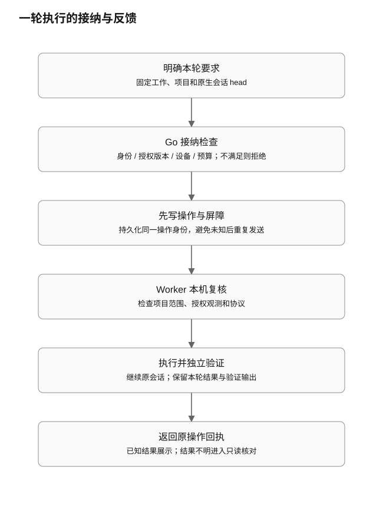
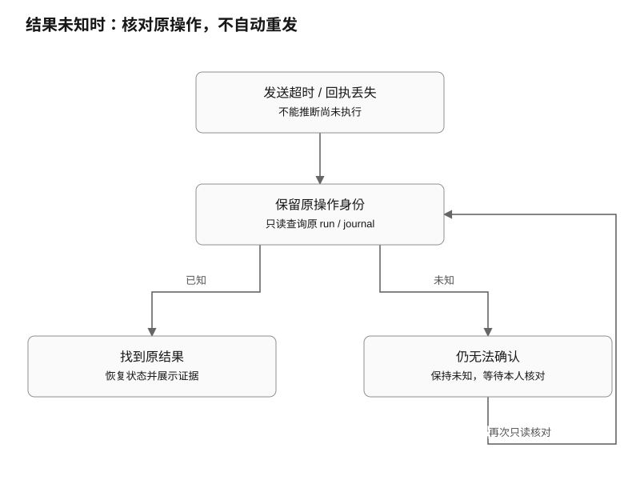

# 持续协作与可靠执行

持续秘书将长期目标、来源事件和执行会话组织在同一个工作账本中。Alpha 已实现持久 Router、有界来源观察和原生任务适配；实现事实、功能验收和研究收益分别记录。

## Router、Assessor 与执行会话

每个 owner 在固定 DeerFlow 中维护一个持久 Router。Router 只使用类型化路由工具，提出工作或关联建议；Assessor 不持有工具。实际代码执行复用普通任务驱动、授权 relay 和 Worker，使用工作的原生会话。

原生执行在独立 lane 中等待，避免长期任务独占秘书输入通道。已关联执行 Thread 的事件进入原工作上下文；范围外请求以 handoff 表达，不能扩大授权。

图 2：一次明确执行的主路径。任何门禁不满足都应拒绝接纳；未知结果按下图核对。

## 必须保持的不变量

1. 任务身份、会话根和每轮结果可追溯，后续轮次不覆盖历史结果。
2. 相同幂等身份与相同输入核对同一操作；内容冲突应拒绝。
3. owner、项目、授权版本、设备与原会话 head 在接纳时检查。
4. 不确定的发送不能通过创建替代会话来“恢复”。
5. 取消请求、停止确认、执行结束与验证通过分别记录。
6. 来源正文和模型建议都不能为系统增加权限。

## 默认交互与背景处理

秘书交互和本人明确发起的工作默认可用，沿用对话模型偏好，未选时使用模型目录中的默认模型。首次投递前冻结实际模型；缺失或不支持时保留等待状态，不预留模型额度。未知投递只核对原操作，不因模型偏好改变重新选模型或发送。

旧的用户停用状态继续暂停背景观察与自动处理，不能阻挡明确交互，也不能被交互自动恢复。明确启用来源时才开放背景接纳；从停用状态恢复时自动原生额度回到零。Go 与内部执行适配器对明确交互使用同一接纳规则；设备授权、项目范围和自动额度仍独立检查。

## 发送屏障与恢复

可能产生副作用的发送前，先保存操作身份与屏障。发送后超时，系统无法仅凭网络错误判断接纳与否；恢复读取同一 run 或 journal 的原记录。

| 情况 | 恢复动作 |
| --- | --- |
| 明确在接纳前拒绝 | 保存拒绝回执，允许本人处理条件后决定下一步 |
| 已知接纳但页面失联 | 查询原操作，恢复状态投影 |
| 接纳情况未知 | 保留未知，禁止自动重放 |
| 原会话 head 已变化 | 更新引用并拒绝过时输入，等待明确下一步 |
| 设备离线且停止未确认 | 保留最后已知状态，不报告已停止 |

这一机制追求可核对的受限投递，不构成任意分布式副作用的全局 exactly-once 保证。

Worker 清理原生执行器时，只操作该实例创建的进程组。进程已退出但异步状态尚未更新时，先有界核对实际退出；权限拒绝、组身份变化或仍无法确认停止时，将原任务保留为需要显式恢复，原生身份与已有结果继续保留。关闭通信读取不等于确认执行停止，重启也不会自动重放该任务。

已收集的补丁与独立验证先保存，任务在清理确认前保持非终态；确认后才发布完成结果。清理被拒绝或中断时保留证据与恢复要求，避免先宣布成功再降为未知。

图 3：不确定恢复分支。取消请求同样需要等待执行端确认，不能由断线推断已停止。

## 恢复后的状态核对

持久状态恢复需要跨文件的一致恢复点。恢复实例先保留原工作、任务与原生根，并冻结执行和自动投递；原卷保留，未知操作按原身份核对。停止确认、连接恢复与状态恢复分别判断，不能因记录已恢复便新开替代任务。

快照之后发生的遗忘或撤权需要在重新开放前补施。冻结期间只允许受原权限和版本检查保护的事实删除与 Agent 授权撤销，确定性存储维护不会启用模型或 Native。其他变化未核对、删除结果仍未知或外部设备尚未确认时，继续保持暂停。

## 来源与自动处理

首期观察管理员固定的单个 GitHub 仓库，使用基线、增量、ETag、去重、分页与退避。一次列表中缺席不能证明远端删除。来源不可读、停用或换代后，需要过滤旧正文并移除对应搜索内容。

规则区分关闭、观察与执行。执行模式还受本人授权、原生轮次预算与模型接纳额度约束；未知投递继续占额，规则更新不回放历史候选。积压达到上限时背压阻止游标继续推进。

## 证据与限制

保留的离线验收覆盖真实 Go/Gateway 与假原生执行器两轮同根、重启后原操作核对和独立验证。这些结果证明指定协议路径的行为，不代表真实模型质量、真实 GitHub 兼容性或全部中断场景通过。

完整来源状态矩阵、跨进程中断与长时公平性，以及真实来源、模型和 Codex 的持续闭环仍待补验。评估应将重复执行数、恢复核对率和成功率分开报告。
