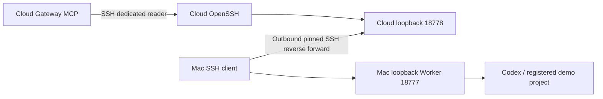

# Temporary home Worker reverse link

- **Status:** Proposed — configuration and installer prepared locally; not installed
- **Milestone / requirements:** M2; FR-009, FR-010, FR-013; NFR-002, NFR-003
- **Updated:** 2026-10-28
- **Decision:** [ADR 0010](../decisions/0010-temporary-home-reverse-link.md)

## Outcome and authority

The home Worker only listens on the Mac loopback interface. A cloud control plane cannot reach it through the existing same-host development SSH fixture. Prepare a separate 24-hour, explicitly approved acceptance link using the server's existing OpenSSH listener. Preserve the default direct-SSH transport and Go public API/auth boundary.

The existing cloud administrator grant prohibits reverse forwarding. It does not authorize new dedicated SSH logins. Installation therefore requires the owner's explicit authorization of the following concrete additions; preparing files grants no access.

## Proposed connection

- `deermate-reverse`: dedicated public key; remote forwarding only to the cloud's exact `127.0.0.1:18778` listener. Mac client fixes the local destination to `127.0.0.1:18777`.
- `deermate-reader`: separate key; local forwarding only to cloud `127.0.0.1:18778`. MCP reaches the existing cloud SSH listener through its private Docker bridge.
- Both accounts have no shell/exec/subsystem sessions, sudo, password login, PTY, Agent/X11 forwarding, Unix-socket forwarding or tunnel devices. New key login expires at the prepared UTC deadline. A persistent systemd timer removes their authorized keys and terminates existing account sessions at expiry.
- Reuse the previously verified cloud host key, pin the Worker instance, and copy only the dedicated reader key, trust record, Worker API token and enrollment into owner-only runtime files. The reverse private key stays on the Mac. Native Codex credentials stay on the Mac.
- Worker authority remains its existing registered `demo` project, test command, task deadline and concurrency policy. Removing access does not assert that already admitted tasks stopped.
- No new public port, domain, paid cloud resource or wider native project grant is requested. The existing administrator key's deadline is unchanged.

## Limits and acceptance

Both SSH legs terminate at the trusted cloud host; this does not hide task plaintext from the cloud operator/application. `PermitListen` constrains the cloud listener, not the client's ultimate local destination. The home client remains trusted; the registered application identity/token prevents accidental endpoint drift. This is a temporary manually provisioned alpha link, not automatic device pairing, a generic NAT service or production isolation.

Before activation, retain the original sshd configuration, validate syntax and effective per-account policy, and install expiry before reloading sshd. Then verify allowed forwarding, rejected shell/arbitrary forwarding, loopback-only listener, authenticated capabilities and grant expiry handling. Back up the app database/config before updating the cloud Gateway package. Enable the MCP entry only after doctor succeeds; run exactly one authorized model-selected demo task and verify native evidence and notification. Retain sanitized facts separately from private keys, addresses and account records. On uncertainty, reconcile state before retrying any mutation.

Prepared private artifacts include an installer with rollback, two key pairs, pinned trust files, controller configuration and exact client arguments. They remain in the operator's ignored workspace. No server account, reverse listener or cloud Worker registration has been created at proposal time.

Preparation verification: `bash -n` passed. On the selected Ubuntu host, the combined proposed sshd configuration passed `sshd -t` and both simulated users' `sshd -T -C` checks (key authentication, direction, no sessions, loopback gateway policy). This used a temporary file that was deleted; the active daemon configuration was not changed. Installation, negative forwarding tests and actual expiry remain pending approval/activation.

OpenSSH settings follow the primary references: [forwarding, Match, MaxSessions and GatewayPorts](https://man.openbsd.org/sshd_config), [restricted keys and expiry-time](https://man.openbsd.org/sshd.8#AUTHORIZED_KEYS_FILE_FORMAT), [ssh reverse forwarding](https://man.openbsd.org/ssh#R). Actual Ubuntu/OpenSSH behavior must be checked on the selected host after approval.
