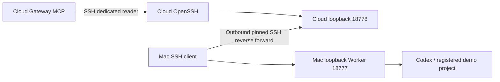

# Temporary home Worker reverse link

- **Status:** Implemented and verified for one explicitly approved temporary cloud-to-home alpha deployment
- **Milestone / requirements:** M2; FR-009, FR-010, FR-013; NFR-002, NFR-003
- **Updated:** 2026-10-28
- **Decision:** [ADR 0010](../decisions/0010-temporary-home-reverse-link.md)

## Outcome and authority

The home Worker only listens on the Mac loopback interface. A cloud control plane cannot reach it through the existing same-host development SSH fixture. Use a separate, explicitly approved acceptance link of at most 24 hours through the server's existing OpenSSH listener. Preserve the default direct-SSH transport and Go public API/auth boundary.

The existing cloud administrator grant prohibits reverse forwarding. The owner separately approved the following dedicated SSH logins and forwarding scope before installation. The original administrator key was not extended and remains expired.

## Installed connection

- `deermate-reverse`: dedicated public key; remote forwarding only to the cloud's exact `127.0.0.1:18778` listener. Mac client fixes the local destination to `127.0.0.1:18777`.
- `deermate-reader`: separate key; local forwarding only to cloud `127.0.0.1:18778`. MCP reaches the existing cloud SSH listener through its private Docker bridge.
- Both accounts have no shell/exec/subsystem sessions, sudo, password login, PTY, Agent/X11 forwarding, Unix-socket forwarding or tunnel devices. New key login expires at the prepared UTC deadline. A persistent systemd timer removes their authorized keys and terminates existing account sessions at expiry.
- The Mac connector reconnects only the SSH transport with bounded backoff, pinned trust and the original fixed deadline. It stops on authentication/trust rejection and never resubmits HTTP, model or native work. Server keepalives clean up stale sessions. Mac system sshd is unchanged.
- Reuse the previously verified cloud host key, pin the Worker instance, and copy only the dedicated reader key, trust record, Worker API token and enrollment into owner-only runtime files. The reverse private key stays on the Mac. Native Codex credentials stay on the Mac.
- Worker authority remains its existing registered `demo` project, test command, task deadline and concurrency policy. Removing access does not assert that already admitted tasks stopped.
- No new public port, domain, paid cloud resource or wider native project grant is requested. The existing administrator key's deadline is unchanged.

## Limits and acceptance

Both SSH legs terminate at the trusted cloud host; this does not hide task plaintext from the cloud operator/application. `PermitListen` constrains the cloud listener, not the client's ultimate local destination. The home client remains trusted; the registered application identity/token prevents accidental endpoint drift. This is a temporary manually provisioned alpha link, not automatic device pairing, a generic NAT service or production isolation.

Before activation, retain the original sshd configuration, validate syntax and effective per-account policy, and install expiry before reloading sshd. Verify allowed forwarding, rejected shell/arbitrary forwarding, loopback-only listener and authenticated capabilities. Back up the app database/config before updating the cloud MCP package. Enable the MCP entry only after doctor succeeds; run one authorized model-selected demo task and verify native evidence and notification. Retain sanitized facts separately from private keys, addresses and account records. On uncertainty, reconcile state before retrying any mutation.

## Deployment and retained evidence

The approved Ubuntu 24.04 host now has the two restricted accounts, loopback-only listener, expiry service/timer and private MCP registration. Installed policy passed `sshd -t`, effective per-account `sshd -T -C`, privilege-group checks and systemd unit validation. The timer was active when checked. Its fixed deadline is **2026-10-30 02:29:56 UTC**; actual expiry/disconnection has not yet been observed. The timer also removes the cloud reader key and Worker token. Revocation does not stop already admitted native work.

The Gateway image stayed unchanged. A SHA-verified public source archive at `2e7fdac` produced the Worker wheel; a version-constrained `uvx` environment was prefetched and its offline doctor passed. MCP uses the supported `uvx` executable and offline cache, without weakening the HTTP executable allowlist. The pinned runtime snapshots durable-task bindings at startup: activating the new toolset required its lifecycle ledger/file lock and a controlled Gateway restart. Temporary credential-staging fields were removed from active configuration and the rollback archive; runtime credentials remain owner-only. The reverse private key and native Codex login remain on the Mac.

Actual OpenSSH checks passed nine cases: reject exec for either account, reverse-account local forwarding, another reverse listener, another reader target, reader remote forwarding, cross-account key and untrusted host key; permit only the reader's exact loopback target. After completion, terminating the reverse account's sessions caused the Mac connector to reconnect; a read-only recheck retained the same task, native session and attempt 1 without another model/native submission.

The normal cloud run selected connection preflight then one submit tool, completed one real home Codex repair, returned the expected single-file patch and independent test exit 0, and delivered its result notification. A prior model run while bindings were disabled admitted zero tasks; it was retained rather than replayed. Browser inspection confirmed the public task/evidence drawer. See the [sanitized receipt](../verification/home-link-2026-10-28.json) and [acceptance guide](../secretary-acceptance.md).

Installer, connector, keys, controller configuration, backups and browser captures remain in the operator's ignored workspace. They are deployment-specific artifacts, not a published automatic enrollment installer. General pairing, restart supervision after Mac reboot, device-loss recovery and actual deadline observation remain follow-up work.

OpenSSH references: [forwarding, Match, MaxSessions and GatewayPorts](https://man.openbsd.org/sshd_config), [restricted keys and expiry-time](https://man.openbsd.org/sshd.8#AUTHORIZED_KEYS_FILE_FORMAT), [ssh reverse forwarding](https://man.openbsd.org/ssh#R).
