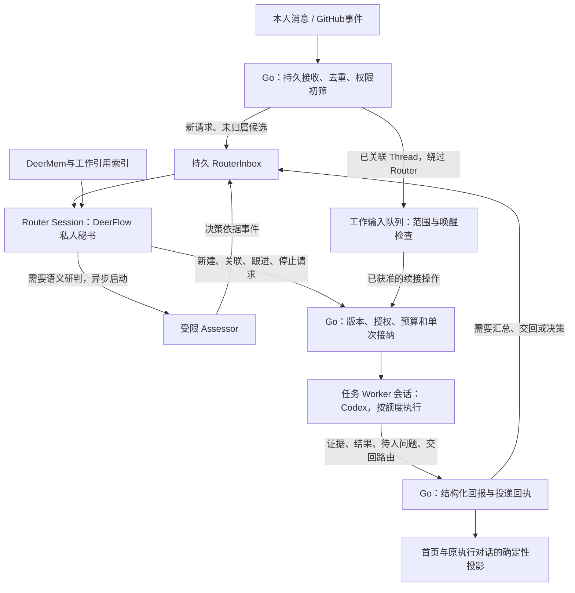
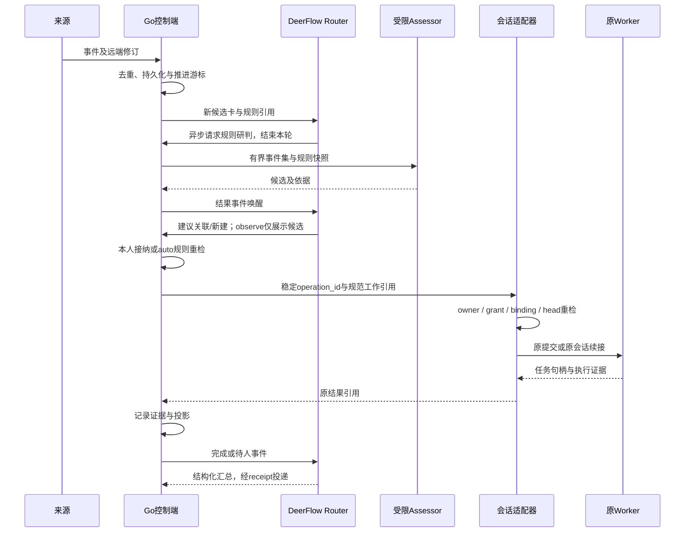
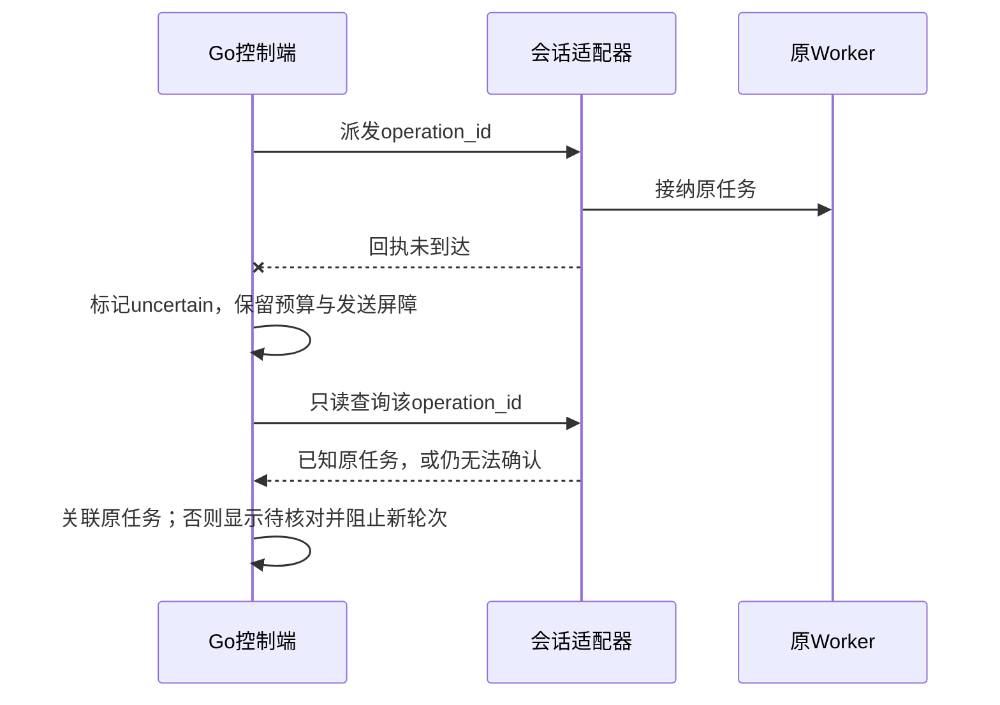

# M4.5 · 持续任务、事件调度与可追溯记忆

- **状态：Accepted，进入实现。** 用户已于 2026-11-03 明确要求按 spec/plan 连续开发；设计接受不等于实现、验收或上线。
- **需求：** FR-001、FR-003、FR-004、FR-007、FR-010–FR-015、FR-018、FR-022–FR-032；NFR-001、NFR-003–NFR-008，见[基础规格](../SPEC.md)。
- **基线：** 本地 `19284cdee7a0bfcc060afd8bfd9bcc2859942f1f`；授权产品化已有实现和本地证据，线上状态单独核对。
- **实现基线：** `5a1ed3a`，含本机授权协议强制校验；后续以实际提交及收据为准。
- **更新：** 2026-11-04 UTC。
- **配套：** [实施 plan](m4-continuous-agent-plan.md) · [Proposed ADR 0015](../decisions/0015-continuous-agent-control-plane.md)。尚未创建专项 Issue/PR。

## 1. 要交付的产品

用户交代“帮我持续跟进这个项目的登录问题”，秘书创建一件有名字的工作，记住来源、范围和执行对话。用户离开页面后，获准的 GitHub 变化和执行结果仍能进入系统；秘书在合适的时候判断是否需要继续。首页展示当前进展、真实证据、等待谁和下一步操作。

首个闭环：**指定 GitHub 仓库 → 事件记录 → 观察模式生成候选 → 本人接纳 → 创建或续接固定 Codex 会话 → 独立验证 → 首页及原执行对话展示结果。** 最后一个阶段才允许用户另行开启有边界的自动执行。

“持续”指状态、订阅和结果处理持续存在；没有新事件或到期工作时不调用模型。刷新首页不发起模型、外部抓取或 Native 任务。用户仍可同时进行普通聊天。

审核摘要：**沿用 Go + DeerFlow + 现有 Worker；显式采用 Router/Worker 双层；首期单仓库/Codex；一个 Router 秘书入口聚合多件工作，每件执行工作有独立绑定会话；明确指令可直接接纳，推断建议先观察；自动模式单独开启；引用召回优先；站外写入后续。**

## 2. 复用基线与范围

| 已有能力 | 本次复用方式 |
| --- | --- |
| Go 登录、owner/CSRF、管理页 | 新 API 继续由 Go 接纳；首期只有现有设备 owner 管理来源、规则和执行 |
| Agent 授权及出站 HTTPS | 复用逐版本本机确认、项目/操作限制、截止时间和 90 秒观测；不新建 SSH 接入体系 |
| Worker、ordinary driver、MCP 跟踪 | 仍是实际执行与验证的主源；新调度层只持有引用 |
| 一对话一原生会话及逐轮 journal | 保持 FR-022；任何恢复都不能创建替代原生会话 |
| 个人记忆、关注、首页 intent | 个人事实继续在 DeerMem；关注可关联一件持续工作；已有按钮和 intent 继续使用 |
| 固定 DeerFlow | 提供模型调用、对话和内部受限适配；不复制其模型循环或另建 Python 调度器 |

### V1 包含

- 一个 owner、一个已注册 GitHub 仓库；站内消息和既有任务状态也是事件来源。
- GitHub 首期采用只读轮询：Issue/PR 元数据、指定讨论的评论、已关联 PR 的 CI 状态。首轮只建立基线，不把历史内容当新请求。
- 持久工作记录、事件去重、版本化决策、串行执行轮次、可靠站内投递、待处理事项。
- `off / observe / auto` 模式；默认 `observe`，来源本身默认未启用。普通读取和显式手动执行与自动模式分开接纳。
- 按引用有界召回、本人范围的关键词查找；程序监测连接、时限、重复失败与不确定状态。
- 最终按用户启用的规则，自动运行指定项目的一轮 Codex 修改及既定验证；默认不连续自主追加轮次。

### 后续范围

Claude、Harness 执行适配器，邮件、IM、Product Hunt、通用网页订阅，GitHub webhook，跨 owner/共享设备，多仓库，多执行器流水线，自动语义记忆提取及向量检索，模型 Watchdog 自行修复，桌面控制，Git 推送/创建 PR/评论/合并/发布，均不在 V1。

新来源采用接口扩展；不为这些后续能力显示可用按钮。既有普通聊天、原任务及首页动作不强制迁移到新工作模型。

## 3. 产品流程

### 交代与查看工作

1. 在现有工作台增加秘书入口，接待普通问题、查看多件工作的进度和交代目标。秘书聚合对话使用原 DeerFlow 会话，其自身不绑定 Native；每件执行工作关联独立执行对话，详情可见，用户无需先切换对话再交代任务。旧的已绑定对话继续作为执行对话，不自动改成秘书聚合对话。
2. 用户可交代新目标，或把本人已有执行对话显式加入持续跟进。新工作保存可改名的标题；首次使用首条目标生成确定性短标题，不增加命名模型调用。既有对话只有绑定完整、归属清晰且没有其他活动工作占用时才可加入。
3. 首页“需要你处理”优先展示待确认候选、待输入、待审核、受阻和待核对；“正在推进”显示活动工作。详情可追溯原事件、决策、执行轮次及证据。
4. 本人可追问、暂停自动处理、关闭工作或请求停止。暂停与取消执行分开呈现。

在秘书入口明确要求执行、且项目/授权/验证均已确定时，可以直接接纳并展示范围和稳定工作链接，无需每轮重复点击确认。只有推断候选、范围不清或新增权限才需要预览/补问。明确指令的依据必须是规范站内用户消息及其真实 owner/run，不接受模型自行声明 `explicit=true`。

多项工作并存时，用户引用工作名称/链接或在当前选中工作中追问即可续接；不能唯一确定目标时，先列出可选工作，不猜测项目或新开原生会话。秘书使用受限的工作查询/提议/接纳工具；实际 Native 工具只存在于目标执行对话的既有门禁后。

### 接入 GitHub

1. 本人选择明确仓库和允许读取的对象，配置该仓库的只读凭据引用。V1 通过受信运维配置 `secret_ref`，不建设 OAuth/App 注册平台，不接受任意抓取 URL。
2. 页面显示准备读取的数据、轮询频率及可能的模型调用额度；用户启用后才建立基线并开始轮询。
3. `observe` 下展示“建议做什么、依据哪些事件、预计使用什么权限”。它不创建执行对话、不运行 Worker、不向 GitHub 发消息。
4. 用户点击“执行这项”后重新预检，使用稳定操作 ID 接纳；也可忽略、改写目标或暂停来源。忽略记录保留，不因普通刷新重新提醒。

### 开启自动模式

用户明确选择规则、项目、Codex 授权、允许操作及额度，并预览后开启。自然语言规则负责描述匹配条件；机器字段负责限定来源、事件类型、项目、操作和预算。模型不能添加这些字段或自行切到 `auto`。

自动派单仅生成补丁并运行已登记验证。需要新项目、额外轮次、外部写入、权限变更或处理未知结果时进入待处理；用户原有授权不是必须再次确认的理由。

## 4. 对象与唯一写入者

用户界面使用“工作”“事件”“建议”“执行轮次”等产品名称，内部标识放在详情。

| 对象 | 核心字段与语义 | 唯一写入者 |
| --- | --- | --- |
| Source | owner、种类、固定远端 ID、secret_ref、读取范围、配置版本、游标、观测时间 | Go 来源模块 |
| SourceEvent | owner、来源实例、远端对象/修订、类型、接收/发生时间、可信元数据、有界正文引用 | Go 事件接纳 |
| SourceThread | 一个 Issue/PR 或站内执行对话的规范来源引用 | Go 事件接纳 |
| AutomationRule | owner、模式、自然语言条件、来源/事件类型、固定项目/操作、预算、不可变 revision | Go 规则模块 |
| RouterSession / RouterInbox | owner 的规范 Router 会话引用/用途、输入 ID、优先级、输入/决策引用、投递/处理回执 | Go 维护登记和收件箱；DeerFlow 维护该会话历史 |
| Decision | 输入事件集、规则/来源版本、模型及 prompt 版本、结论、理由、输入哈希、预算引用 | Go 决策接纳 |
| WorkOrder | owner、标题/目标、范围、来源、执行对话引用、授权引用、revision、生命周期 | Go 工作模块 |
| ExecutionAttempt | 工作与轮次、operation_id、绑定/期望 head、原 run/task 引用、派发及核对状态 | Go 记投递；运行时/Worker 提供执行事实 |
| Subscription | 工作与来源 Thread、`context` 或 `action_candidate`、规则引用 | Go 工作模块 |
| Effect / Receipt | 稳定操作键、待投递工作、结果引用、失败次数、下次执行时间、回执 | Go 同一事务账本 |
| Attention | 问题类型、工作/证据版本、下一步动作、已读/解决状态 | Go 投影 |

Go 使用现有本地 SQLite 的新增命名空间表和索引；不写上游任务表，不接管 Worker 数据库或原生 journal。一个 Go 控制实例、一个来源轮询所有者；不支持多副本或网络文件系统。所有网络和模型调用均在事务外执行。

## 5. 架构与接纳

Go 唯一拥有事件调度、工作和规则；DeerFlow 唯一拥有其模型/对话循环；设备 Worker 服务唯一拥有原生执行状态。Go 的 dispatcher 只投递稳定操作，不成为另一个 Native 执行器，也不另建与上游争用的任务调度循环。

Assessor 研判返回严格结构：`ignore / propose / attach / request_action`、输入引用、匹配规则与理由、建议范围；它不能直接创建授权或执行。该调用使用有界上下文且工具集为空，工具入口也拒绝调用。模型输出通过 schema、引用、owner、规则版本和权限检查后才成为决策依据；Router 决定关联哪件工作，最终接纳仍由 Go 执行。

每次接纳保留不可变快照：规范用户消息或 Decision、来源/规则版本、目标与操作、设备/Worker 实例、grant 及版本、预算预留、绑定与期望 head。派发使用“原快照范围 ∩ 当前规则 ∩ 当前设备授权”，不能因配置后来扩权而自动扩大旧工作的范围；新增范围需要新接纳。规则关闭/收窄立即阻止新的自动派发，在途任务仍按已有到期/停止策略处理。

已有任务的普通变化可直接送入工作上下文，不经过模型路由。需要新执行时仍形成可审计的候选和单次接纳；已关联且范围确定的候选可走直通路径，不要求再次经过 Router 模型。相关话题相似不能作为自动关联依据；仅接受明确工作 ID、已绑定 Issue/PR 或本人确认的关联。

### 5.1 Router 是独立的智能角色

首期每 owner 一个持久 Router Session，复用 DeerFlow 的会话和压缩能力。秘书入口复用此会话；普通聊天和任务执行会话独立。Go 保存 Router 的规范会话引用和收件箱，不把全局上下文藏在进程内变量或一个临时 prompt 中。

| 角色 | 负责 | 可用工具边界 |
| --- | --- | --- |
| Router | 接待、识别目标、查询工作全局状态、按引用恢复上下文、提议/关联工作、投递追问、汇总结果和转达待人问题 | 工作/来源/记忆的受限查询、异步研判、规范工作操作、结构化回复；不含 shell、文件写入、Native 提交原语或第三方写工具 |
| Assessor | 对推断事件批次作规则匹配，返回有依据的候选 | 无工具的有界研判；不是第二个全局秘书 |
| 任务 Worker | 阅读原始任务/事件、判断工作范围、实现、验证，处理本工作内追问，越范围时交回 Router | 本执行对话原绑定 Codex 的获准能力；不改 Router、规则、授权或其他工作 |
| Go 控制层 | 保存事实和队列，强制权限/版本/预算、幂等与副作用接纳 | 确定性程序，不承担 Router 的模型理解职责 |

这里的“任务 Worker”指每件工作的 Agent 会话，首期由实际 Codex 原生会话承担；现有 Python Worker 是管理这些会话、进程和验证的设备服务。无需再增加一个等待 Codex 完成的中间编码 Agent。

Router 的工作以路由和协调为主，普通简短问答仍可直接回答；编码、独立验证和深入执行留在任务 Worker。Router 读取原目标、少量状态卡和引用，不把所有 Worker 工具日志复制进自己的上下文。

### 5.2 非阻塞与持久收件箱

- 本人请求、候选、Assessor 结果、Worker 回报都是带稳定 ID 的输入；Go 先保存，再送入 Router。记录已投递/已接纳及关联 run/Decision，重复输入不能创建重复工作。
- 派发或研判工具立即返回“已接纳/已排队”及操作 ID。Router 结束当前轮次；完成后由结果事件唤醒，不在 Router 内 `sleep`、轮询或等待任务完成。
- 同一 Router 同时最多一个模型轮次。新的人类请求优先于下一批后台候选；正在进行的一次模型请求仍有耗时，不能承诺零等待。后台批次受输入数量、时间及预算上限约束。
- Router 可管理多件独立工作，各 Worker 会话彼此隔离；V1 Native 并发 1 是低成本执行槽限制，不要求 Router 等待这个槽内的工作结束。
- 空闲没有模型请求。服务重启恢复原 Router 引用、输入游标和投递回执；会话无法核对时显示待恢复，不丢弃工作记录或重派 Native。

### 5.3 已关联 Thread 直通与交回路由

已归属工作的 CI、评论和明确追问经 Go 订阅校验后直接进入该工作的输入队列，不要求 Router 再理解、转述每条消息。仅补充上下文时不唤醒模型；需要续接时仍按当前规则、授权、head 和预算形成单次操作，再送入原 Worker 会话。

Worker 处理原范围内的后续事项；若请求超范围、应交给其他工作或缺少唯一目标，则通过绑定原任务的结构化 `handoff` 回报交回 Router，不能自行新开会话或扩大授权。`ready / needs_input / blocked / handoff` 等回报使用规范字段，执行成功与验证仍取自原证据，不从自由文本猜测。

未归属消息、明确 handoff、需要人决策的问题，以及需要统一解释的最终结果才进入 Router。普通进度直接更新首页；对外回复由 Router 的结构化回复经 Go receipt 统一记录/投递。Worker 原对话保留真实原始结果供检查。首期仍只有站内渠道，不因“统一对外”获得 GitHub 评论或其他写权限。

## 6. 会话与并发不变量

- 总秘书视图聚合多件工作；每件执行工作使用自己的对话。总秘书不通过一条已绑定对话偷偷切换多个执行器。
- 秘书聚合/执行对话的用途由 Go 规范创建记录确定；已绑定对话不变更用途。公开 metadata、提示词或模型输出不能修改用途、注入保留字段或取得另一种会话的工具。
- 一个执行对话 incarnation 固定一个注册执行器/项目/原生会话；每个对话最多一个活动 WorkOrder，每个 WorkOrder 最多一个活动执行轮次。
- 后续轮次复用原会话和工作区，保留父任务证据；新项目或执行器创建新工作及新对话。
- 首期一个外部 Thread 最多一个活动负责工作；其他订阅仅提供只读上下文，不能扇出多次执行。
- 同一执行对话的用户消息和自动候选竞争同一接纳屏障。head/授权/来源变更则拒绝旧候选；忙碌时等待或请求本人处理，不另开根会话。
- 订阅消息不获得站内用户身份或新权限。GitHub actor 使用服务返回的稳定 ID，不通过显示名或模型推断映射为 owner。

## 7. 生命周期与恢复

WorkOrder 生命周期仅为 `active / paused / closed`；关闭附 `completed / cancelled / not_needed`。展示阶段由执行与 Attention 推导，不复制一套 Worker 成功状态。

| 展示阶段 | 可核对事实 |
| --- | --- |
| 排队 | 已接纳操作，尚未确认开始 |
| 执行中 | 原执行端确认开始，且观测仍有效 |
| 等待变化 | 当前轮次结束，工作仍订阅事件 |
| 需要你处理 | 待确认、待输入、待审核、授权/连接受阻、结果待核对 |
| 正在停止 | 已请求取消，尚未确认停止 |
| 已结束 | 原结果与关闭条件满足；独立验证单独展示 |

Effect 接纳状态为 `prepared → dispatching → acknowledged → settled`，并可进入 `uncertain`。准备记录和工作版本在一个事务保存，投递前记录发送屏障。仅确认从未投递的操作可重试；一旦可能越过发送屏障，后续只按稳定 operation/run/task ID 查询。

新内部适配器必须支持“按 operation_id 查询原接纳结果”，并复用原 binding/journal/ordinary driver。若现有固定版本做不到，P0 必须先补窄查询契约；不能把重复 POST、临时管理 shim 或 verifier 当恢复实现。

### 事件到执行

### 回执丢失

服务重启后先读取 effect 和原接纳结果；不根据模型的“我还没做”决定重发。关闭后事件仍可留作来源记录，但不会自行重开工作。本人显式重新接纳需重检范围、当前授权及原会话；已撤销授权不能被恢复事件复活。

暂停阻止新研判/自动派发，允许接收执行结果；不宣称已停止运行任务。请求停止调用原取消路径，只有原生停止确认后显示已取消。授权到期/撤销沿用 ADR 0014 的在途策略和观测窗口；不改为“恢复工作即续期”。

## 8. 来源、规则与事件交付

- GitHub 仅访问固定官方 API 与明确仓库 ID；凭据在模型上下文之外。首期只读，不复用 Codex 本机登录或宿主机通用 `gh` 权限。
- 唯一事件键为 `(owner, source_id, remote_object_id, event_kind, remote_revision)`；编辑是新修订，不覆盖旧接纳依据。自有输出带来源标签，不能回流生成新执行。
- 游标只在事件持久提交后推进；分页中断、重叠窗口、同时间戳事件和 429 均可重读去重。404/权限变化先标不可读，不推断对象已删除。
- 同一 Thread 串行研判，积压事件合批，批次有固定输入版本。规则或来源变化使旧研判失效；不能持旧答案执行。
- 已订阅 Thread 直通不跳过代码授权，不保证任何自然语言追问都在旧任务范围；越范围须结构化交回 Router。新请求/交回需要路由，已知本工作事件不重复消耗 Router 请求。
- `off` 不做自动模型研判；`observe` 记录建议；`auto` 才允许规则接纳。每次派发和 Worker 排队启动继续检查真实授权。
- 本人手动操作属于单独明确接纳，不能把网页、Issue、CI 或其他 Agent 的原话当作设备授权。
- 外部评论即使已订阅也只是上下文；仅受支持的事件种类和已启用规则可产生自动执行候选。

## 9. 可追溯记忆与数据生命周期

首期关系链为 `AttentionTopic → WorkOrder → SourceEvent/SourceThread → execution chat/incarnation → run/task/round → evidence/artifact`。使用外键或校验引用，不引入图数据库。

- 精确引用优先走索引查询。未知对象可用本人范围 FTS5 搜索工作标题、短摘要和获准事件预览，不复制全部历史聊天/原生日志进新索引。
- 每一跳先检查 owner、当前来源可读性、对象 revision 和授权。不可访问时返回失效占位，不继续展开正文；不能先跨 owner 搜索再过滤结果。
- 每次最多三跳、20 个对象、32 KiB 正文；原文分段分页，返回来源时间、版本、截断标识和继续游标。限制为设计默认值，需验收校准。
- 模型短摘要是派生内容，保留原始引用和输入版本；不能替代任务成功、测试通过或权限事实。个人事实继续遵守既有关闭、纠正与遗忘屏障。
- 来源断开/删除、原对话删除/换代或权限撤销时立即禁止后续读取并失效缓存/派生摘要。删除通知未到达前，页面只能声明最后核对时间。
- V1 不自动清空历史记录；事件正文单项上限 16 KiB，超限保留截断和受限原文读取入口。新增事件/索引/回执逻辑配额建议 256 MiB/owner，达到上限暂停接收且不推进游标，显示人工清理/导出入口。审计 tombstone 和幂等键不因正文清理删除；更完整保留期另行设计。

DSH 的精确日志读取可能重放整份日志，本方案不能据此宣称低延迟；应对分段引用使用独立有界查询。旧个人记忆 FTS 与新工作索引保持各自内容主源。

## 10. 预算、背压与监测

以下为待审核的 V1 默认值，不是当前已通过的性能结论：

| 项目 | 默认与达到上限后的行为 |
| --- | --- |
| GitHub 轮询 | 60 秒一轮；每轮最多 5 页、每页最多 100 条；保留后续游标，遵守服务端退避 |
| 研判并发/批次 | 全实例 1；每 Thread 合批最多 20 项、最多 32 KiB，上限外排队 |
| 自动模型请求 | 每 owner UTC 日最多 20 次，合计后台 Router/Assessor/汇总请求；投递前预留，禁用无界 SDK 重试；每次输出上限 1,024 tokens；本人普通交互走原聊天额度 |
| 自动 Native | 默认额度 0；开启 auto 时本人明确设置，V1 上限 2 轮/UTC 日、全实例并发 1 |
| Native 单轮时限 | 不超过现有 Worker/授权限制及 30 分钟中的最小值；不扩大既有授权 |
| 工作数量 | 每 owner 最多 20 件活动工作；事件候选积压最多 1,000 项，溢出暂停来源 |
| 监测 | 无事件时不运行模型；同一故障按工作/版本去重，状态恢复后关闭待处理项 |

模型请求数是本系统可观测的派发边界；原生 Agent 内部 token、供应方内部重试和真实账单不由此保证。缺少用量时显示未知，已经可能投递的请求不退还预留额度。不能设置可执行的模型输出上限或控制重试时，拒绝开启自动研判。

程序监测先覆盖：未确认投递、时限、过期观测、设备离线、连续失败和待输入。不根据“长时间没有文字”推断 Native 死亡，不自动重启或换会话。模型级 Watchdog 自愈后续再做。

## 11. 提议的公开与内部接口

以下接口已有 Alpha 实现，实际状态与限制见 [STATUS](../STATUS.md) 和[使用指南](../continuous-secretary.md)。写入沿用会话、CSRF、owner、`operation_id` 和 `expected_revision`；返回公开视图，不暴露技术 token、任意本机路径或第三方凭据。普通账号保持既有只读边界；新增来源/规则/执行由设备 owner 管理。

| 接口 | 行为 |
| --- | --- |
| `GET/POST /api/me/work-orders` | 本人分页列表 / 显式创建或加入已有对话 |
| `GET/PATCH /api/me/work-orders/{id}` | 详情 / 标题及生命周期变更 |
| `POST /api/me/work-orders/{id}/actions` | 接纳候选、明确下一步、暂停、关闭、请求停止或核对原结果 |
| `GET /api/me/work-orders/{id}/timeline` | 游标分页的事件/决策/执行证据引用 |
| `GET /api/me/work-orders/{id}/context` | 有界关系展开；参数只能缩小上限 |
| `GET /api/me/work-orders/search` | owner 预过滤的有界关键词查询；路由优先于 `/{id}` |
| `GET/PATCH /api/me/event-sources/{id}` | 固定来源配置、读取范围、状态与开关；不接收 secret 明文 |
| `GET/POST/PATCH /api/me/automation-rules[/{id}]` | 规则版本、模式与预算；开启 auto 必须明确范围和额度 |
| `GET /api/me/agent-decisions` | 候选/观察记录及其原始依据 |

首次来源实例由受信配置登记，V1 不提供任意服务端地址的创建表单。内部窄适配器仅接收规范 operation ID 和 Go 认证的 owner，上下文从规范记录重建；结果查询只返回同 owner 原 run/task，不信任模型给出的 executor、server、native ID 或路径。原始插件及保留幂等键继续由公共代理封锁。

## 12. UI 契约

沿用 [design.md](../../design.md) 和现有首页布局，不新增另一套工作台。

- 首页增加“需要你处理”和持续工作条目；今日关注仍最多三项，可链接工作详情。正常系统健康不占大块空间。
- 详情先展示目标、阶段、下一步和证据，再折叠授权版本、事件/投递标识；任务完成与验证通过分别显示。
- 来源页显示未启用、建立基线、正常、退避、额度不足、凭据失效、储存已满、暂停和最后核对时间。
- 候选显示建议、来源、模式及“执行这项/忽略”；auto 设置显示将允许的操作及额度，不能只有一个无说明开关。
- 支持 loading、空、部分失败、无权限、失效来源、忙碌、待核对；390px、浅/深色、键盘及减少动态效果均有验收。
- 下一轮草稿按工作隔离，切换工作不串用；已结束工作不提供追问输入。已有原生轮次必须填写明确的新要求，不能将原目标默认为下一轮。
- 同一页面中回执未知的重试保留原操作 ID 和原请求快照，即使工作 revision 或执行 head 已更新；明确拒绝后才允许使用新上下文提交。刷新页面后的恢复依赖服务端原操作核对，不宣称浏览器草稿持久化。
- 关键配置/工作读取失败时保留已显示内容并提示过时，停用依赖该内容的写入；原操作的只读核对仍可使用。来源、规则、建议分别显示局部读取失败。

## 13. 验收标准

以下为固定验收标准；实际覆盖与剩余缺口见 plan 和 STATUS，不因实现落地自动标为通过。

| 编号 | 可观察结果 | 验证方式 |
| --- | --- | --- |
| CONT-01 | 旧账号、聊天/命名、首页动作、记忆及授权 API 保持；开关关闭无后台模型/Native | 现有契约 + 实际 API 回归 |
| CONT-02 | Source 与 mode 默认关闭/observe；建立基线不回放旧请求 | Go/来源 fixture |
| CONT-03 | 重复、乱序、同秒、编辑和分页中断不丢事件、不重复候选；失败不提前推进游标 | 可控时钟 + GitHub HTTP fixture |
| CONT-04 | observe 只产生建议；off 无研判；显式接纳与 auto 都在代码中重查范围/版本 | Go + 对抗模型 fixture |
| CONT-05 | 过期/撤销/错 owner/错设备/越项目在 Go、内部适配和 Worker 拒绝 | 跨进程授权集成 |
| CONT-06 | 一个执行对话只有一个 Native 根；并发追问/自动事件最多接纳一个当前轮次 | 真实 journal + pinned driver 集成 |
| CONT-07 | 研判 prompt 注入、伪造引用、原始插件或超范围工具调用不能扩大能力 | 固定图 + 工具门禁对抗 |
| CONT-08 | 首次投递、回执丢失、重启及迟到结果都核对原操作；未知不创建替代工作/会话 | 跨进程故障注入 |
| CONT-09 | 暂停、关闭、取消请求和停止确认语义独立；事件不复活关闭/撤销状态 | 状态机 + Worker 集成 |
| CONT-10 | 订阅只路由明确关联的上下文；同 Thread 不扇出多轮执行，自有输出不触发循环 | 来源/路由 fixture |
| CONT-11 | 引用召回逐跳检查本人/版本，超深/超量有界；失效来源不泄漏旧摘要 | API + 索引/缓存失效测试 |
| CONT-12 | 个人记忆关闭/纠正/遗忘仍生效；任务进展由证据提供，不写成稳定个人事实 | DeerMem 固定 Provider/图契约 |
| CONT-13 | 预算原子预留、日界、并发耗尽及未知用量不能超发；重试有上限 | 可控时钟 + 可计数 Provider |
| CONT-14 | 站内投递重启后可核对；去重键、顺序、失败和已读状态真实 | 故障注入 + 实际 UI |
| CONT-15 | 刷新首页/上下文无外部或模型请求；执行期间秘书仍能接待其他问题，并按明确工作引用路由追问 | 计数器 + 浏览器 |
| CONT-16 | 新界面所有关键状态、390px/桌面、浅深色、键盘与减少动态检查通过 | 真实浏览器、截图复核 |
| CONT-17 | 旧数据不自动导入或重新派发；回退先停新调度，未确认操作继续保留 | 实际 Compose 升级/回退 fixture |
| CONT-18 | 有界负载下服务无 OOM，限额/积压能退避；性能目标和实测分开记录 | 见 plan 的低内存验收 |
| CONT-19 | 一次真实只读 GitHub 变化经历 observe 与明确接纳，原 Codex 两轮同会话、独立证据可查 | 单独授权与限额内的实机验收 |
| CONT-20 | Router/Assessor/任务 Worker 的用途和工具集由 host 强制隔离；Router 不能接替原生执行或修改规则/授权 | 固定图/工具集及保留字段对抗 |
| CONT-21 | Worker 或 Assessor 未完成时，Router 可接纳下一本人请求；完成事件自动进入收件箱，Router 不靠轮询等待 | 可控延迟 + 实际 Gateway/浏览器 |
| CONT-22 | 已关联 Thread 原范围事件绕过 Router 模型；越范围 handoff 返回 Router，仍复用原绑定或显式新工作 | 模型调用计数 + journal/路由集成 |
| CONT-23 | Router 重启后恢复原会话引用及 inbox；重复/迟到消息不重复接单，无法核对时保持待恢复 | 跨进程故障注入 |

## 14. 迁移、回退与交付边界

新增表/索引和可关闭模块；不自动迁移原对话、关注或 Native 绑定，不重写旧事实。旧数据只在用户显式关联后纳入工作；模糊历史保持不可接纳。Go/Gateway 适配契约必须有版本协商，缺少能力时新入口不可用，旧入口保持。

按 plan 先本地离线闭环，再有限实机验收，最后安排上线。停用来源/auto 不能丢失已接纳操作；回退前冻结新派发、核对在途任务及备份 home/SQLite/journal。旧版本不认识新 schema 时，不直接强行启动；使用经过验证的兼容回退版本或保留当前版本关闭新模块。不得用恢复旧 DB 覆盖新任务结果。

审核通过仅接受这里的产品/实现范围，不自动授予新的设备权限、第三方读写能力、付费资源或云端登录。已具备的授权继续有效，日常实现和离线验证可按 plan 连续推进。

## 15. 调研依据与已接受选择

研究问题和目标架构见[中文 README](../../README.zh-CN.md#research) / [English README](../../README.md#research)；配套 plan 的 R-EVAL-01–R-EVAL-05 定义受控对照、消融和复现材料。它们是拟开展的系统研究，不以现有组件收据宣称 Router 性能优势。

- [DSH 原型领域模型](https://github.com/deepseek-ai/dsh-superagent-prototype/blob/8c32a9dc5d72c033816c6a8110b37f40cf94fba4/docs/001-domain.md)、[授权](https://github.com/deepseek-ai/dsh-superagent-prototype/blob/8c32a9dc5d72c033816c6a8110b37f40cf94fba4/docs/002-authorization.md)、[执行](https://github.com/deepseek-ai/dsh-superagent-prototype/blob/8c32a9dc5d72c033816c6a8110b37f40cf94fba4/docs/003-execution.md)、[主会话/执行者角色](https://github.com/deepseek-ai/dsh-superagent-prototype/blob/8c32a9dc5d72c033816c6a8110b37f40cf94fba4/docs/004-prompts.md)：采用 Router/Worker 分工、异步回报、订阅直通、观察模式和可靠投递；不照搬多工单执行扇出、无边界宿主 shell 或仅提示词的合并条件。
- [DSH 会话查询](https://github.com/deepseek-ai/deepseek-harness/blob/8bd073392eef6f54e921a093b95076248eb08cbb/packages/session-query/session-query/README.md)：借鉴精确读取和关系追溯，同时落实调用方权限和分段开销。
- [Anthropic 上下文工程](https://www.anthropic.com/research/effective-context-engineering-for-ai-agents)：轻量引用、按需读取和结构化笔记。
- [长期 Agent harness](https://www.anthropic.com/research/effective-harnesses-for-long-running-agents)：增量交付、可接续进度和实际验证。
- [计算/状态/环境解耦](https://www.anthropic.com/research/managed-agents)、[多 Agent 调研系统](https://www.anthropic.com/research/multi-agent-research-system)：保持云端协调与设备执行边界，并按任务价值限制并发和成本。

用户已于 2026-11-03 批准实施：**保留 Go + DeerFlow + 现有 Worker；独立 Router/Worker 角色、异步回报及已关联 Thread 直通；V1 单仓库/Codex；先 observe 后 opt-in auto；原生绑定不变；先有界引用召回；先程序监测；站外写入和其他执行器后续。** 设计接受不代替 CONT 验收，历史收据与本轮证据分别记录。

## 2026-11-04 · 实现映射

Go 的 `continuous_*.go` 以版本化 `workRecord` envelope 保存来源/事件/规则/Router/inbox/决策/工作/操作/上下文，唯一键和预算独立表提供事务约束。Python `continuous.py` 是原 AgentRuns/journal/ordinary driver 的内部适配层，`continuous_middleware.py` 强制角色与请求限制；Worker 的结构化范围报告为 `DEERMATE_WORK_V1`。这些实现不引入第二份 Native 主状态。

本人 FTS5 使用 trigram MATCH，按最近索引顺序返回最多 20 项，避免高频词触发全历史 BM25 评分；短词只查最近 200 张卡。排序取舍及低配实测见使用指南/本轮收据。来源撤销与逐跳版本仍由账本检查，索引不构成权限。

验收按 CONT 保留原标准，组件通过不等同端到端全部通过。真实只读来源/真实 Native、完整 UI 状态、兼容回退及研究对照尚未全部完成，详见 plan。
