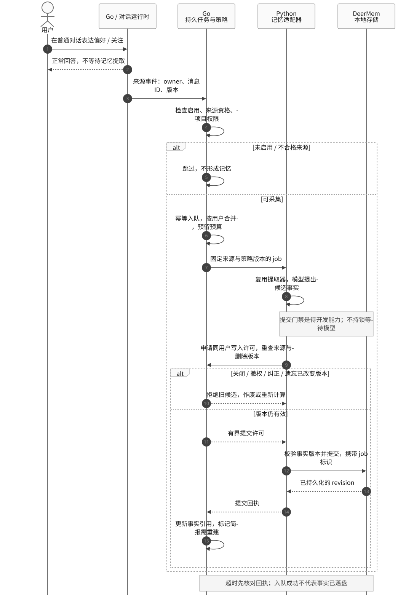
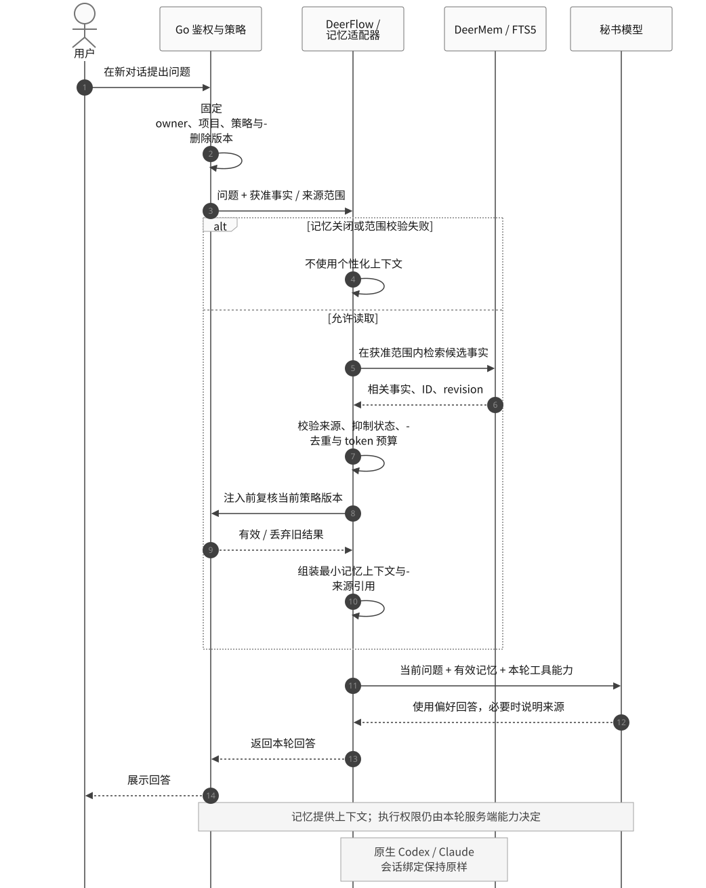
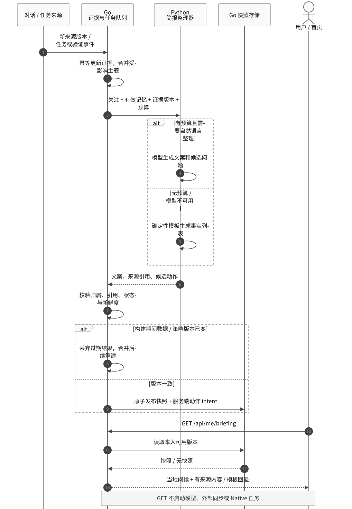
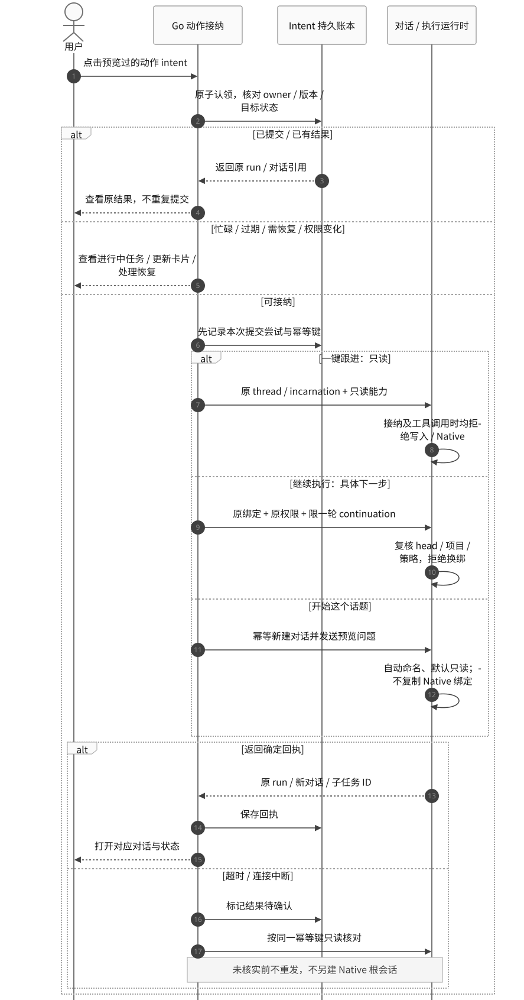
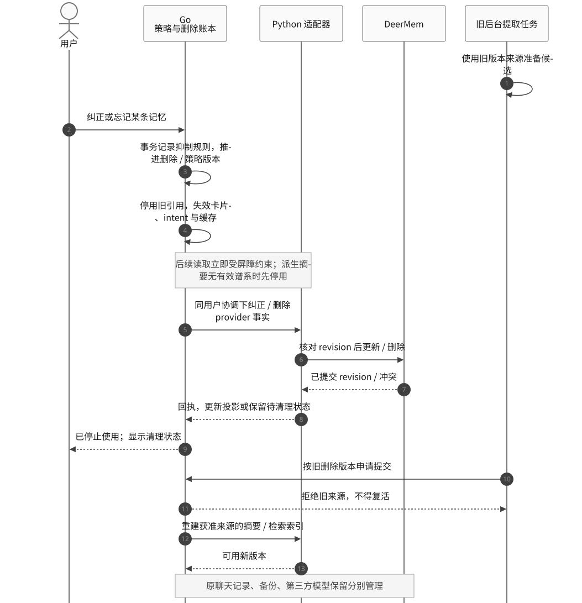

# M4.4 · 记忆技术原型、关键时序与实现原理

- **状态：Proposed；技术设计原型，未实现、未启用或部署。**
- **版本：** 0.1 · 2026-10-30
- **产品契约：** [个人记忆与今日简报](m4-personal-memory-briefing.md)
- **架构选择：** [ADR 0013](../decisions/0013-memory-backed-personal-briefing.md)
- **需求：** FR-023–FR-028；验收沿用主规格 MEM-01–MEM-21，本文不将源码核对等同于功能验收。

## 1. 技术原型的具体选择

首期采用 **Go + 现有 SQLite 产品层 + DeerFlow 的本地 DeerMem + 受限 Python 适配器**。记忆通过“抽取事实 → 有来源地保存 → 按问题检索 → 按预算放入上下文”影响回答；不需要训练模型。首页另用任务和来源的新版本证明进展。

| 层 | 原型采用什么 | 责任与状态 |
| --- | --- | --- |
| 主后端 / 用户接口 | 既有 Go 控制端、现有 SQLite | 鉴权、资料、开关、关注、证据、整理任务、简报、动作账本；新增实体均待实现 |
| 语义记忆 | 固定 DeerFlow 的 `DeerMem` 本地 provider | 复用事实提取、CRUD、文件事务、检索和上下文格式化；源码已有，DeerMate 集成待验收 |
| 事实主存储 | 按用户/agent 的 Markdown 事实文件；用户级 JSON 摘要 | provider 是正文主源；Go 保存身份、来源、状态和引用，不维护第二套长期事实正文 |
| 候选检索 | provider 的 SQLite FTS5 / BM25 | 首期使用已有全文检索；中文分词需验证 `jieba` 可用性和实际召回效果 |
| 记忆模型 | provider 已支持的记忆更新模型接口 | 可接入既有模型供应方；具体模型、预算和敏感字段处理待适配验收，不在本次文档工作中调用 |
| 首页内容 | Go 证据投影 + 缓存快照 + 可选模型整理 | 任务进展可用模板；模型负责表达和提议问题，不决定真实执行状态 |

首期无需增加 Redis、独立向量数据库、外部记忆 SaaS 或新服务器。现有 2 GiB 主机能否满足目标，仍以 MEM-19 实机验收为准；不由组件数量推导容量结论。

适配时拟固定以下配置约束；它们不是可直接开启功能的部署文件：

| 项 | 拟议约束 |
| --- | --- |
| `storage_path` / 索引路径 | 明确放在 Gateway 持久卷与本机索引目录，纳入备份/恢复规则 |
| `strict_user_scope` | 设为 `true`；内部请求携带真实 owner，不允许登录用户落入匿名/default 桶 |
| `retrieval_adapter` | 使用 `fts5`；中文分词依赖与召回效果列为准入检查 |
| `retrieval_relevance_enabled` | FTS5 原型保持 `false`；词法模式单独作对照，避免误以为二者叠加 |
| token 统计 | 优先使用已缓存 tokenizer；无网络回退估算需要留下统计方式，不将估算值当实际计费 tokens |
| 自动采集 / 注入 | 接入每用户策略及删除屏障之后才启用，不能只翻转现有全局 memory 开关 |

所有模型调用仍在内部 Python DeerFlow/整理器完成；Go 提供接纳、策略和公开 API，不新建一套 Agent 模型循环。

### 四类状态各有用途

| 类别 | 示例 | 主源 / 作用 |
| --- | --- | --- |
| 当前对话与执行器上下文 | 本轮问题、原 Codex 会话及工作区 | 既有 thread/checkpoint 和执行绑定；延续多轮工作 |
| 长期语义记忆 | “DeerMate 控制端使用 Go” | DeerMem 事实；让新对话理解用户偏好、项目约束 |
| 关注与目标 | “本周关注记忆首页” | Go `AttentionTopic`；决定首页该关注哪些事情 |
| 进展证据 | 某任务完成、独立测试退出码、来源版本 | 任务/验证/来源记录；决定现在能声称什么进展 |

长期记忆可以跨获准对话被召回，执行器会话仍严格遵循一个 DeerMate 对话对应一个绑定。记忆不会把两个 Codex 会话合并，也不会把“我喜欢自动执行”变成执行授权。

## 2. 固定源码已经具备什么

核对对象是仓库固定的 DeerFlow **`a1b89d0432de4e45adc59f512cb25bb386ea1e51`**，不是对上游最新版的承诺。源码定位见[第 10 节](#10-源码依据与本轮验证范围)。

### 2.1 内容与索引

```text
<provider-root>/
  users/<safe-user-id>/
    memory.json                         # 用户级共享摘要、版本等；不是事实列表
    agents/<agent-name>/
      facts/<sha256前两位>/<fact-id>.md  # 一条事实一个文件，带元数据
  .retrieval/                           # 配置 storage_path 时的默认派生索引目录
```

`memory.json` 的用户级摘要和 agent 事实作用域不同。FTS5 索引是可重建的派生数据；事实文件和用户反馈不能随索引一起丢弃。没有显式 storage root 时，检索索引可为内存索引；实施时必须固定路径。多实例也不能把 SQLite WAL 索引直接共享到网络文件系统。

provider 已有文件锁、manifest revision、逐事实 revision、恢复 journal 和冲突错误。它们保护 provider 文件事务；不自动构成 Go 数据库、来源权限和 provider 之间的跨系统事务。

### 2.2 检索和注入是不同路径

`DeerMem.search()` 默认走 FTS5，使用 BM25 并结合时间和 confidence 调整排序，检索失败/无结果时可走子串回退。`jieba` 是可选依赖；默认 FTS 分词在缺少它时回退为空白切分，需要特别验证无空格中文。

`get_context()` 的默认事实选择以 confidence 和 token 预算为基础。另有可选 `retrieval_relevance_enabled`：使用确定性词法相关性、confidence 和可选多样性选择；开启后 `search()` 会绕过 FTS5。**不能宣称默认聊天注入已经使用 BM25，也不能宣称两种检索策略默认叠加。**

本原型拟让受限适配器显式调用 FTS5 检索，在获准事实中选择、去重并格式化为不超过主规格建议的 1,500 tokens 的上下文。复用 provider 存储、搜索和格式化能力；“检索结果 → 过滤后的上下文”这一组合、项目范围过滤及提交门禁需要实现。词法相关性模式作为对照评测，依据中文召回结果再决定是否替换默认。

这提供的是全文/词法召回，不保证跨措辞、跨语言的语义召回。后续如果评测发现漏召回，再评估 embedding；当前设计不为尚未测到的问题增加向量服务。

### 2.3 自动提取与队列

上游 middleware 会在 Agent 一轮结束后捕获 user ID，把消息交给 provider；后者过滤为用户消息和最终助手回复，再进行提取。它**不等于**本产品要求的“只有合格用户表达才能形成偏好”：助手建议、测试会话、系统通知和用户采用的推荐消息仍需要 DeerMate 可信元数据与提取规则区分。

上游提取队列按 `(thread_id, user_id, agent_name)` 防抖合并，使用进程内列表与 timer。正常消息可能在后续回合补提，但进程退出时的待处理项仍可能丢失。`add()` / 入队完成不能作为持久记忆提交回执。

因此拟由 Go 的 SQLite job/outbox 管理可靠调度，Python 适配器执行有界作业；复用上游提取器，补充同步完成回执、稳定 job 标识和提交前门禁。自动提取、手动记忆修改、摘要更新和任何 memory tools 都必须经过同一策略边界，不能保留另一条绕过 Go 策略的原始自动写入路径。

## 3. 最小数据原型与一致性

以下是拟议契约，不代表当前已有数据库表或可调用接口。

| 对象 | 核心信息 | 约束 |
| --- | --- | --- |
| `PersonalProfile` | owner、display_name、timezone、memory/proactive 开关、policy revision | Go 是称呼和策略主源 |
| `MemoryReference` | owner、provider fact ID/revision、范围、source refs、明确/推断、状态 | 内容在 provider；来源需指向真实记录和版本 |
| `AttentionTopic` | 目标、项目、优先级、关联对话、已读/静音版本 | 显式关注优先；候选建议不自动成为订阅 |
| `EvidenceRecord` | 来源 ID/版本、事件时间、核对时间、授权范围 | 不能用模型口头结论替代任务/验证记录 |
| `MemoryJob` / outbox | owner、来源版本、策略/删除版本、幂等键、租约、尝试与回执 | 持久保存来源引用；模型输入最小化；重启后可核对 |
| `DeletionBarrier` | owner、fact/source ID、范围、递增删除版本 | 保存抑制依据，不保存已忘正文；恢复备份也应用当前屏障 |
| `BriefingSnapshot` | owner、当地日期、来源/记忆/策略版本、内容、时效 | 发布前核对版本；GET 只读 |
| `ActionIntent` | 规范问题、动作类型、目标 incarnation、范围、有效期、幂等键 | 服务器签发和持久保存，模型只提议候选 |

例如用户说：“控制端改用 Go，Worker 继续用 Python。”应形成两个范围清晰、有原消息引用的事实；旧“控制端用 Python”在相同项目/组件范围被替代，Worker 的事实保留。不能把项目局部选择概括成“用户不使用 Python”。

### 项目隔离和摘要谱系是必须补的契约

上游已有 user/agent 作用域，不能直接等同于 DeerMate 项目授权。Go 先计算获准来源/事实集合，适配器在**候选选择和排名之前**限制范围；provider 公共搜索接口目前没有 DeerMate 项目 ACL 参数，需要补充窄范围适配契约。仅从全库取 top-k 后再过滤，不能作为验收通过的实现。

共享摘要可能包含多个事实。首个技术原型优先使用有结构化来源的事实，不直接注入无法证明来源范围的旧共享摘要；实现摘要谱系和撤权重建后再启用对应摘要。姓名/时区直接读取 Go 资料，不再从摘要维护第二份。

### 两套存储间采用版本屏障与可核对回执

1. Go 接纳来源事件时固定 owner、来源版本、policy/deletion revision 和幂等键；作业开始及模型调用前复核并预留预算。
2. 提取阶段不持有数据库事务或用户写锁；模型仅提出候选。
3. 适配器在真正的 storage commit 前取得同用户有界提交许可，复核当前策略/来源；实际 provider 写入、纠正和清理使用同一协调路径。仅在排队前或模型调用前检查一次不够。
4. provider 用自己的 revision 防止过期事实覆盖；所有受影响事实和摘要必须保留可核对的 job/来源谱系。原生接口尚不提供整套协议，需要补齐适配层和必要的提交钩子。
5. provider 已提交、Go 回执未写入时，作业进入核对；按 job、来源和 provider revision 找回结果，不盲目重复创建事实。不确定模型调用不自动重发并冒称“恰好一次”。
6. 遗忘先在 Go 事务内建立读屏障，再异步完成 provider/派生数据清理。即使提交已在途，旧版本也不能再次用于展示或注入；未清理部分保持阻断。协调服务重启或许可失效要失败关闭。

提交许可、读屏障、Go 投影和 provider 文件事务组合保证产品层的可见性；不声称跨进程数据库天然具有同一个 ACID 事务。

## 4. 时序一：从用户表达形成记忆



[Mermaid 源文件](../diagrams/personal-memory/01-capture.mmd)。正常回答不等待记忆提取。候选通过来源、范围和策略校验后才生效；一次提问、助手回答或自动生成的建议不直接变成确定性个人偏好。覆盖 MEM-02、MEM-07、MEM-13–MEM-16。

## 5. 时序二：新对话召回与上下文注入



[Mermaid 源文件](../diagrams/personal-memory/02-recall.mmd)。先限定用户和项目范围，再检索、去重、选取预算内上下文；注入前再次检查策略版本。事实及引用是参考数据，实际工具调用仍经过现有服务端能力门禁。覆盖 MEM-02、MEM-14、MEM-15、MEM-20。

注入前遗忘或撤权会使旧结果失效。若请求已将上下文发给外部模型，不能撤回已经发送的数据；后续停止发送，对尚未展示的派生结果按当前版本阻断，并如实保留这条隐私边界。

## 6. 时序三：事件驱动简报与首页读取



[Mermaid 源文件](../diagrams/personal-memory/03-briefing.mmd)。用户记忆让系统知道“哪些事情与你相关”；任务事件和来源版本回答“现在发生了什么”。未连接 GitHub 时不凭历史记忆生成今日 PR 进展。首页读取不触发模型或 Native 任务；没有可用新快照时返回可授权读取的结构化事实/空状态。覆盖 MEM-04–MEM-06、MEM-16、MEM-17、MEM-19。

候选动作经 Go 校验和签发后才能展示。发布时比较完整的 memory/data/policy revisions；构建期间变化则作废旧结果。删除/撤权后不能把旧快照当作回退继续展示。

## 7. 时序四：点击卡片，跟进或继续执行



[Mermaid 源文件](../diagrams/personal-memory/04-action.mmd)。覆盖 MEM-08–MEM-12、MEM-21。

| 点击类型 | 实际行为 | 会话 / 权限 |
| --- | --- | --- |
| 查看 / 继续这个对话 | 打开原对话，不发送消息 | 保留原绑定 |
| 一键跟进 | 在原对话发送已预览的问题，只读查询已有进展 | 本轮服务端只读能力；接纳及调用时均检查 |
| 继续执行：具体下一步 | 在原绑定上只提交一轮子任务 | 复核最新 head、原项目和原权限；正常授权不重复确认 |
| 开始这个话题 | 创建新对话并发送预览问题，默认只读分析 | 按首句命名；没有复制的 Native 绑定 |

新对话分配、首条消息及 run 都关联同一个 intent；部分成功后只核对并完成该 intent 的剩余步骤，不能再创建第二个对话或重复发送。这里的一键只读能力仍是待实现约束，现有通用 Agent 不能仅通过改提示词取得该保证。

| 动作状态 | 含义 / 下一步 |
| --- | --- |
| `ready` | 用户可点击；点击时仍需重查版本和状态 |
| `admitting` | 幂等键已认领；先持久记录尝试，再向运行时发送 |
| `submitted` | 已有确定 run/对话/任务回执；重复点击查看同一结果 |
| `uncertain` | 可能已提交；仅核对，不能盲目重发 |
| `resolved` | 核对得到原结果，转到该结果 |
| `invalidated / expired / blocked` | 来源、时间、权限或目标状态不允许；更新页面或进入既有恢复流程 |

intent 的“已提交”只表示提交成功，后续任务可能失败、取消或需要输入；不能据此显示代码已完成验证。

## 8. 时序五：纠正、遗忘与旧任务竞争



[Mermaid 源文件](../diagrams/personal-memory/05-correct-forget.mmd)。纠正使同范围旧事实失效并引用替代事实；遗忘建立抑制规则。两者都先影响可见性，再完成内容和派生数据变更。覆盖 MEM-03、MEM-13–MEM-15。

“已停止使用”与“provider/索引已清理”要分开显示。provider 暂不可用时屏障持续有效；有来源谱系的依赖摘要重建，没有可靠谱系的摘要先停用。备份恢复先恢复当前删除账本，再开放检索。原聊天删除、第三方 Native 会话和模型供应方保留策略单独管理，不把删除长期记忆描述成全链路历史消失。

### 事实生命周期



[Mermaid 源文件](../diagrams/personal-memory/06-memory-lifecycle.mmd)。这些是 Go 产品层拟议状态，不声称 provider 已有同名状态字段。`active` 还必须满足当前启用策略与来源权限；“关闭个人记忆”停止使用和采集，但允许用户管理已有事实，不自动把全部事实永久删除。

`superseded` 不参与正常个性化；`suppressed` 即使正文仍在清理也不得召回。保留删除屏障用于拒绝旧来源，不保存被遗忘的明文内容。用户明确重新录入时走新的来源和当前策略，不能让旧任务自动解禁。

## 9. 后续如何把设计变成可运行原型

下面是实施顺序，全部待开发；本轮不启动任何一步的运行时工作。

1. **契约与隔离骨架：** Go 资料/策略/来源/删除版本，Python 受限适配器，固定 provider 路径；用合成数据验证本人隔离、CRUD、事实重启保留、中文检索、修订冲突及无谱系摘要禁用。人工事实 CRUD 无需模型。
2. **可靠提取与召回：** Go outbox/作业、稳定回执和提交门禁；把普通用户表达与助手/通知/验收来源区分。打通提取、去重、更正、跨对话召回、关闭/遗忘竞争；先离线 fixture，再做单独的有界真实模型验收。
3. **产品首页闭环：** 关注主题、证据事件、快照版本、时区问候、模板降级，随后接入可选模型整理；实现原对话只读跟进、明确范围续接、新话题和幂等核对。
4. **真实验收与灰度：** MEM-01–MEM-21、2 GiB 有限负载、浏览器/可访问性、恢复与删除；先个人主动启用，不自动导入全部旧历史。GitHub 等增量来源在第二期接入。

记忆提取、摘要压缩、合并或过期复核可能产生多次内部模型调用。预算要拦截每次实际模型调用并预留实例/用户额度；“最多十个批次”不能被当作“最多十次模型请求”。并发、token 和每日上限沿用主规格建议，验收前不作费用或延迟承诺。

## 10. 源码依据与本轮验证范围

固定源码已从本地 checkout 阅读；以下是相同提交的永久链接：

| 依据 | 支持的判断 |
| --- | --- |
| [MemoryManager 契约](https://github.com/bytedance/deer-flow/blob/a1b89d0432de4e45adc59f512cb25bb386ea1e51/backend/packages/harness/deerflow/agents/memory/manager.py) | provider API 与用户/agent 作用域 |
| [DeerMem 实现](https://github.com/bytedance/deer-flow/blob/a1b89d0432de4e45adc59f512cb25bb386ea1e51/backend/packages/harness/deerflow/agents/memory/backends/deermem/deer_mem.py) | search / get_context 的不同路径及 CRUD |
| [配置](https://github.com/bytedance/deer-flow/blob/a1b89d0432de4e45adc59f512cb25bb386ea1e51/backend/packages/harness/deerflow/agents/memory/backends/deermem/deermem/config.py) | 默认 FTS5、词法检索开关与预算配置 |
| [路径](https://github.com/bytedance/deer-flow/blob/a1b89d0432de4e45adc59f512cb25bb386ea1e51/backend/packages/harness/deerflow/agents/memory/backends/deermem/deermem/core/paths.py) / [存储](https://github.com/bytedance/deer-flow/blob/a1b89d0432de4e45adc59f512cb25bb386ea1e51/backend/packages/harness/deerflow/agents/memory/backends/deermem/deermem/core/storage.py) | 事实 Markdown、用户摘要、派生索引及 revision/文件事务 |
| [FTS5 检索](https://github.com/bytedance/deer-flow/blob/a1b89d0432de4e45adc59f512cb25bb386ea1e51/backend/packages/harness/deerflow/agents/memory/backends/deermem/deermem/core/retrieval.py) / [词法排序](https://github.com/bytedance/deer-flow/blob/a1b89d0432de4e45adc59f512cb25bb386ea1e51/backend/packages/harness/deerflow/agents/memory/backends/deermem/deermem/core/relevance.py) / [注入格式](https://github.com/bytedance/deer-flow/blob/a1b89d0432de4e45adc59f512cb25bb386ea1e51/backend/packages/harness/deerflow/agents/memory/backends/deermem/deermem/core/prompt.py) | BM25、中文回退、可选词法/多样性与 token 选择 |
| [middleware](https://github.com/bytedance/deer-flow/blob/a1b89d0432de4e45adc59f512cb25bb386ea1e51/backend/packages/harness/deerflow/agents/middlewares/memory_middleware.py) / [提取器](https://github.com/bytedance/deer-flow/blob/a1b89d0432de4e45adc59f512cb25bb386ea1e51/backend/packages/harness/deerflow/agents/memory/backends/deermem/deermem/core/updater.py) / [队列](https://github.com/bytedance/deer-flow/blob/a1b89d0432de4e45adc59f512cb25bb386ea1e51/backend/packages/harness/deerflow/agents/memory/backends/deermem/deermem/core/queue.py) | 身份捕获、候选写回和进程内防抖队列 |
| [DeerMate 部署生成器](../../scripts/ack_deploy.py) / [Go 存储](../../backend/internal/controlplane/store.go) | 当前最小 profile 显式关闭记忆；既有 Go SQLite 边界 |

图中的 Go 新实体、权限/删除门禁、可靠作业与简报均为提案。图源及渲染方法见[图目录说明](../diagrams/personal-memory/README.md)。本轮验证范围为源码一致性、文档链接和 Mermaid 渲染；应用测试、模型、历史导入、云端部署及性能验收未运行。
